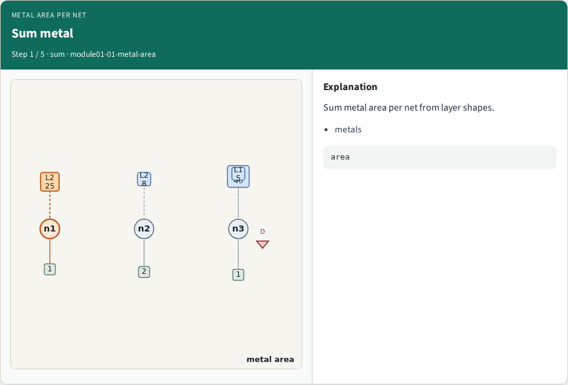
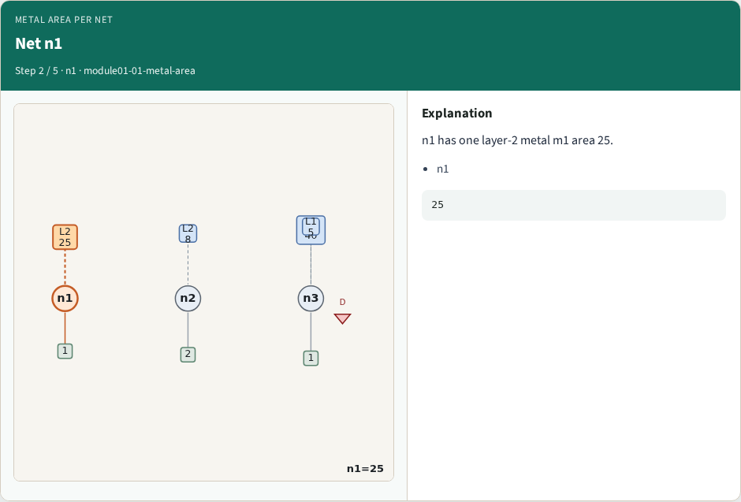
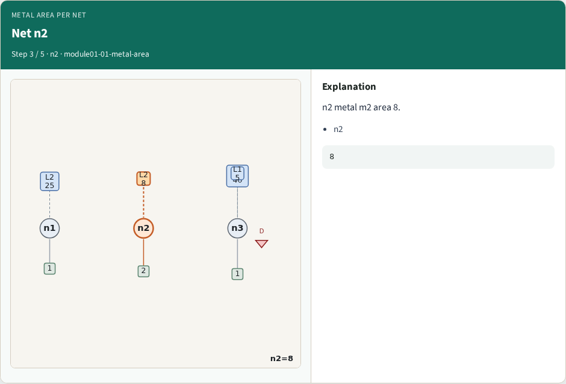
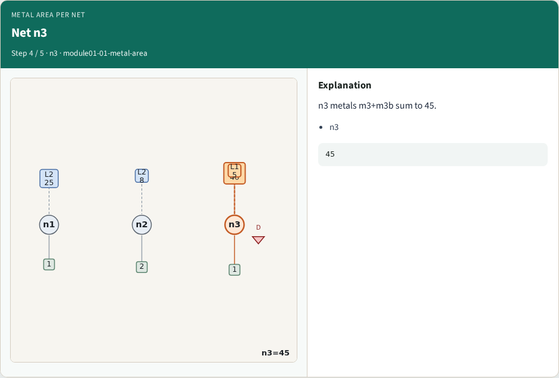
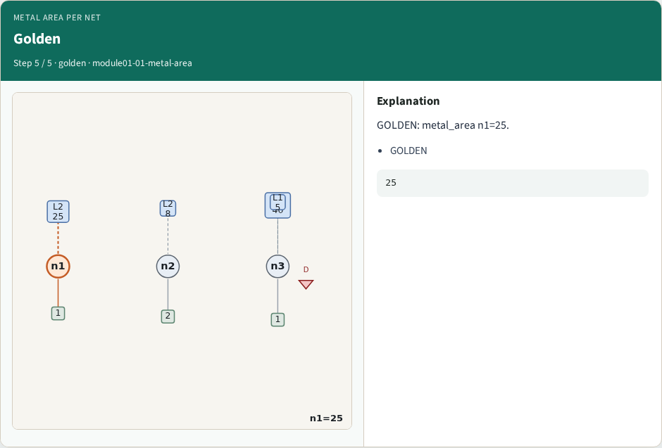

# Metal area per net — step-by-step (for slides / transcript)

**Module:** `module01-01-metal-area`  
**Lab / algo:** `metal-area`  
**Viewer:** `/tools/algorithm-walkthrough/?algo=metal-area&step=1`

Use each **Caption** as spoken prose (or a shortened slide note).
Use **Bullets** on the PPT; pair with the PNG in `assets/steps/`.

## Step 1 — Sum metal



**Caption (transcript):** Sum metal area per net from layer shapes.

**Slide bullets:**

- metals

**On-screen metrics:**

```
area
```

## Step 2 — Net n1



**Caption (transcript):** n1 has one layer-2 metal m1 area 25.

**Slide bullets:**

- n1

**On-screen metrics:**

```
25
```

## Step 3 — Net n2



**Caption (transcript):** n2 metal m2 area 8.

**Slide bullets:**

- n2

**On-screen metrics:**

```
8
```

## Step 4 — Net n3



**Caption (transcript):** n3 metals m3+m3b sum to 45.

**Slide bullets:**

- n3

**On-screen metrics:**

```
45
```

## Step 5 — Golden



**Caption (transcript):** GOLDEN: metal_area n1=25.

**Slide bullets:**

- GOLDEN

**On-screen metrics:**

```
25
```

