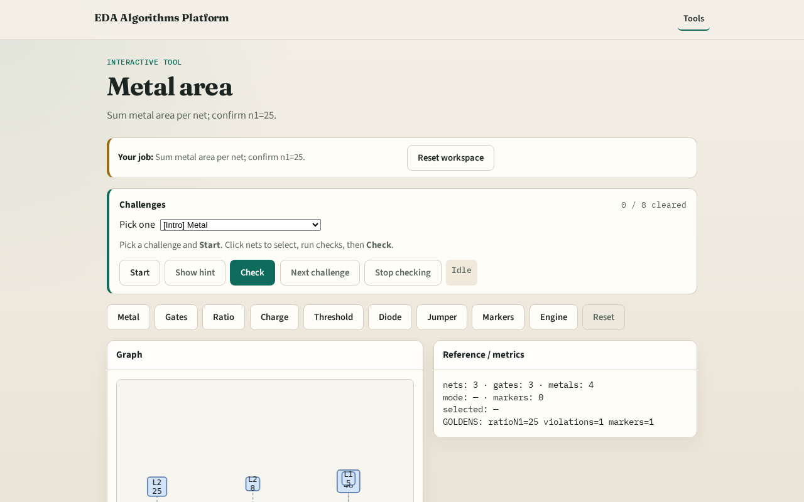

# Metal area

Antenna checks start by summing metal area on each net

---

## The idea
- GOLDEN: metal_area n1=25

---

## Sum metal

---

## Net n1

---

## Net n2

---

## Net n3

---

## Golden

---

## Browser lab track

---

## Implement track
- Call metal_area_by_net(); assert area['n1']==25

---

## Pitfalls
- Double-counting after jumper cap
- Ignoring layer filter

---

## Your turn
- Next: gate area per net

