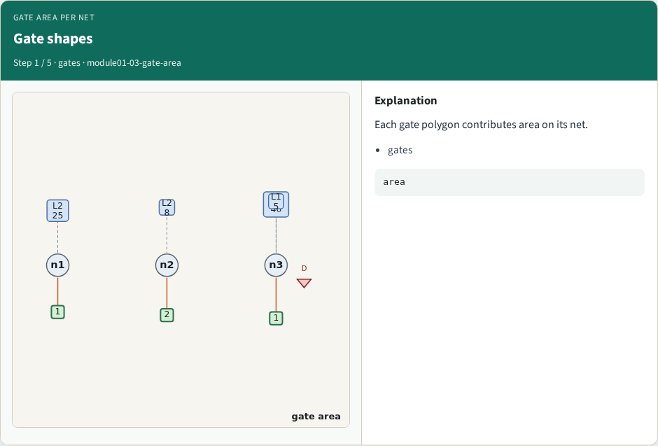
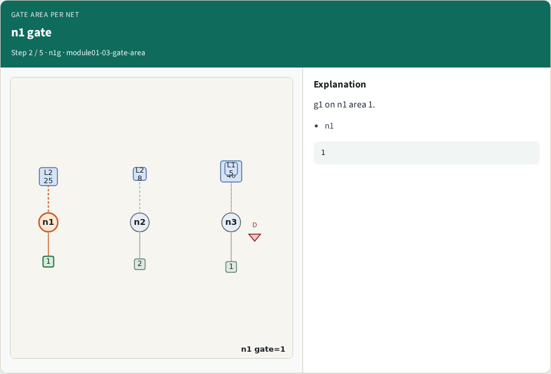
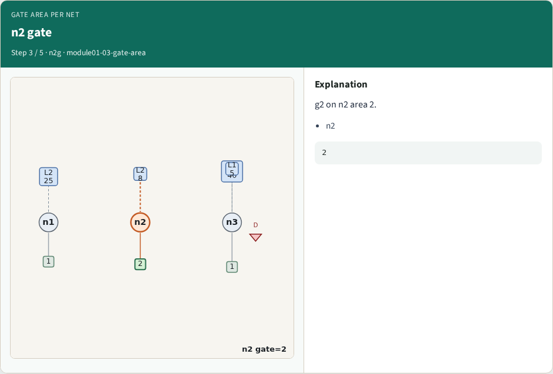
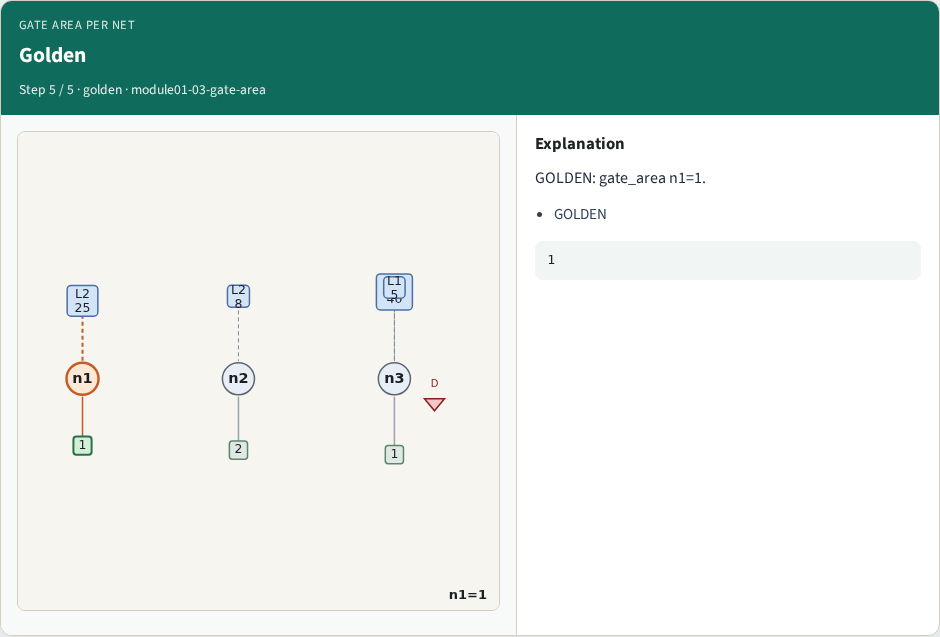

# Gate area per net — step-by-step (for slides / transcript)

**Module:** `module01-03-gate-area`  
**Lab / algo:** `gate-area`  
**Viewer:** `/tools/algorithm-walkthrough/?algo=gate-area&step=1`

Use each **Caption** as spoken prose (or a shortened slide note).
Use **Bullets** on the PPT; pair with the PNG in `assets/steps/`.

## Step 1 — Gate shapes



**Caption (transcript):** Each gate polygon contributes area on its net.

**Slide bullets:**

- gates

**On-screen metrics:**

```
area
```

## Step 2 — n1 gate



**Caption (transcript):** g1 on n1 area 1.

**Slide bullets:**

- n1

**On-screen metrics:**

```
1
```

## Step 3 — n2 gate



**Caption (transcript):** g2 on n2 area 2.

**Slide bullets:**

- n2

**On-screen metrics:**

```
2
```

## Step 4 — n3 gate


**Caption (transcript):** g3 on n3 area 1.

**Slide bullets:**

- n3

**On-screen metrics:**

```
1
```

## Step 5 — Golden



**Caption (transcript):** GOLDEN: gate_area n1=1.

**Slide bullets:**

- GOLDEN

**On-screen metrics:**

```
1
```

