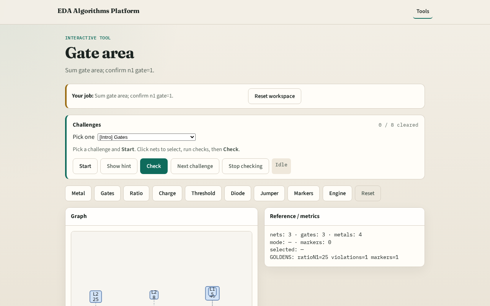

# Gate area

Antenna ratio divides metal area by gate area on the same net

---

## The idea
- GOLDEN: gate_area n1=1

---

## Gate shapes

---

## n1 gate

---

## n2 gate

---

## n3 gate

---

## Golden

---

## Browser lab track

---

## Implement track
- Call gate_area_by_net(); assert area['n1']==1

---

## Pitfalls
- Mixing gate count with gate area
- Using wrong net id

---

## Your turn
- Next: antenna ratio

