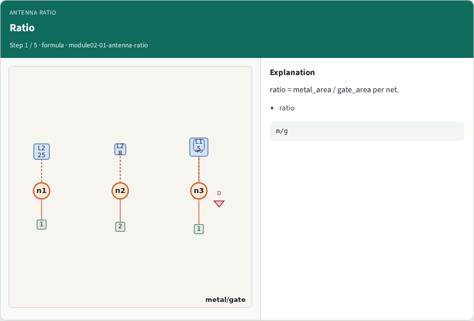
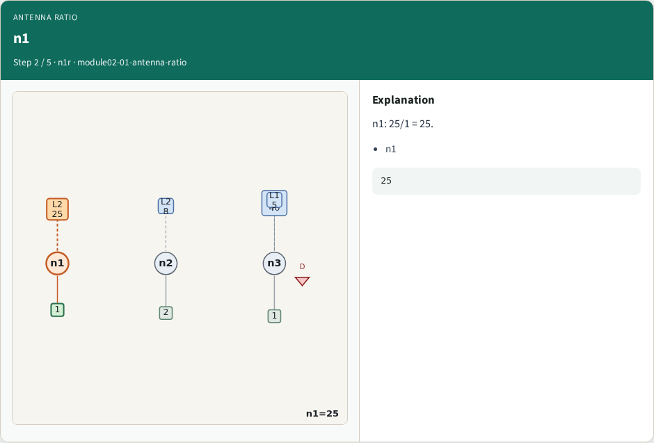
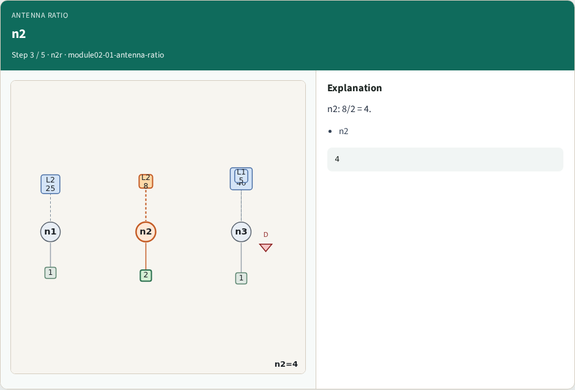
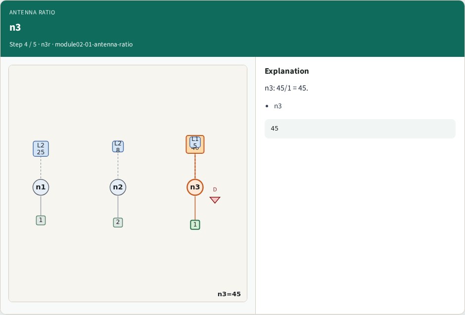
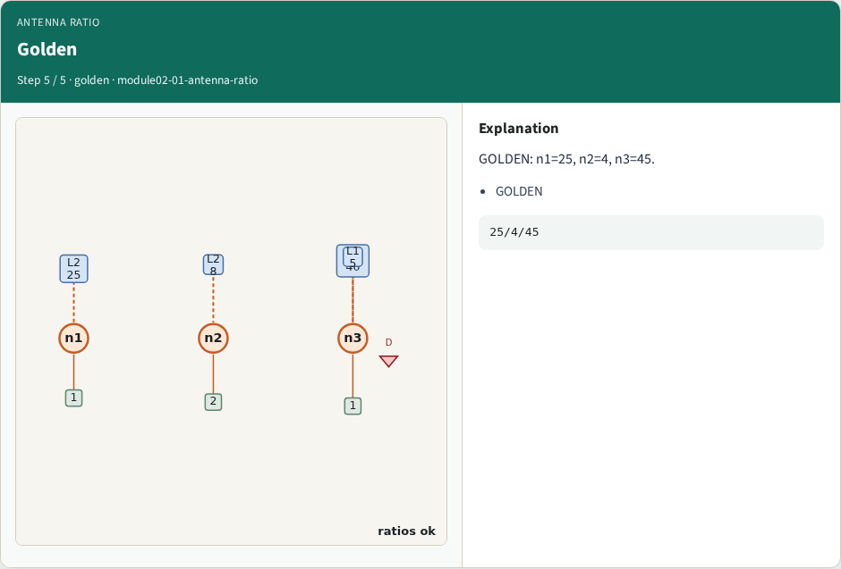

# Antenna ratio — step-by-step (for slides / transcript)

**Module:** `module02-01-antenna-ratio`  
**Lab / algo:** `antenna-ratio`  
**Viewer:** `/tools/algorithm-walkthrough/?algo=antenna-ratio&step=1`

Use each **Caption** as spoken prose (or a shortened slide note).
Use **Bullets** on the PPT; pair with the PNG in `assets/steps/`.

## Step 1 — Ratio



**Caption (transcript):** ratio = metal_area / gate_area per net.

**Slide bullets:**

- ratio

**On-screen metrics:**

```
m/g
```

## Step 2 — n1



**Caption (transcript):** n1: 25/1 = 25.

**Slide bullets:**

- n1

**On-screen metrics:**

```
25
```

## Step 3 — n2



**Caption (transcript):** n2: 8/2 = 4.

**Slide bullets:**

- n2

**On-screen metrics:**

```
4
```

## Step 4 — n3



**Caption (transcript):** n3: 45/1 = 45.

**Slide bullets:**

- n3

**On-screen metrics:**

```
45
```

## Step 5 — Golden



**Caption (transcript):** GOLDEN: n1=25, n2=4, n3=45.

**Slide bullets:**

- GOLDEN

**On-screen metrics:**

```
25/4/45
```

