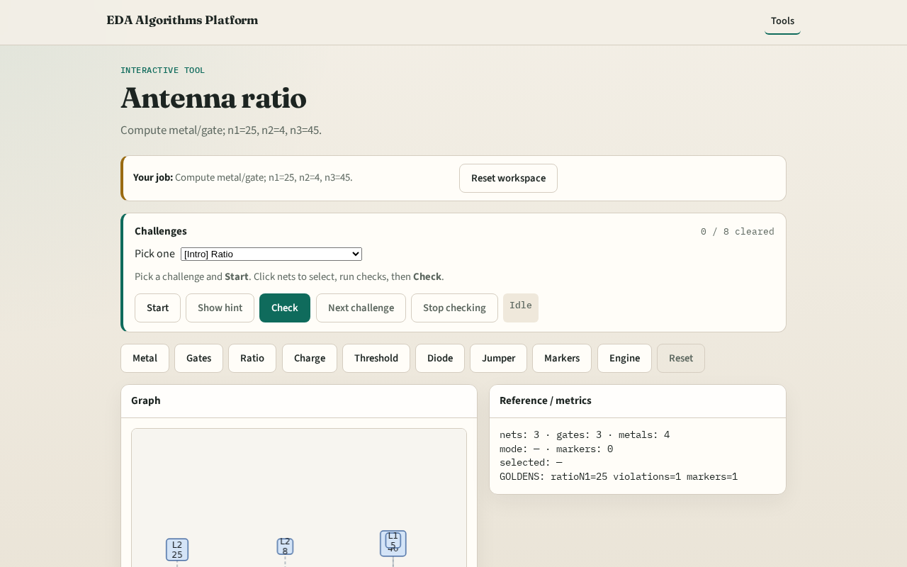

# Antenna ratio

**Module id:** module02-01-antenna-ratio
**Lab:** antenna-ratio
**Tracks:** A (implement) · B (browser lab)

## Slide 1 — Why ratio

Foundry antenna rules compare metal exposure to gate area.

## Slide 2 — The idea

GOLDEN: n1=25, n2=4, n3=45.

<!-- algorithm-walkthrough -->

## Slide 3 — Ratio formula

ratio = metal_area / gate_area per net.

## Slide 4 — n1

n1: 25/1 = 25.

## Slide 5 — n2

n2: 8/2 = 4.

## Slide 6 — n3

n3: 45/1 = 45.

## Slide 7 — Golden

GOLDEN: n1=25, n2=4, n3=45.

<!-- /algorithm-walkthrough -->

## Slide 8 — Browser lab track

Open **antenna-ratio**. Confirm the three golden ratios.

## Slide 9 — Implement track

Call antenna_ratios(); assert ratios['n1']==25, ratios['n2']==4, ratios['n3']==45.

## Slide 10 — Pitfalls

Dividing gate/metal. Forgetting multi-layer metal sum.

## Slide 11 — Your turn

Next: charge accumulation.
