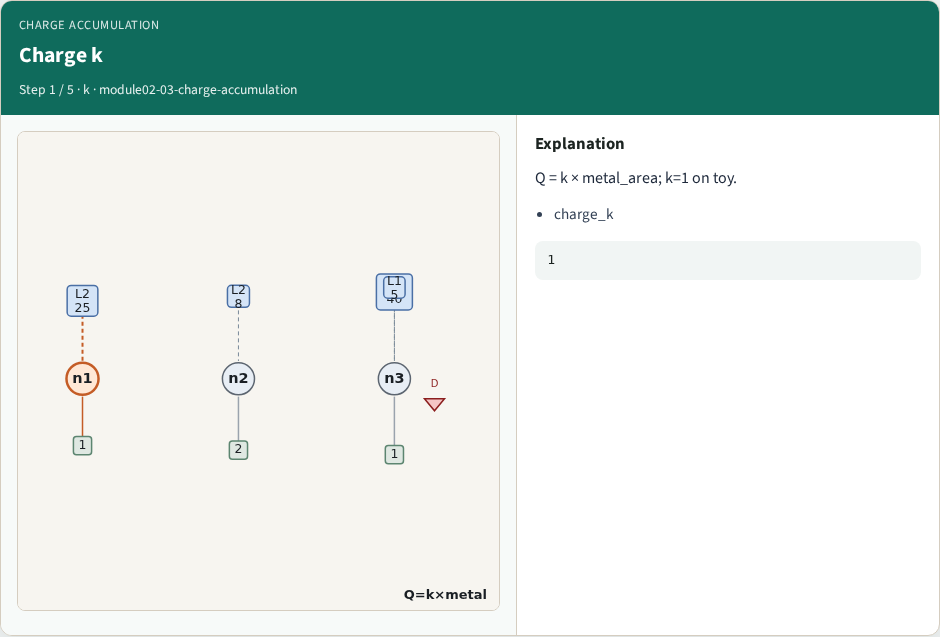
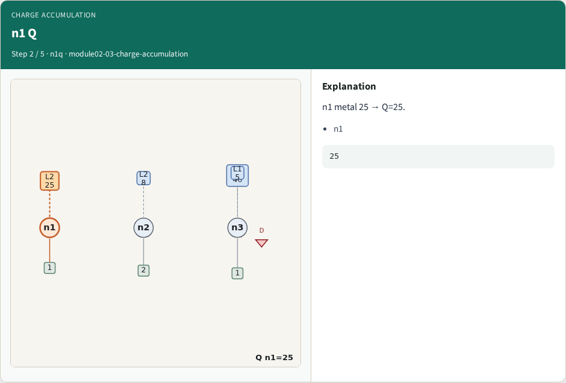
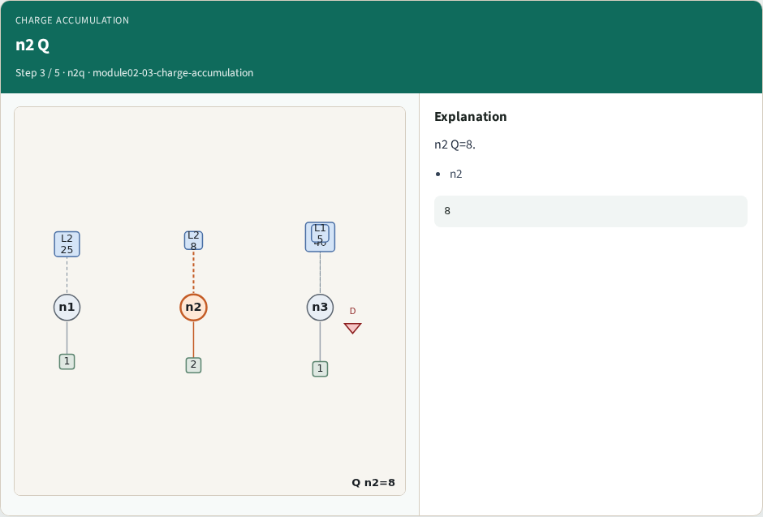
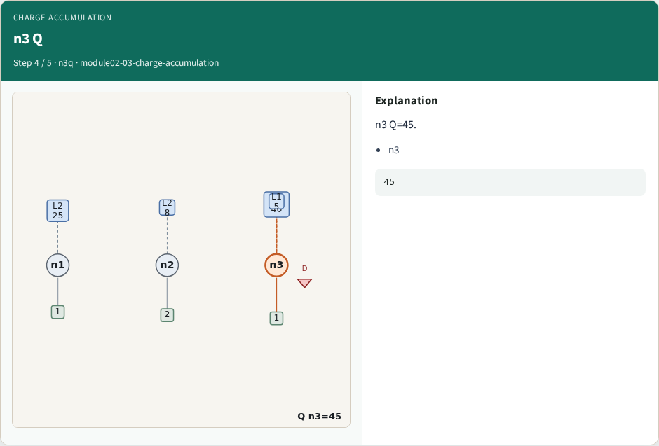
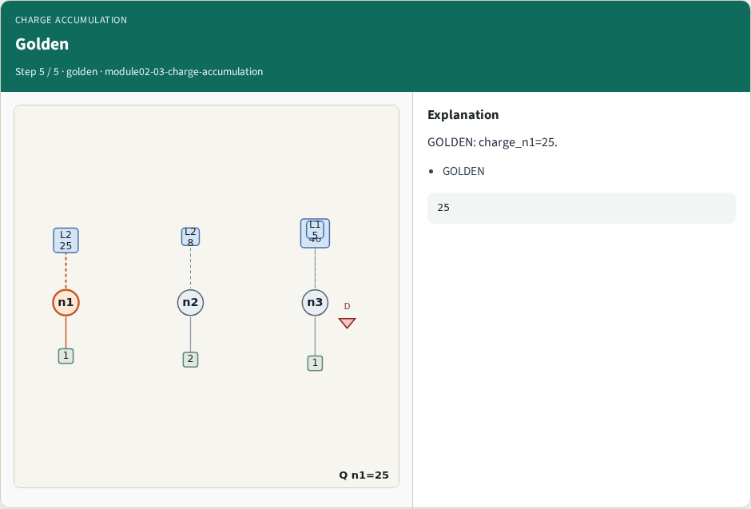

# Charge accumulation — step-by-step (for slides / transcript)

**Module:** `module02-03-charge-accumulation`  
**Lab / algo:** `charge-accumulation`  
**Viewer:** `/tools/algorithm-walkthrough/?algo=charge-accumulation&step=1`

Use each **Caption** as spoken prose (or a shortened slide note).
Use **Bullets** on the PPT; pair with the PNG in `assets/steps/`.

## Step 1 — Charge k



**Caption (transcript):** Q = k × metal_area; k=1 on toy.

**Slide bullets:**

- charge_k

**On-screen metrics:**

```
1
```

## Step 2 — n1 Q



**Caption (transcript):** n1 metal 25 → Q=25.

**Slide bullets:**

- n1

**On-screen metrics:**

```
25
```

## Step 3 — n2 Q



**Caption (transcript):** n2 Q=8.

**Slide bullets:**

- n2

**On-screen metrics:**

```
8
```

## Step 4 — n3 Q



**Caption (transcript):** n3 Q=45.

**Slide bullets:**

- n3

**On-screen metrics:**

```
45
```

## Step 5 — Golden



**Caption (transcript):** GOLDEN: charge_n1=25.

**Slide bullets:**

- GOLDEN

**On-screen metrics:**

```
25
```

