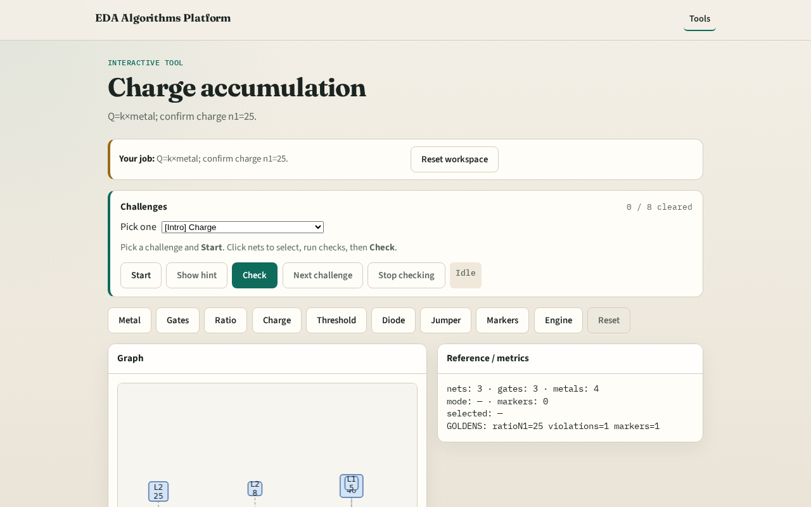

# Charge

Plasma etch charge scales with exposed metal , toy uses Q=k×metal

---

## The idea
- GOLDEN: charge_n1=25

---

## Charge k

---

## n1 Q

---

## n2 Q

---

## n3 Q

---

## Golden

---

## Browser lab track

---

## Implement track
- Call charge_by_net(); assert charge['n1']==25

---

## Pitfalls
- Using ratio instead of metal for Q
- Wrong k constant

---

## Your turn
- Next: threshold rules

