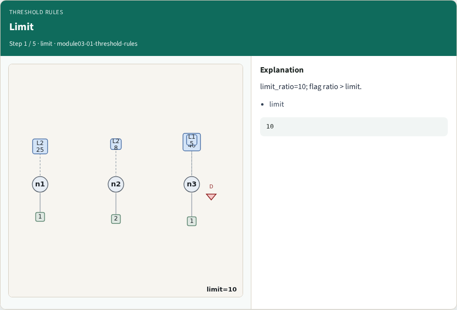
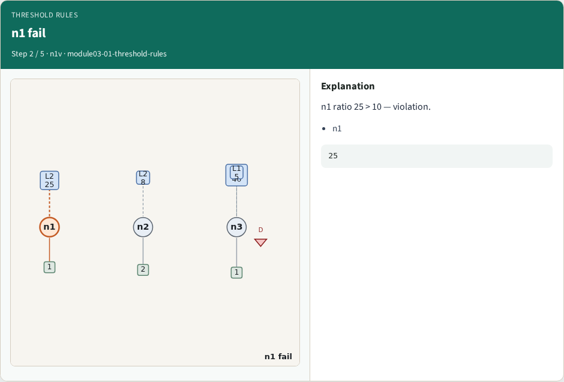
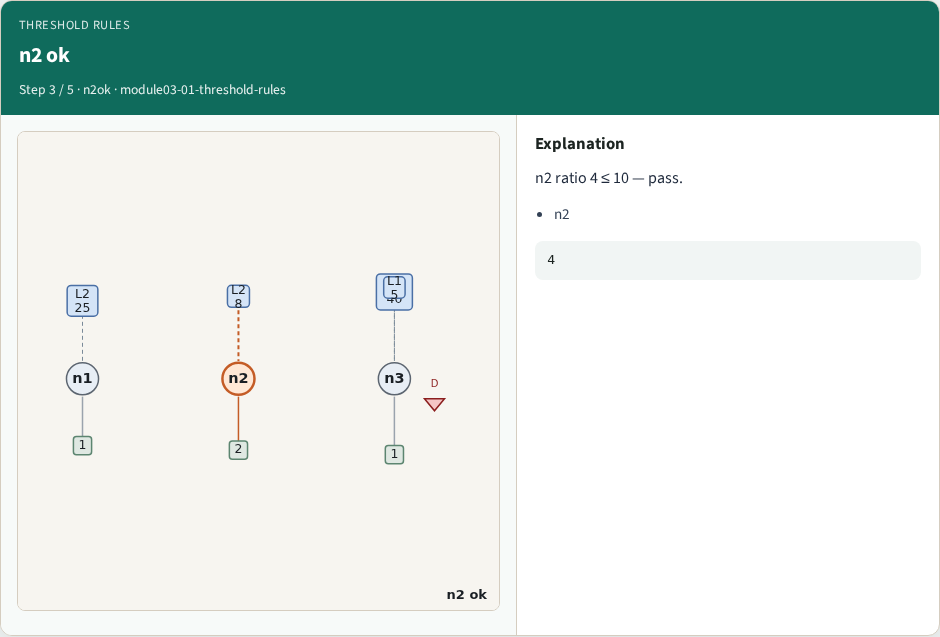
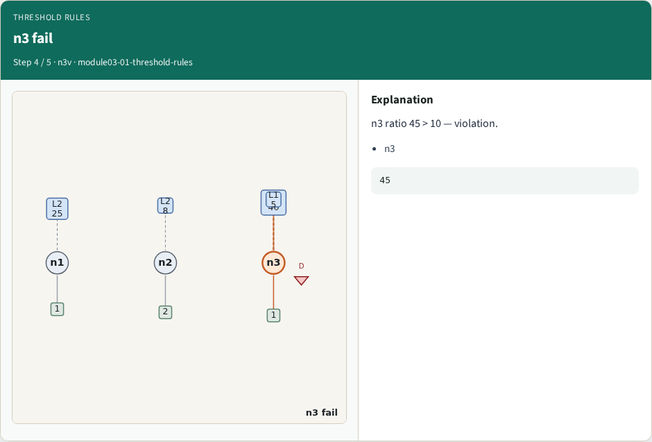
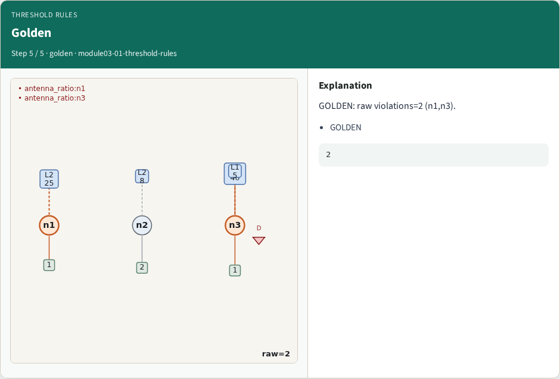
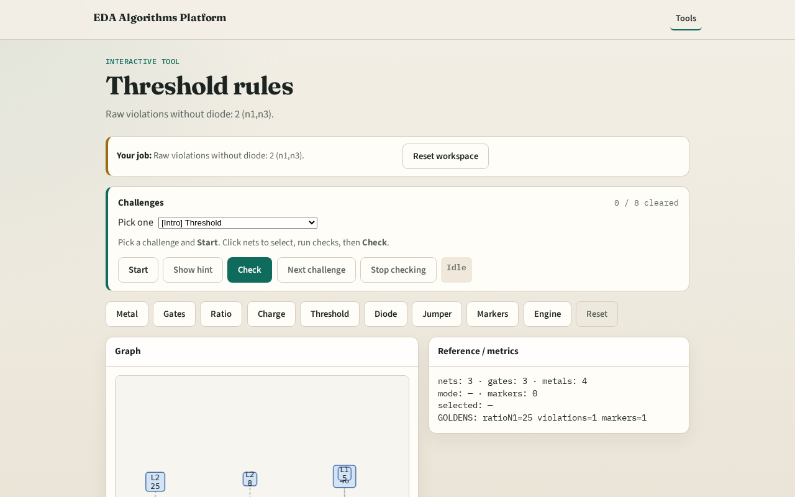

# Threshold rules

**Module id:** module03-01-threshold-rules
**Lab:** threshold-rules
**Tracks:** A (implement) · B (browser lab)

## Slide 1 — Threshold

Raw violations before diode protection: any ratio above limit.

## Slide 2 — The idea

GOLDEN: raw_violation_count=2 (n1, n3).

<!-- algorithm-walkthrough -->

## Slide 3 — Limit

limit_ratio=10; flag ratio > limit.

## Slide 4 — n1 fail

n1 ratio 25 > 10 — violation.

## Slide 5 — n2 ok

n2 ratio 4 ≤ 10 — pass.

## Slide 6 — n3 fail

n3 ratio 45 > 10 — violation.

## Slide 7 — Golden

GOLDEN: raw violations=2 (n1,n3).

<!-- /algorithm-walkthrough -->

## Slide 8 — Browser lab track

Open **threshold-rules**. Run raw check; confirm 2 violations.

## Slide 9 — Implement track

Call find_violations(apply_diodes=False); assert count==2.

## Slide 10 — Pitfalls

Applying diodes too early. Using charge instead of ratio.

## Slide 11 — Your turn

Next: diode protection.
