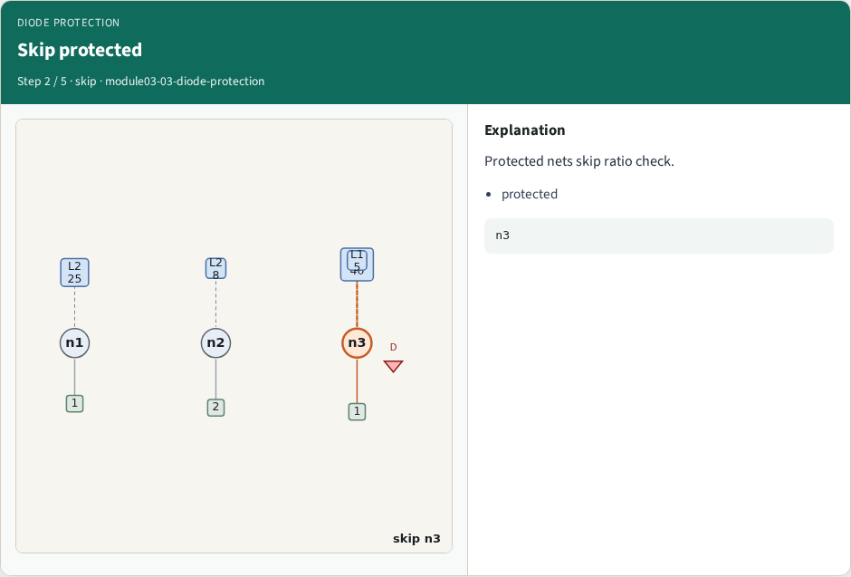
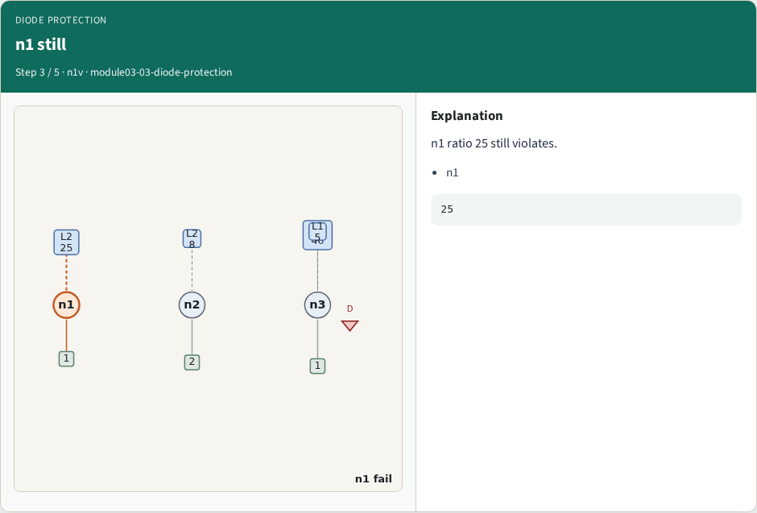
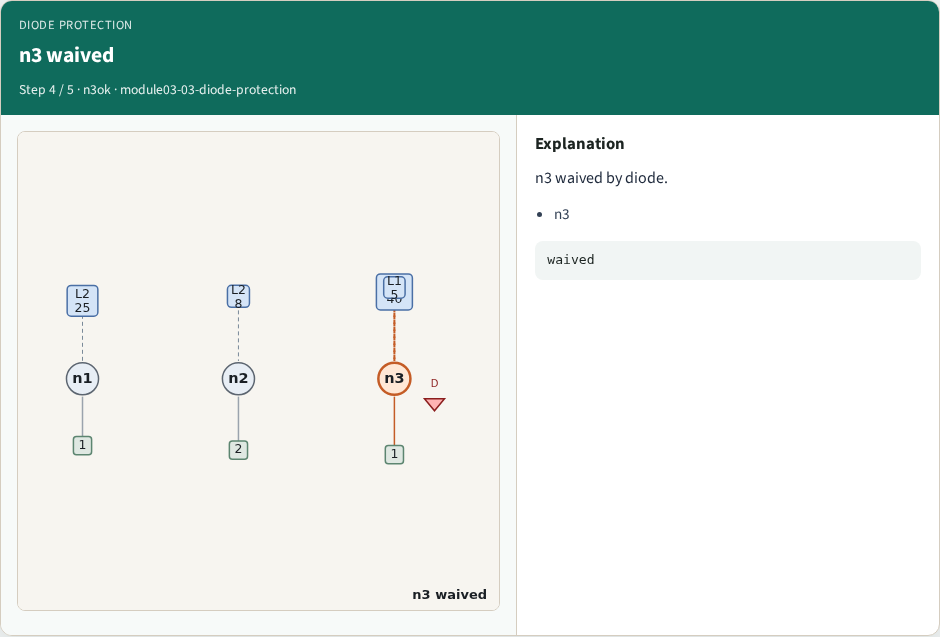
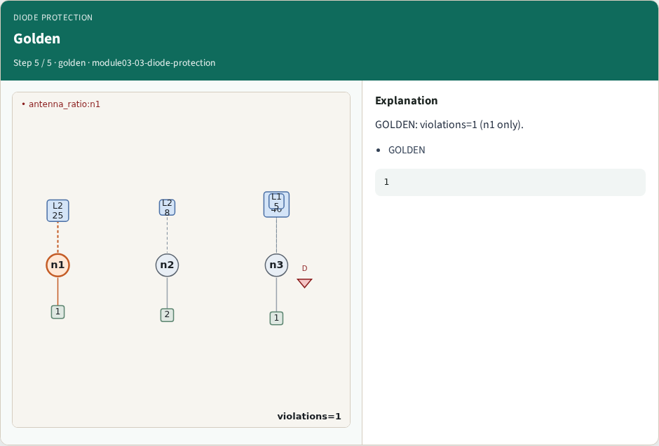
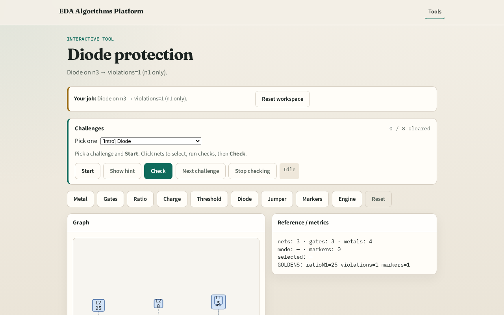

# Diode protection

**Module id:** module03-03-diode-protection
**Lab:** diode-protection
**Tracks:** A (implement) · B (browser lab)

## Slide 1 — Why diode

Foundry diode cells waive antenna on protected nets — n3 here.

## Slide 2 — The idea

GOLDEN: violation_count=1 (n1 only after diode).

<!-- algorithm-walkthrough -->

## Slide 3 — Protect diode

d1 on n3 protects that net.

## Slide 4 — Skip protected

Protected nets skip ratio check.

## Slide 5 — n1 still

n1 ratio 25 still violates.

## Slide 6 — n3 waived

n3 waived by diode.

## Slide 7 — Golden

GOLDEN: violations=1 (n1 only).

<!-- /algorithm-walkthrough -->

## Slide 8 — Browser lab track

Open **diode-protection**. Confirm only n1 violates.

## Slide 9 — Implement track

Call find_violations(apply_diodes=True); assert count==1 and hits[0]['net']=='n1'.

## Slide 10 — Pitfalls

Forgetting to apply diode list. Still flagging n3.

## Slide 11 — Your turn

Next: jumper break.
