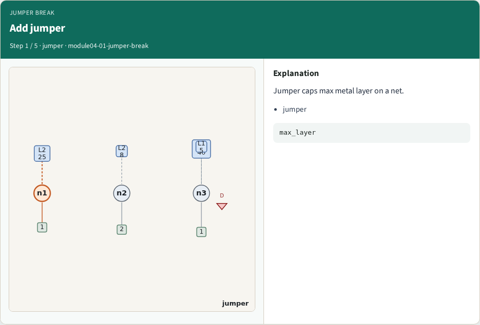
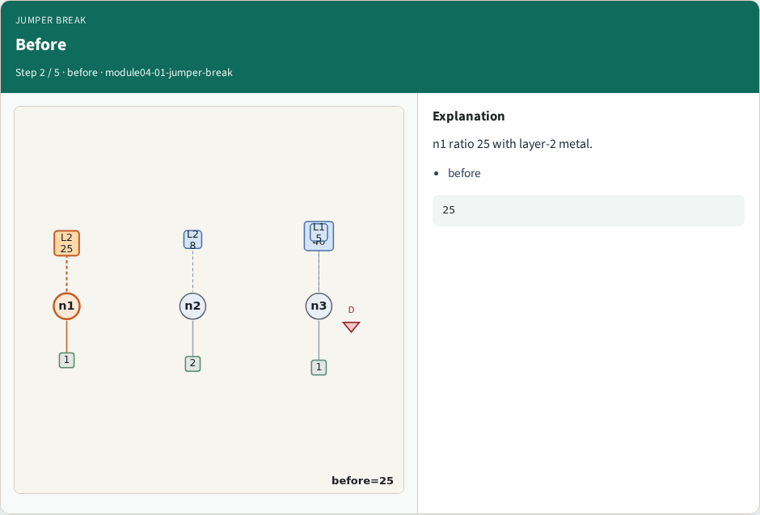
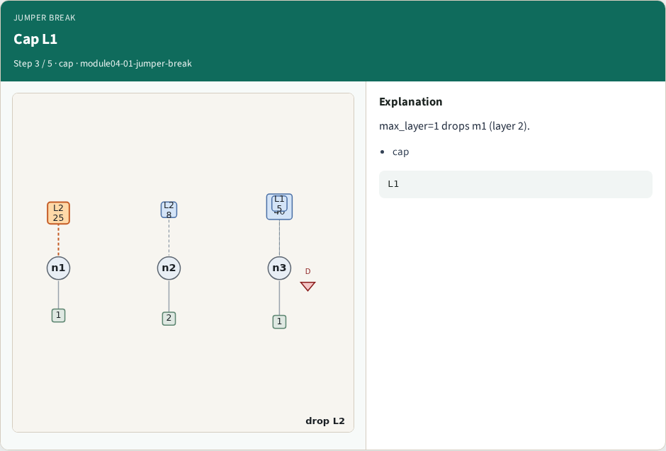
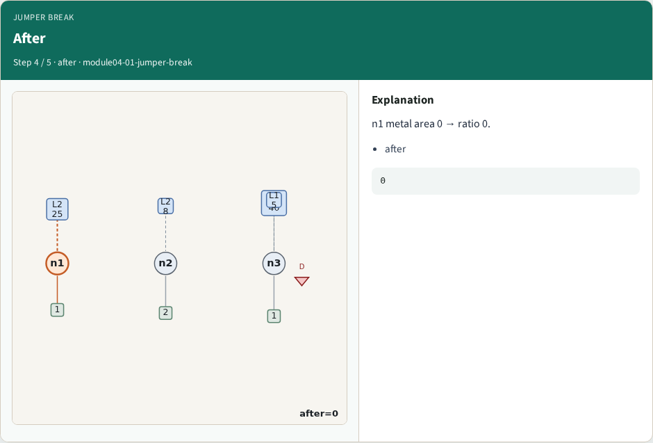
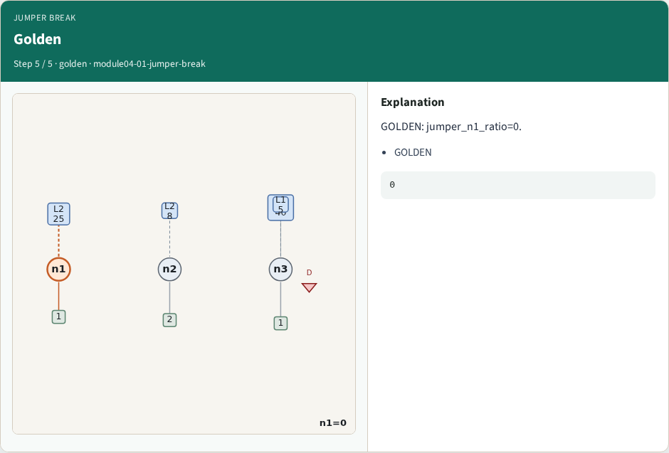
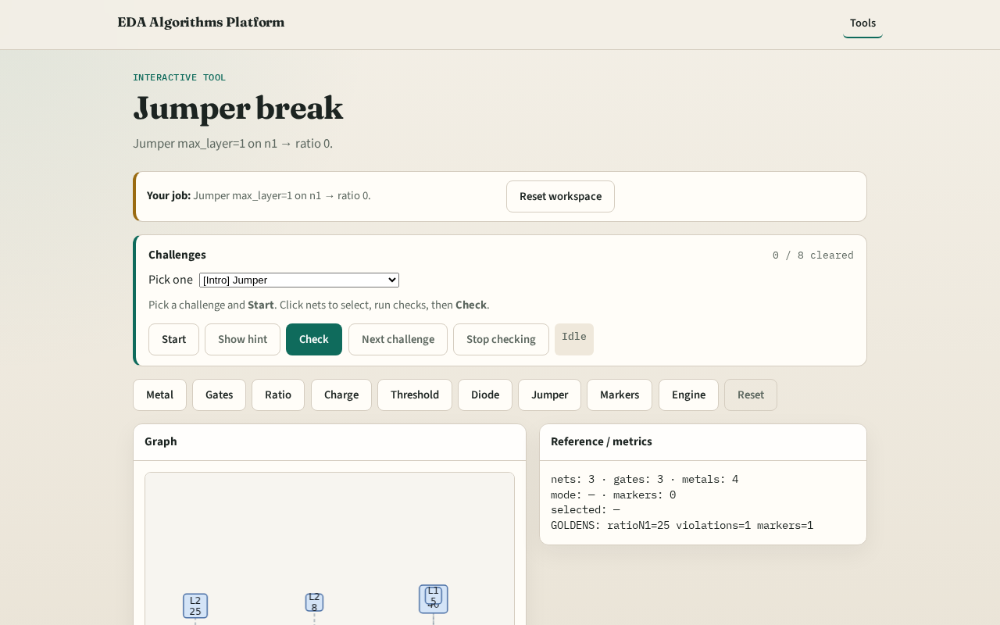

# Why jumper

A jumper on lower metal breaks antenna path , drops high-layer metal

---

## The idea
- GOLDEN: jumper on n1 max_layer=1 → ratio 0

---

## Add jumper

---

## Before

---

## Cap L1

---

## After

---

## Golden

---

## Browser lab track

---

## Implement track
- Call jumper_effect(); assert after_ratio==0

---

## Pitfalls
- Not filtering by layer
- Applying jumper to wrong net

---

## Your turn
- Next: antenna markers

