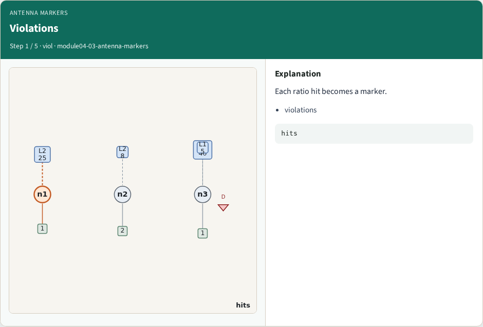
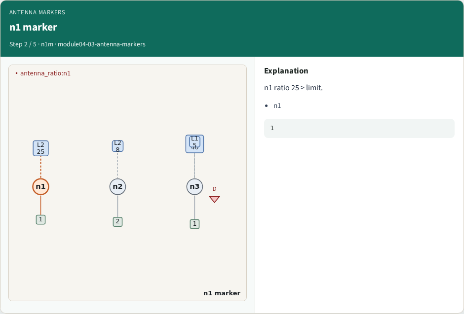
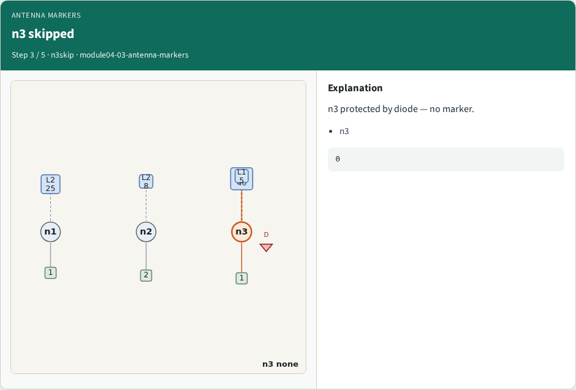
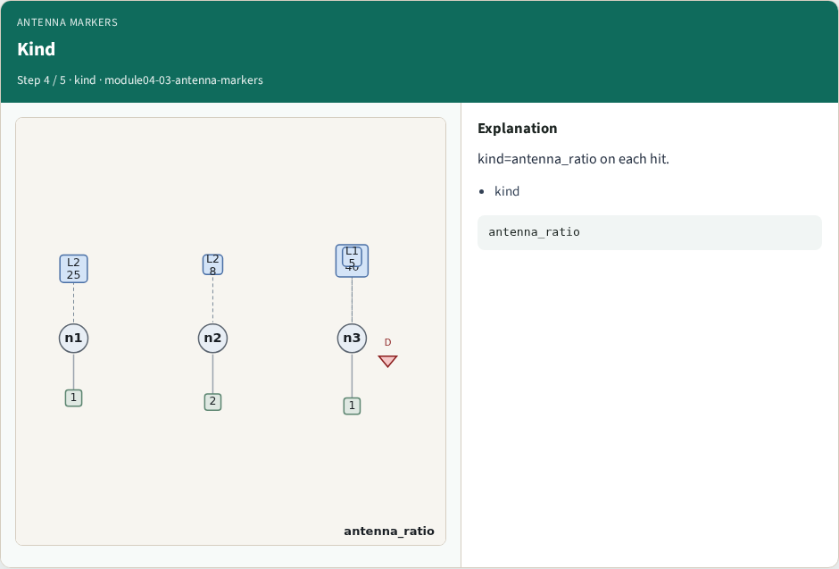
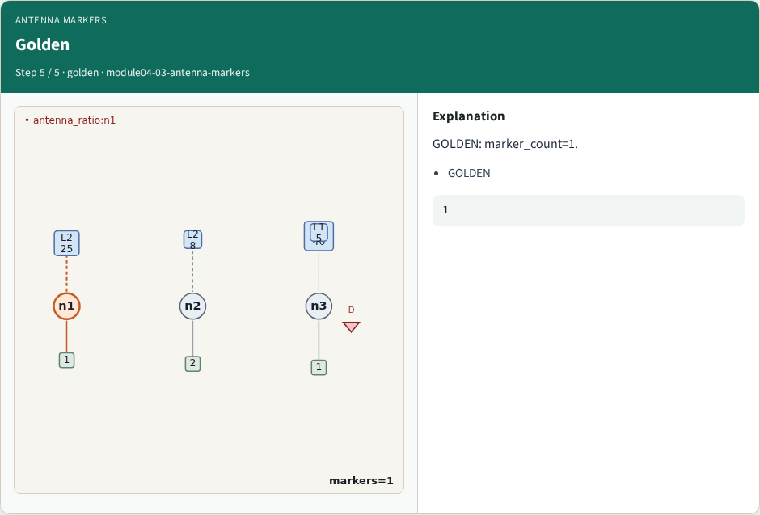
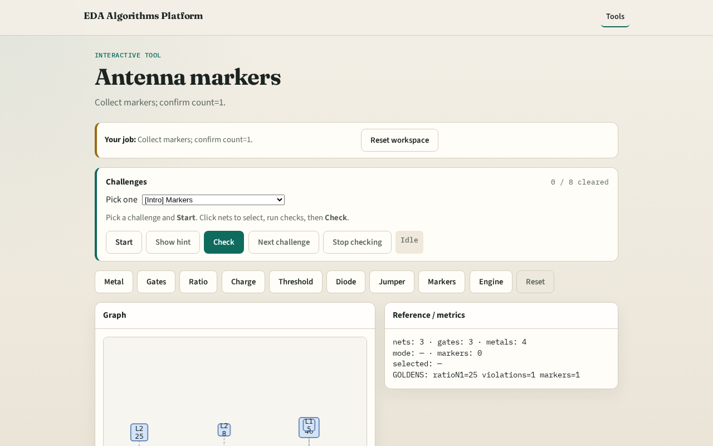

# Markers

Signoff antenna emits one marker per violating net (after diode)

---

## The idea
- GOLDEN: marker_count=1 on tiny_antenna

---

## Violations

---

## n1 marker

---

## n3 skipped

---

## Kind

---

## Golden

---

## Browser lab track

---

## Implement track
- Call collect_markers(); assert count==1

---

## Pitfalls
- Counting raw violations
- Missing diode waiver

---

## Your turn
- Next: antenna engine

