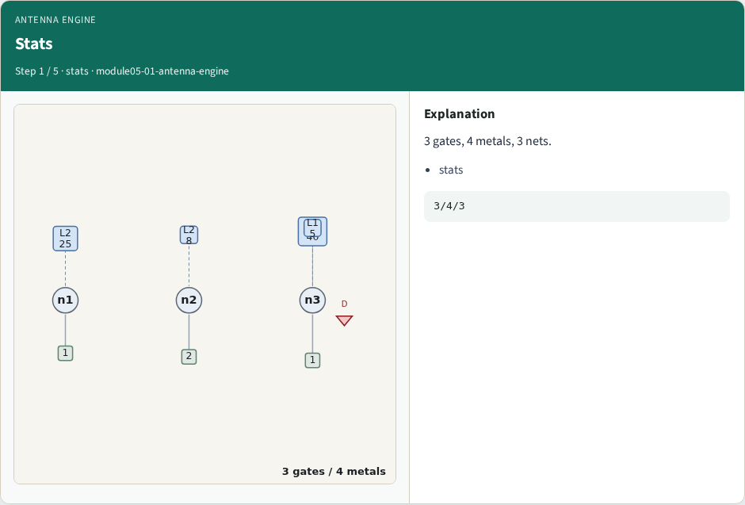
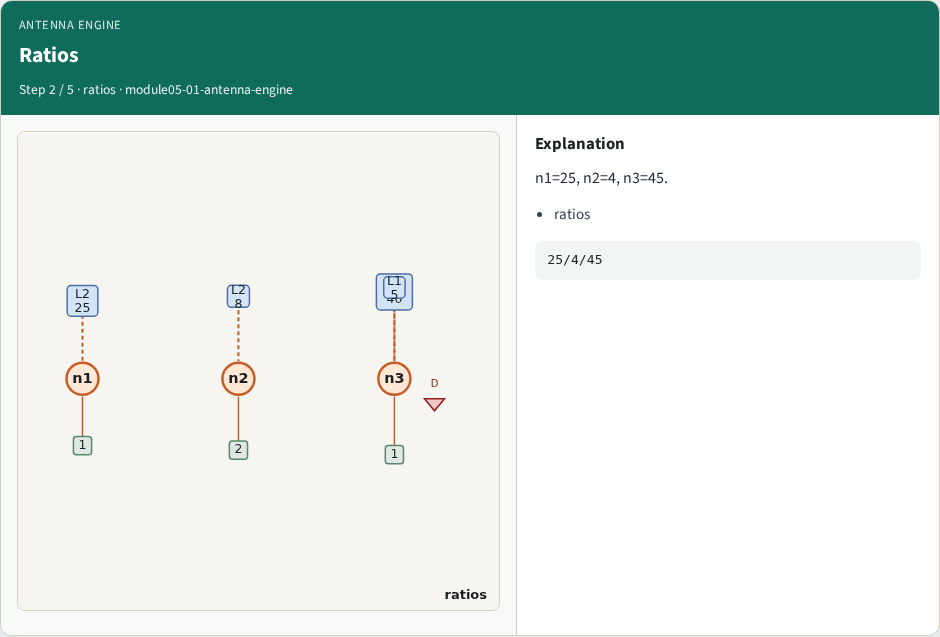
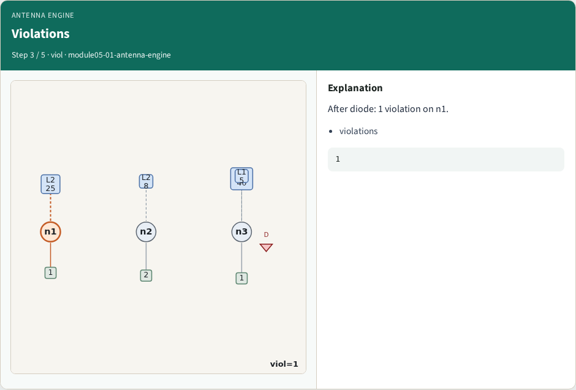
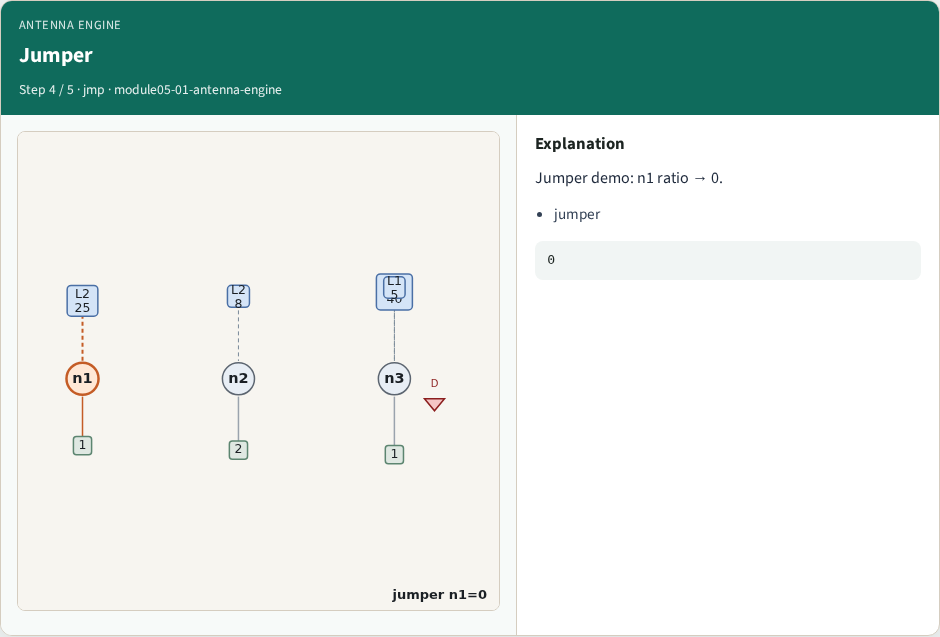
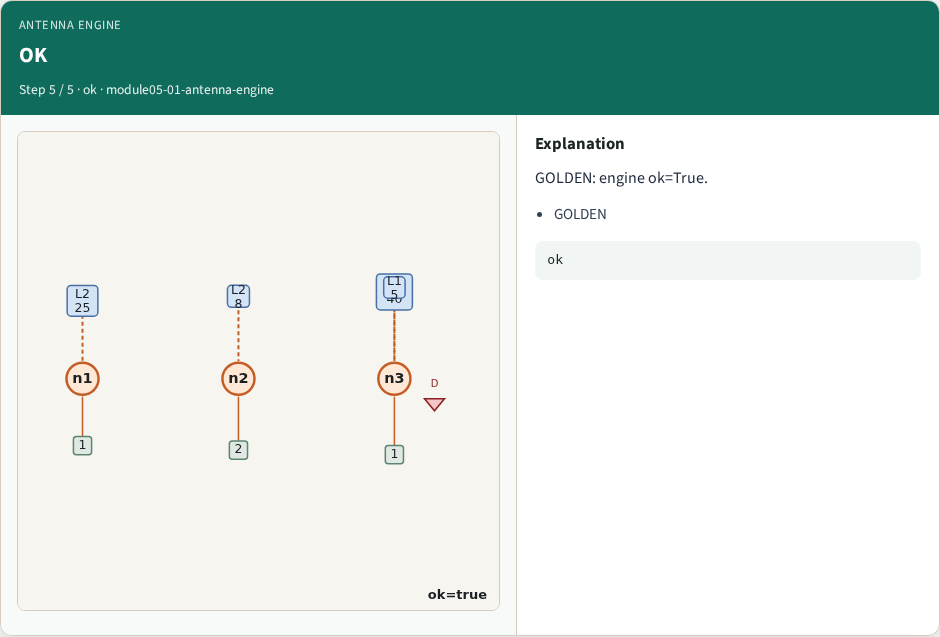

# Antenna engine integration — step-by-step (for slides / transcript)

**Module:** `module05-01-antenna-engine`  
**Lab / algo:** `antenna-engine`  
**Viewer:** `/tools/algorithm-walkthrough/?algo=antenna-engine&step=1`

Use each **Caption** as spoken prose (or a shortened slide note).
Use **Bullets** on the PPT; pair with the PNG in `assets/steps/`.

## Step 1 — Stats



**Caption (transcript):** 3 gates, 4 metals, 3 nets.

**Slide bullets:**

- stats

**On-screen metrics:**

```
3/4/3
```

## Step 2 — Ratios



**Caption (transcript):** n1=25, n2=4, n3=45.

**Slide bullets:**

- ratios

**On-screen metrics:**

```
25/4/45
```

## Step 3 — Violations



**Caption (transcript):** After diode: 1 violation on n1.

**Slide bullets:**

- violations

**On-screen metrics:**

```
1
```

## Step 4 — Jumper



**Caption (transcript):** Jumper demo: n1 ratio → 0.

**Slide bullets:**

- jumper

**On-screen metrics:**

```
0
```

## Step 5 — OK



**Caption (transcript):** GOLDEN: engine ok=True.

**Slide bullets:**

- GOLDEN

**On-screen metrics:**

```
ok
```

