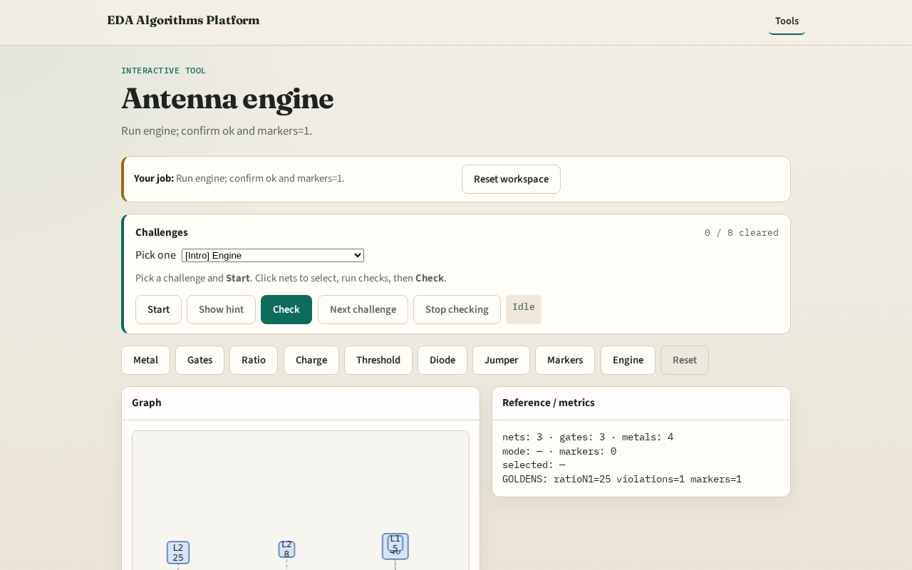

# Antenna engine integration

**Module id:** module05-01-antenna-engine
**Lab:** antenna-engine
**Tracks:** A (implement) · B (browser lab)

## Slide 1 — Engine

A tiny engine chains area, ratio, charge, violations, jumper, markers.

## Slide 2 — The idea

GOLDEN: ratios, violations=1, markers=1, jumper n1=0, ok=True.

<!-- algorithm-walkthrough -->

## Slide 3 — Stats

3 gates, 4 metals, 3 nets.

## Slide 4 — Ratios

n1=25, n2=4, n3=45.

## Slide 5 — Violations

After diode: 1 violation on n1.

## Slide 6 — Jumper

Jumper demo: n1 ratio → 0.

## Slide 7 — OK

GOLDEN: engine ok=True.

<!-- /algorithm-walkthrough -->

## Slide 8 — Browser lab track

Open **antenna-engine**. Run engine; confirm ok.

## Slide 9 — Implement track

Call antenna_engine(); assert ok and markers.count==1.

## Slide 10 — Pitfalls

Reporting partial checks. Changing toy without updating goldens.

## Slide 11 — Your turn

Next: offline compare, then wrap.
