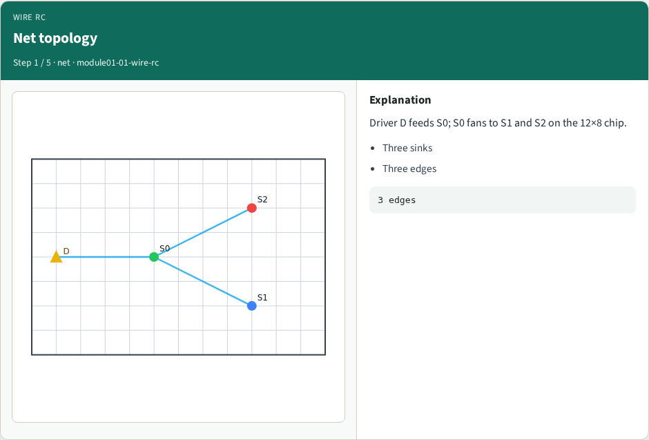
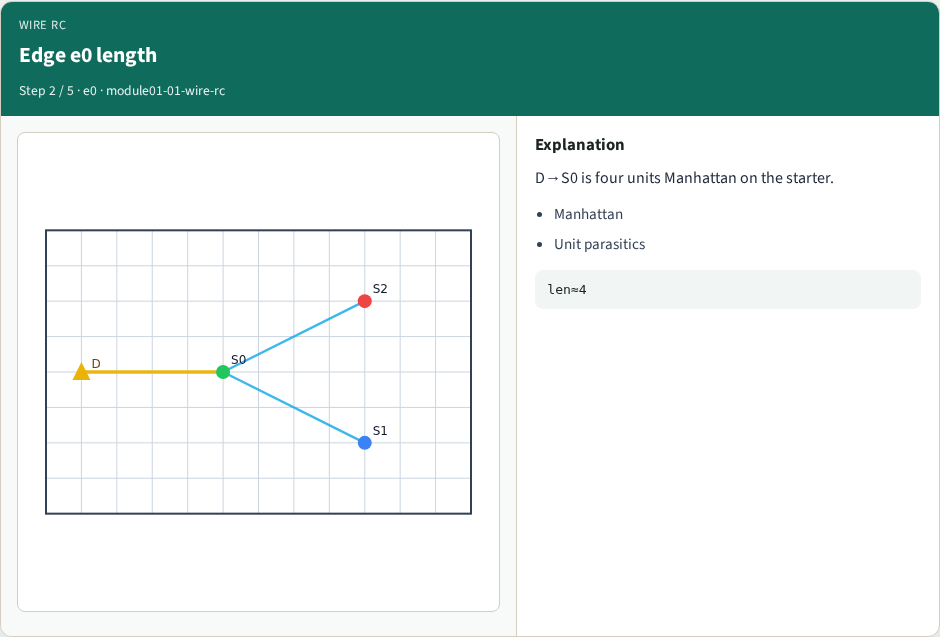
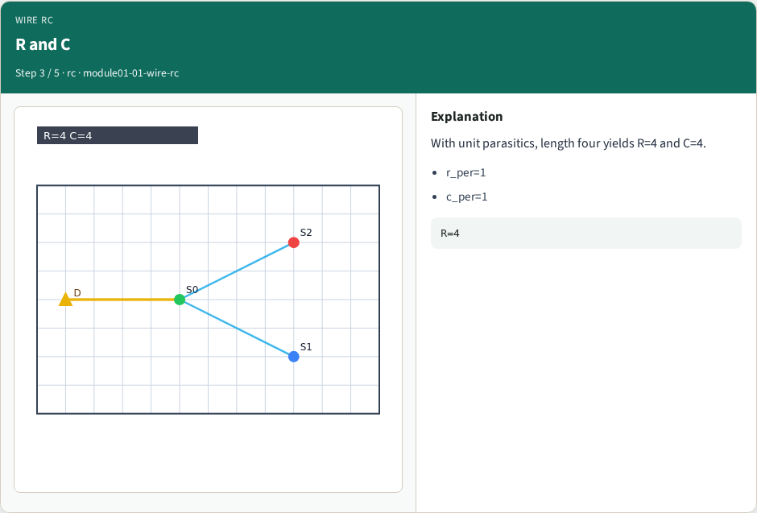
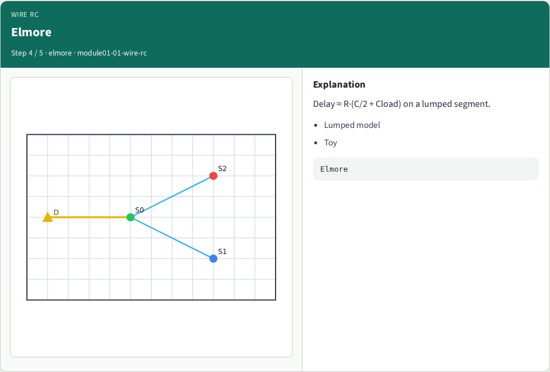
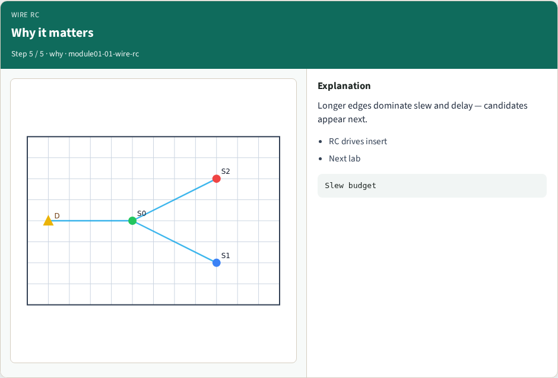
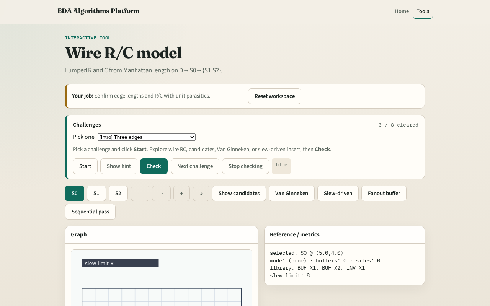

# Wire RC

Every buffering decision starts from how much resistance and capacitance a wire segment carries

---

## The idea
- Wire_rc of length L returns R equals L times r_per and C equals L times c_per
- Elmore delay uses R times C_self over two plus C_load

---

## Net topology

---

## Edge e0 length

---

## R and C

---

## Elmore

---

## Why it matters

---

## Browser lab track

---

## Implement track
- Call `wire_rc(length)` and `elmore_delay` in `common/`
- Match GOLDENS.wireRcLen4R

---

## Pitfalls
- Using Euclidean length
- Forgetting C_load in Elmore
- Mixing per-unit R with total R

---

## Your turn
- Next: slew budgets on those RC segments

