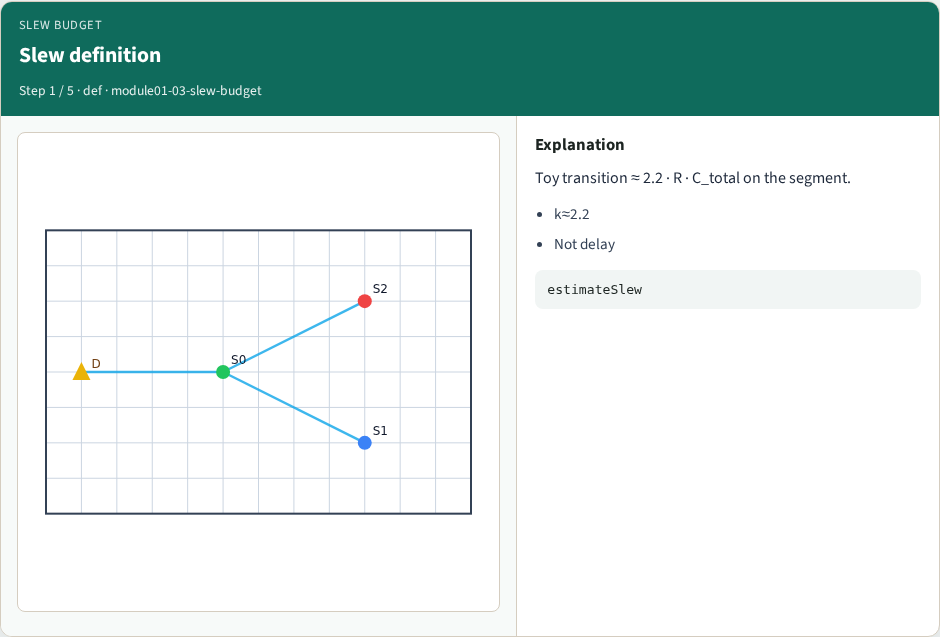
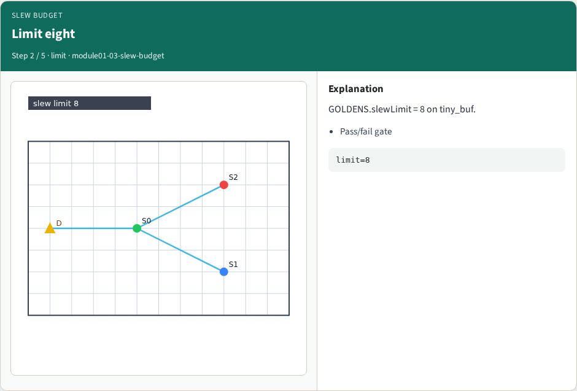
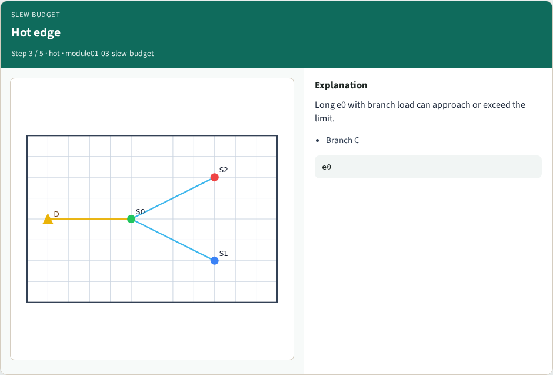
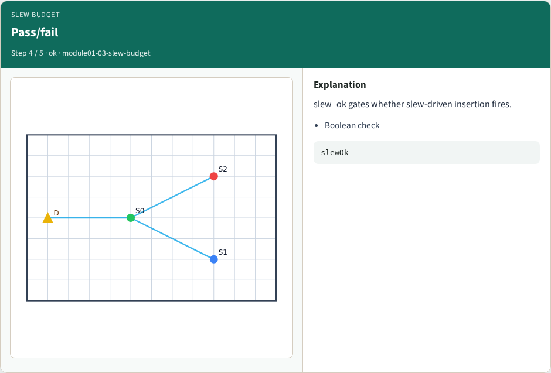
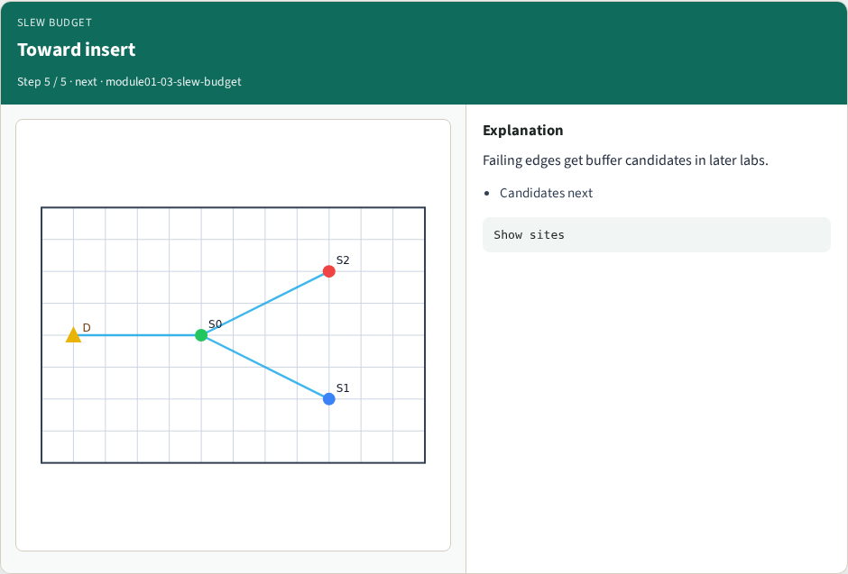

# Slew / transition budget — step-by-step (for slides / transcript)

**Module:** `module01-03-slew-budget`  
**Lab / algo:** `slew-budget`  
**Viewer:** `/tools/algorithm-walkthrough/?algo=slew-budget&step=1`

Use each **Caption** as spoken prose (or a shortened slide note).
Use **Bullets** on the PPT; pair with the PNG in `assets/steps/`.

## Step 1 — Slew definition



**Caption (transcript):** Toy transition ≈ 2.2 · R · C_total on the segment.

**Slide bullets:**

- k≈2.2
- Not delay

**On-screen metrics:**

```
estimateSlew
```

## Step 2 — Limit eight



**Caption (transcript):** GOLDENS.slewLimit = 8 on tiny_buf.

**Slide bullets:**

- Pass/fail gate

**On-screen metrics:**

```
limit=8
```

## Step 3 — Hot edge



**Caption (transcript):** Long e0 with branch load can approach or exceed the limit.

**Slide bullets:**

- Branch C

**On-screen metrics:**

```
e0
```

## Step 4 — Pass/fail



**Caption (transcript):** slew_ok gates whether slew-driven insertion fires.

**Slide bullets:**

- Boolean check

**On-screen metrics:**

```
slewOk
```

## Step 5 — Toward insert



**Caption (transcript):** Failing edges get buffer candidates in later labs.

**Slide bullets:**

- Candidates next

**On-screen metrics:**

```
Show sites
```

