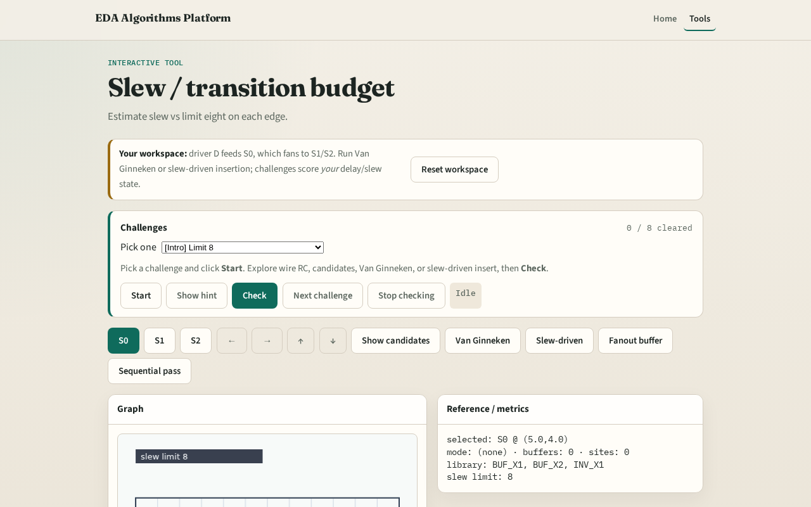

# Slew budget

Slew (transition) is what library cells require; long RC violates the budget

---

## The idea
- Estimate_slew equals k times R times C_total with k about 2.2
- Slew_ok is true when slew is at most the limit, eight on the toy

---

## Slew definition

---

## Limit eight

---

## Hot edge

---

## Pass/fail

---

## Toward insert

---

## Browser lab track

---

## Implement track
- Call `estimate_slew` and `slew_ok` in solvers
- Assert limit from tiny_buf.json

---

## Pitfalls
- Using delay as slew
- Ignoring C_load
- Hard-coding pass without measuring

---

## Your turn
- Next: place candidate buffer sites along edges

