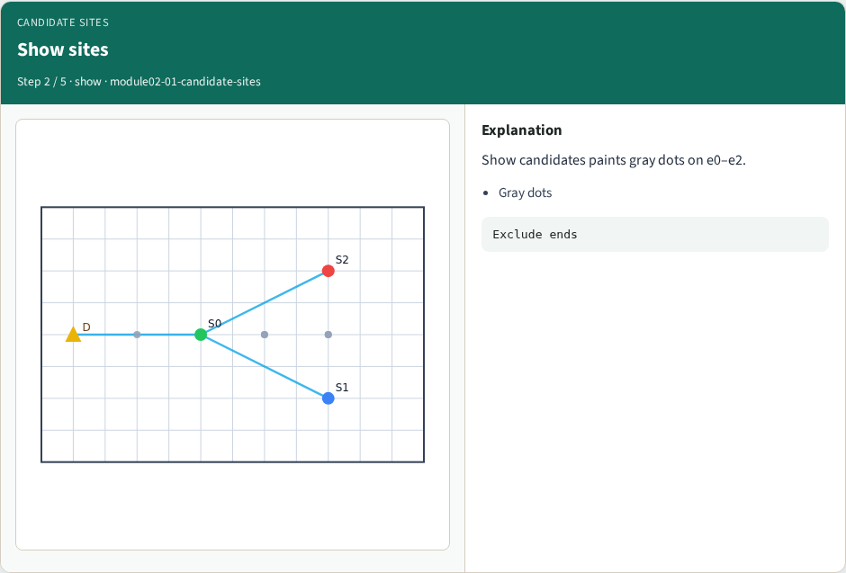
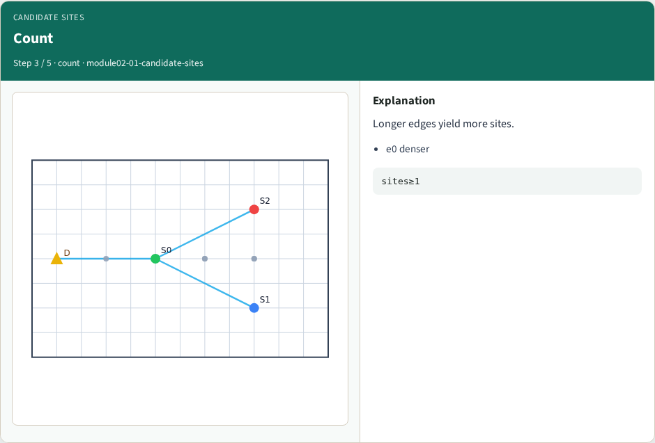
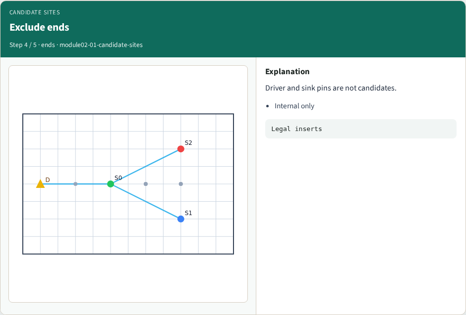
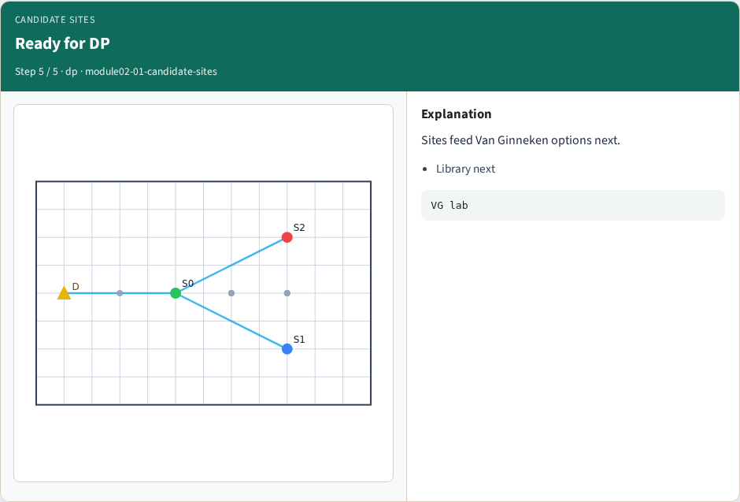
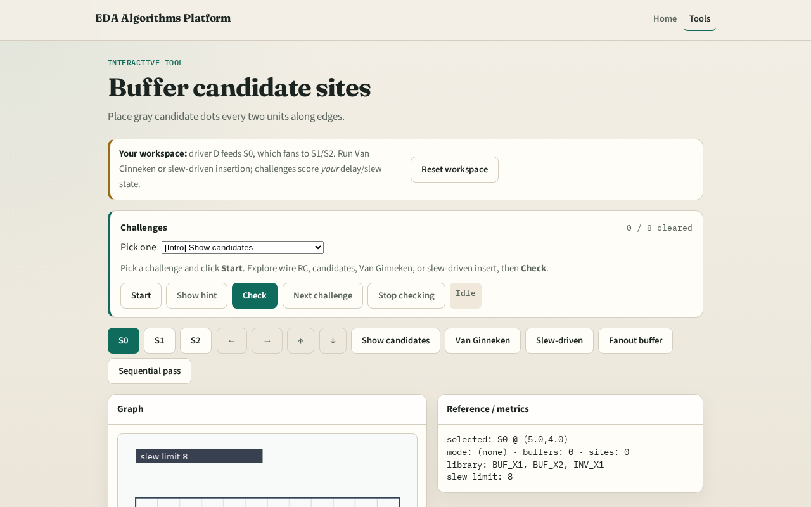

# Candidates

Van Ginneken and slew-driven flows only insert where candidates exist

---

## The idea
- Walk each edge; every candidate_step units place a site excluding endpoints
- Gray dots mark legal insert points

---

## Step size

---

## Show sites

---

## Count

---

## Exclude ends

---

## Ready for DP

---

## Browser lab track

---

## Implement track
- Call `candidate_sites(data)`
- Assert length > 0 for tiny_buf

---

## Pitfalls
- Placing sites past the far endpoint
- Using step zero
- Forgetting diagonal HV walk

---

## Your turn
- Next: the buffer library cells you can instantiate

