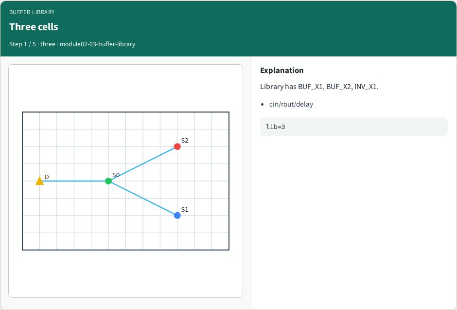
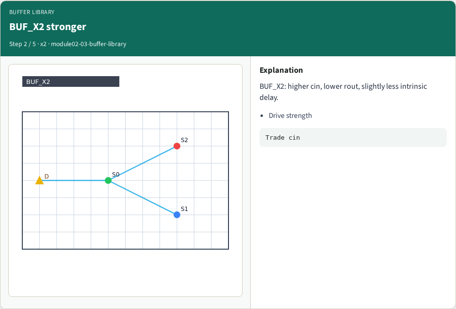
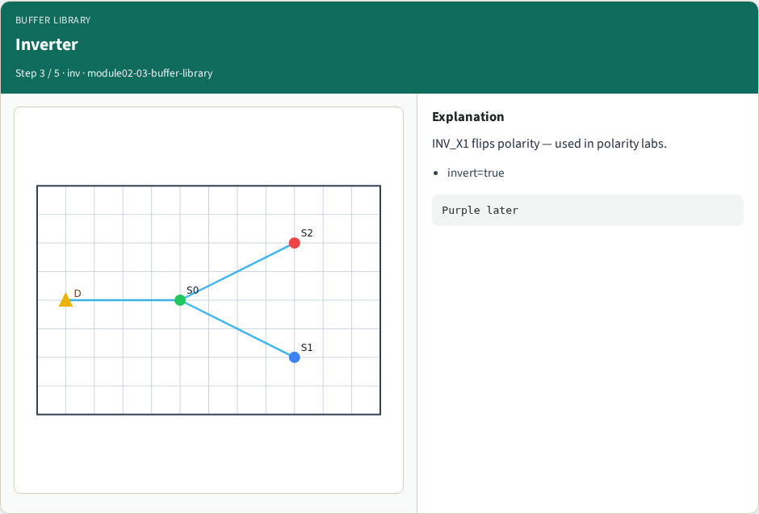
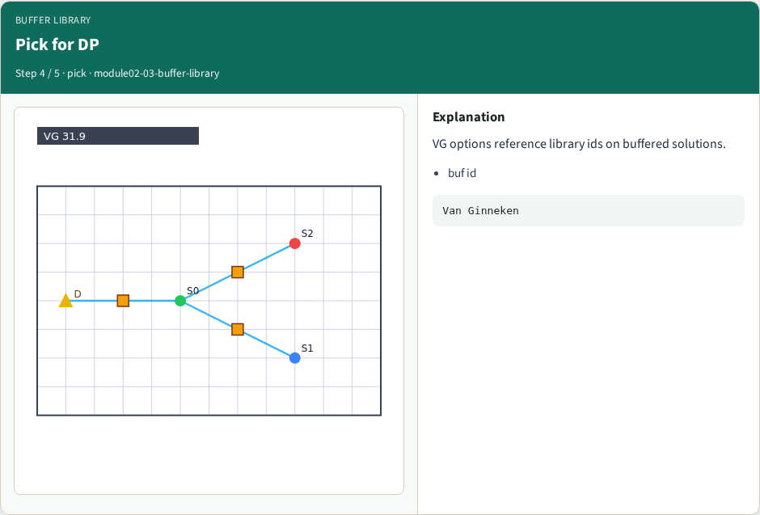
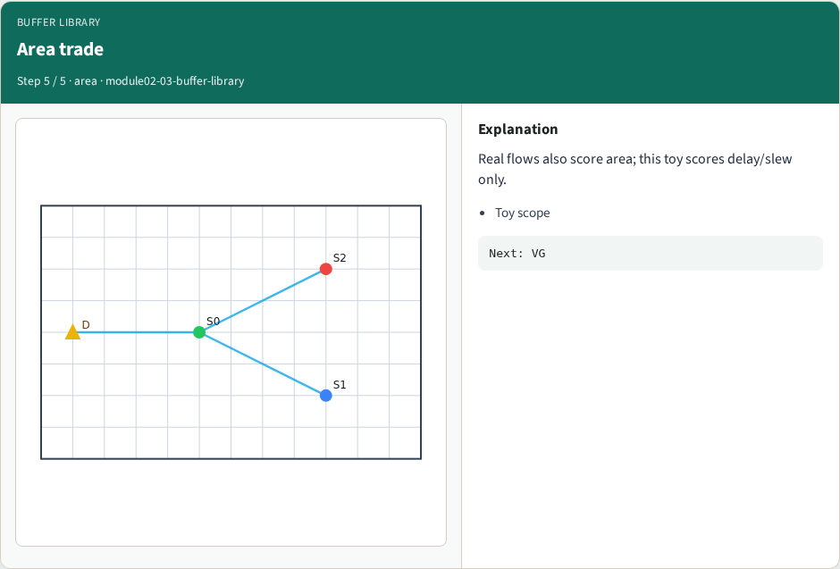
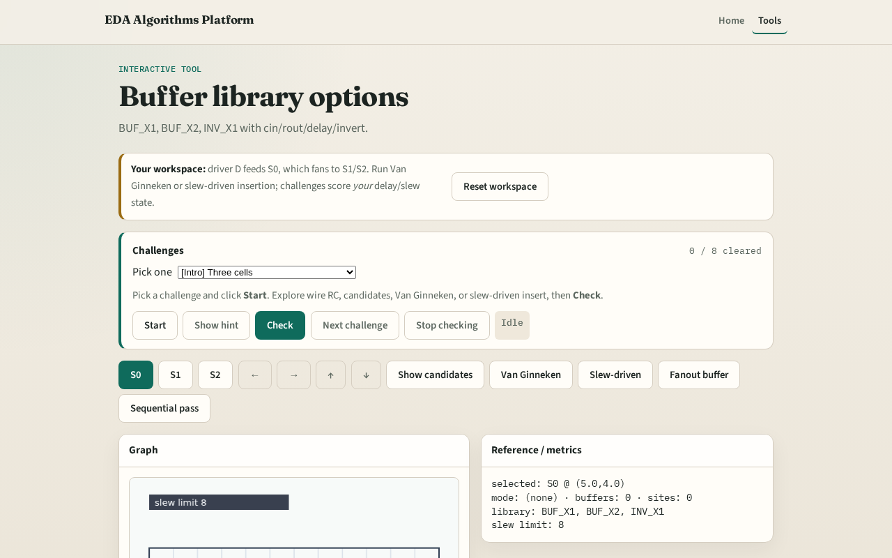

# Buffer library options

**Module id:** module02-03-buffer-library
**Lab:** buffer-library
**Tracks:** A (implement) · B (browser lab)

## Slide 1 — Library

Stronger buffers cost input cap but drive with lower resistance.

## Slide 2 — The idea

BUF_X1, BUF_X2, INV_X1 each publish cin, rout, delay, invert. Van Ginneken tries each non-inverting cell unless polarity mode allows INV.

<!-- algorithm-walkthrough -->

## Slide 3 — Three cells

Library has BUF_X1, BUF_X2, INV_X1.

## Slide 4 — BUF_X2 stronger

BUF_X2: higher cin, lower rout, slightly less intrinsic delay.

## Slide 5 — Inverter

INV_X1 flips polarity — used in polarity labs.

## Slide 6 — Pick for DP

VG options reference library ids on buffered solutions.

## Slide 7 — Area trade

Real flows also score area; this toy scores delay/slew only.

<!-- /algorithm-walkthrough -->

## Slide 8 — Browser lab track

Open **buffer-library**. Confirm three cells. Run Van Ginneken and see which buf ids appear.

## Slide 9 — Implement track

Print `data['buffer_library']`. Assert GOLDENS.libCount == 3.

## Slide 10 — Pitfalls

Ignoring invert flag. Treating rout as delay. Using cells not in the library.

## Slide 11 — Your turn

Next: Van Ginneken dynamic programming lite.
