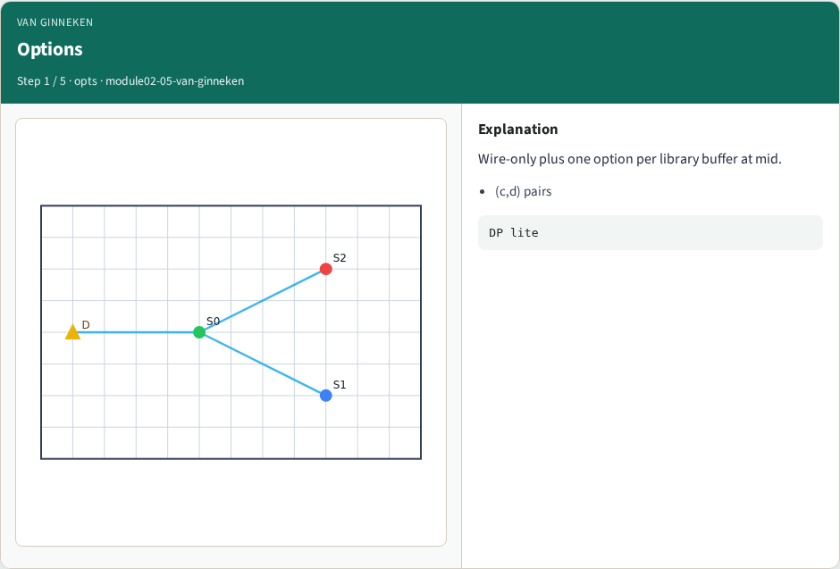
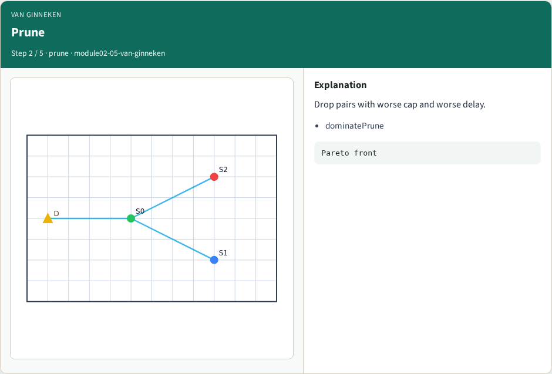
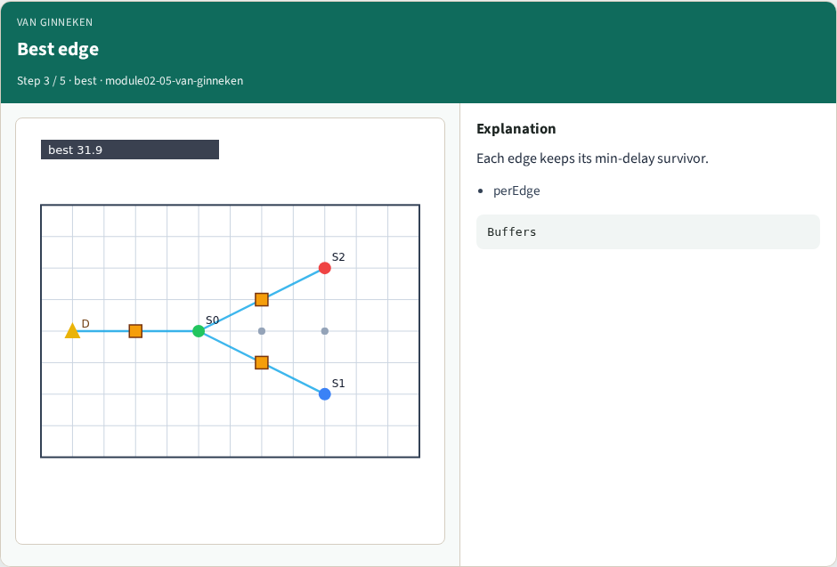
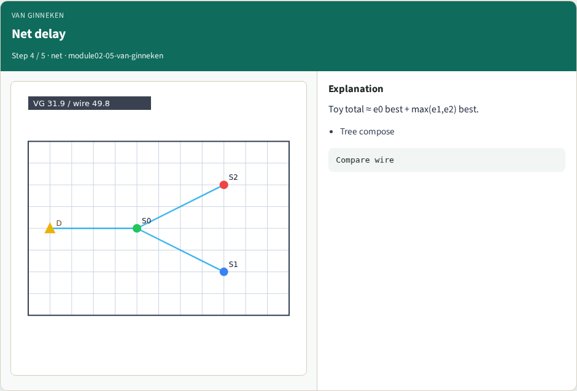
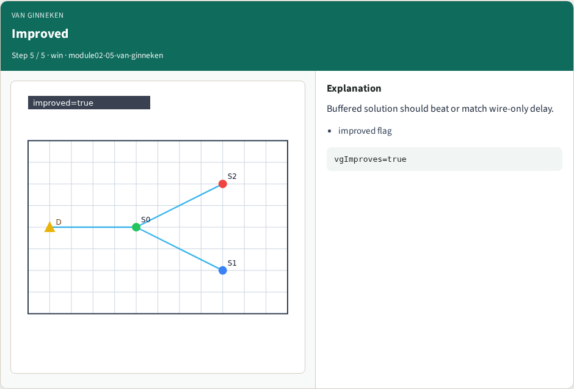

# Van Ginneken DP lite — step-by-step (for slides / transcript)

**Module:** `module02-05-van-ginneken`  
**Lab / algo:** `van-ginneken`  
**Viewer:** `/tools/algorithm-walkthrough/?algo=van-ginneken&step=1`

Use each **Caption** as spoken prose (or a shortened slide note).
Use **Bullets** on the PPT; pair with the PNG in `assets/steps/`.

## Step 1 — Options



**Caption (transcript):** Wire-only plus one option per library buffer at mid.

**Slide bullets:**

- (c,d) pairs

**On-screen metrics:**

```
DP lite
```

## Step 2 — Prune



**Caption (transcript):** Drop pairs with worse cap and worse delay.

**Slide bullets:**

- dominatePrune

**On-screen metrics:**

```
Pareto front
```

## Step 3 — Best edge



**Caption (transcript):** Each edge keeps its min-delay survivor.

**Slide bullets:**

- perEdge

**On-screen metrics:**

```
Buffers
```

## Step 4 — Net delay



**Caption (transcript):** Toy total ≈ e0 best + max(e1,e2) best.

**Slide bullets:**

- Tree compose

**On-screen metrics:**

```
Compare wire
```

## Step 5 — Improved



**Caption (transcript):** Buffered solution should beat or match wire-only delay.

**Slide bullets:**

- improved flag

**On-screen metrics:**

```
vgImproves=true
```

