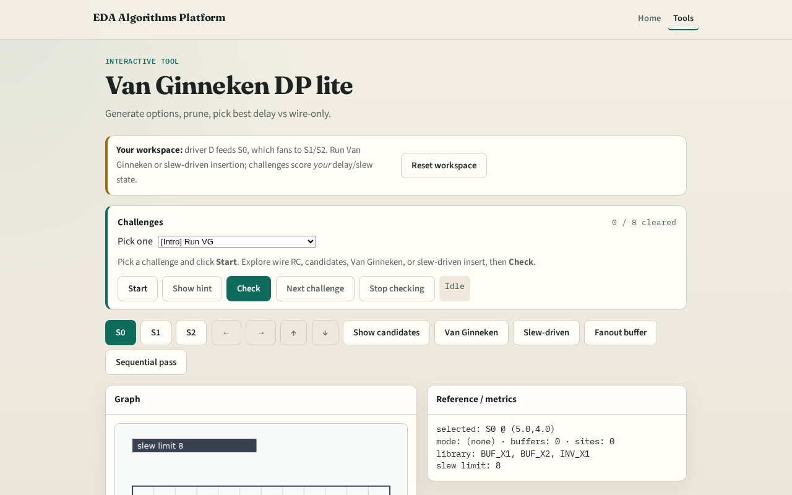

# Van Ginneken DP lite

**Module id:** module02-05-van-ginneken
**Lab:** van-ginneken
**Tracks:** A (implement) · B (browser lab)

## Slide 1 — Van Ginneken

Van Ginneken is the classic DP for buffer insertion on trees.

## Slide 2 — The idea

For each edge build wire-only and mid-buffer options as (c,d) pairs. dominate_prune keeps non-dominated fronts. Pick minimum delay. Sum along the toy tree.

<!-- algorithm-walkthrough -->

## Slide 3 — Options

Wire-only plus one option per library buffer at mid.

## Slide 4 — Prune

Drop pairs with worse cap and worse delay.

## Slide 5 — Best edge

Each edge keeps its min-delay survivor.

## Slide 6 — Net delay

Toy total ≈ e0 best + max(e1,e2) best.

## Slide 7 — Improved

Buffered solution should beat or match wire-only delay.

<!-- /algorithm-walkthrough -->

## Slide 8 — Browser lab track

Open **van-ginneken**. Click Van Ginneken. Confirm improved delay vs wire and orange buffers where chosen.

## Slide 9 — Implement track

Call `van_ginneken_net(data)`. Assert best_delay ≤ wire_delay.

## Slide 10 — Pitfalls

Keeping dominated options. Double-counting branch loads. Forgetting wire-only option.

## Slide 11 — Your turn

Next: slew-driven greedy insertion.
