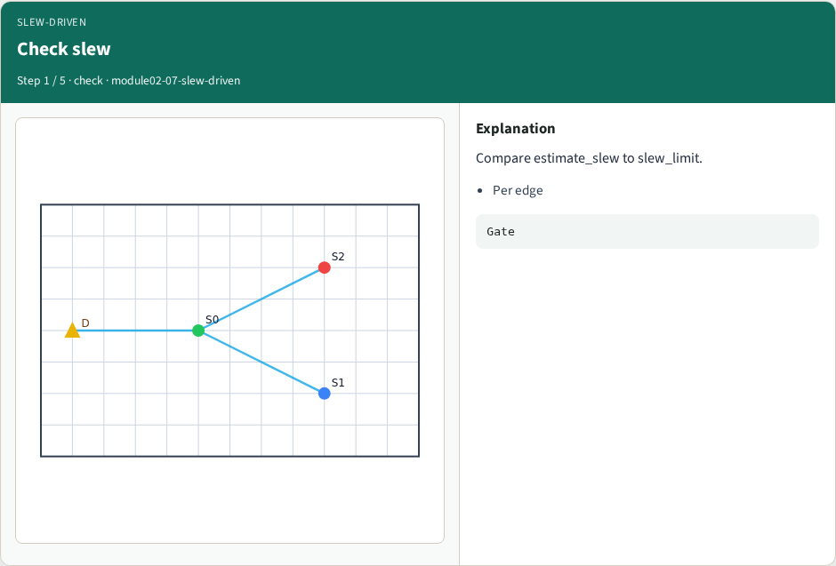
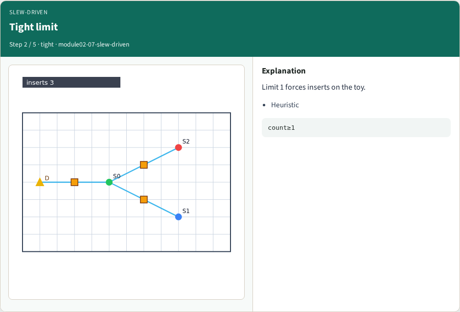
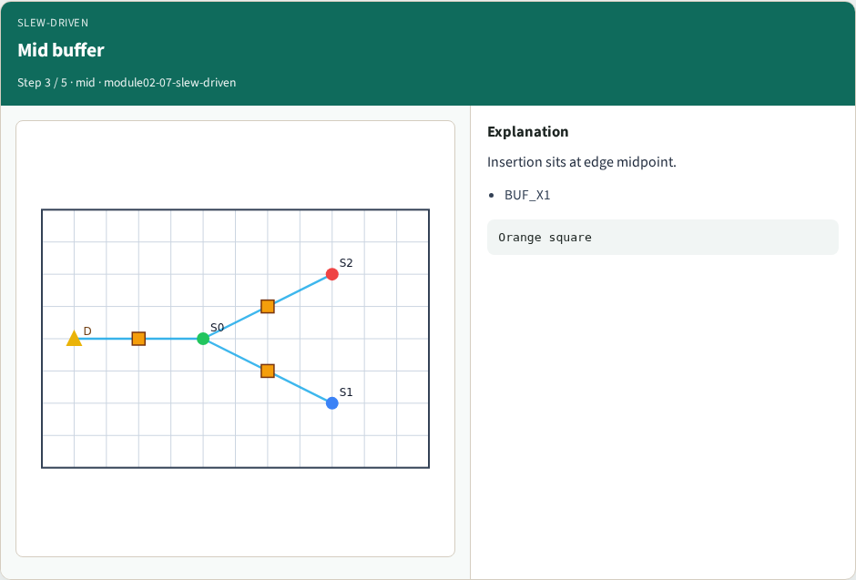
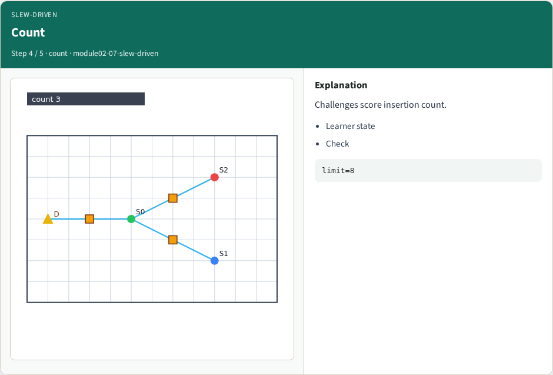
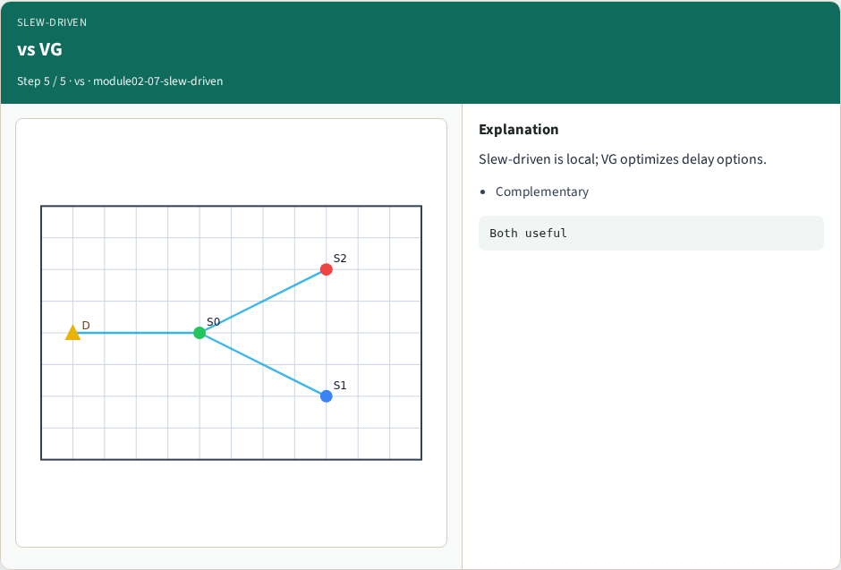
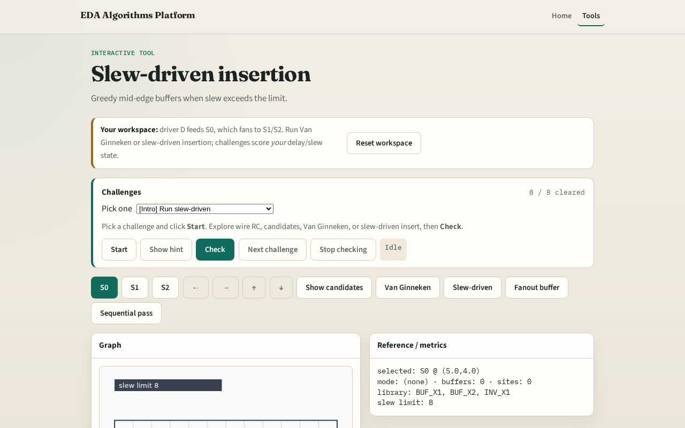

# Slew-driven insertion

**Module id:** module02-07-slew-driven
**Lab:** slew-driven
**Tracks:** A (implement) · B (browser lab)

## Slide 1 — Slew-driven

When DP is heavy, a slew check plus mid-edge buffer is a fast practical heuristic.

## Slide 2 — The idea

For each edge compute slew; if above limit, insert BUF_X1 at the midpoint. Lowering the limit forces more insertions.

<!-- algorithm-walkthrough -->

## Slide 3 — Check slew

Compare estimate_slew to slew_limit.

## Slide 4 — Tight limit

Limit 1 forces inserts on the toy.

## Slide 5 — Mid buffer

Insertion sits at edge midpoint.

## Slide 6 — Count

Challenges score insertion count.

## Slide 7 — vs VG

Slew-driven is local; VG optimizes delay options.

<!-- /algorithm-walkthrough -->

## Slide 8 — Browser lab track

Open **slew-driven**. Click Slew-driven. With default limit, note count; mentally compare to Van Ginneken.

## Slide 9 — Implement track

Call `slew_driven_insert` with slew_limit=1; assert count ≥ 1.

## Slide 10 — Pitfalls

Inserting without measuring slew. Stacking infinite buffers. Ignoring branch load.

## Slide 11 — Your turn

Next: polarity and inverters.
