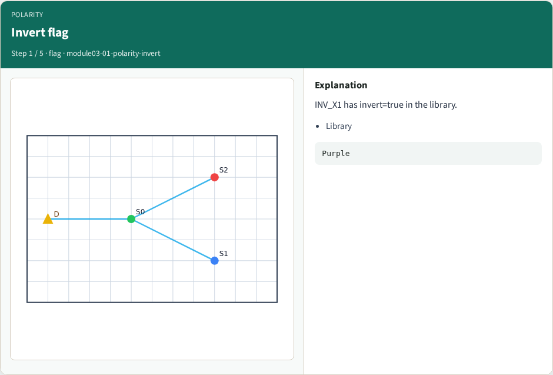
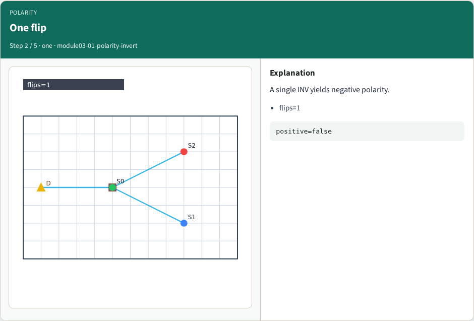
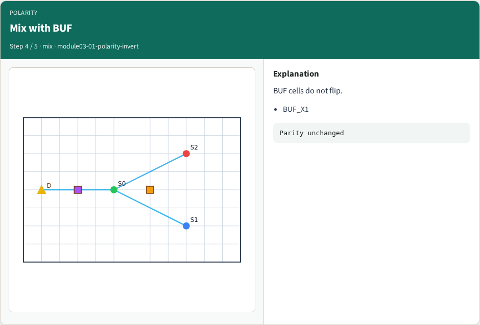
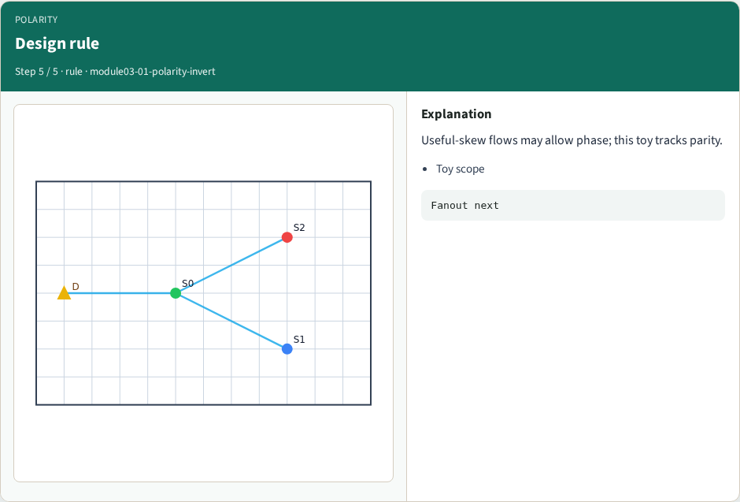
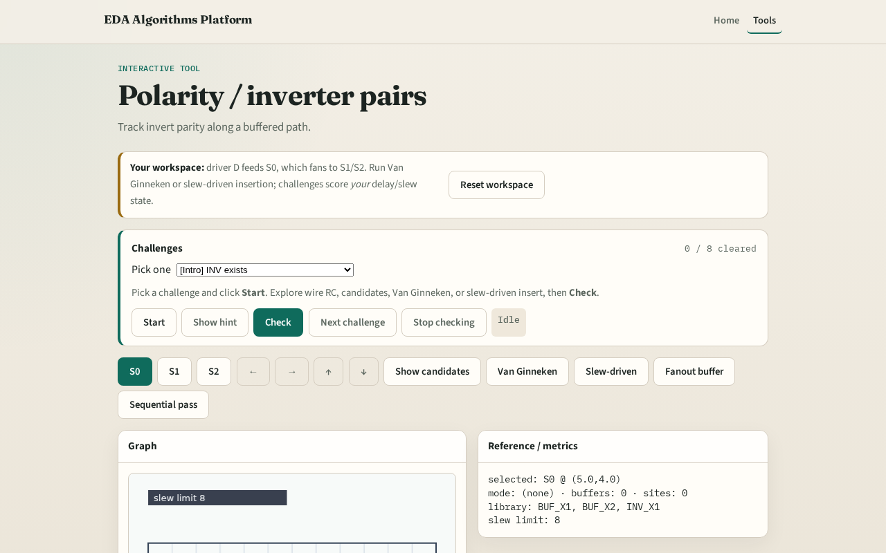

# Polarity / inverter pairs

**Module id:** module03-01-polarity-invert
**Lab:** polarity-invert
**Tracks:** A (implement) · B (browser lab)

## Slide 1 — Polarity

Inverters are useful buffers but flip the signal; odd counts need a fix.

## Slide 2 — The idea

Each INV_X1 flips polarity. polarity_fix reports flips and whether the path is still positive.

<!-- algorithm-walkthrough -->

## Slide 3 — Invert flag

INV_X1 has invert=true in the library.

## Slide 4 — One flip

A single INV yields negative polarity.

## Slide 5 — Two flips

Two INVs restore positive sense.

## Slide 6 — Mix with BUF

BUF cells do not flip.

## Slide 7 — Design rule

Useful-skew flows may allow phase; this toy tracks parity.

<!-- /algorithm-walkthrough -->

## Slide 8 — Browser lab track

Open **polarity-invert**. Place an INV on a path mentally; Check polarity challenges.

## Slide 9 — Implement track

Call `polarity_fix([INV],[BUF])`. Assert flips and positive flags.

## Slide 10 — Pitfalls

Counting BUF as invert. Forgetting parity. Using INV in VG when allow_invert is false.

## Slide 11 — Your turn

Next: fanout buffering at the junction.
