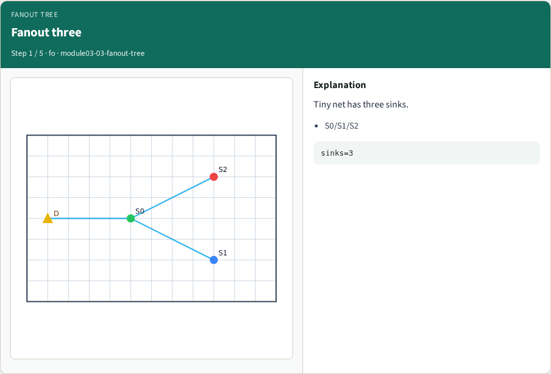
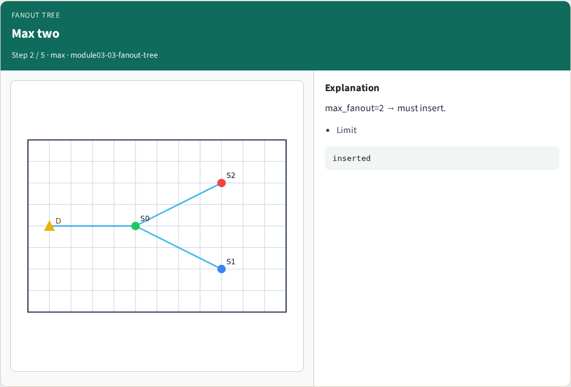
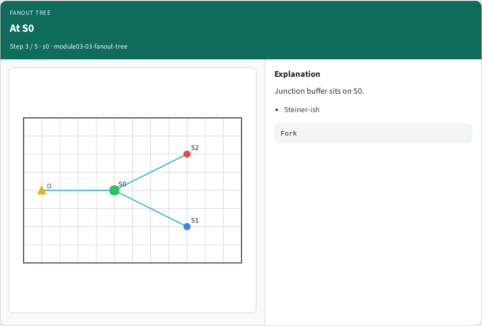
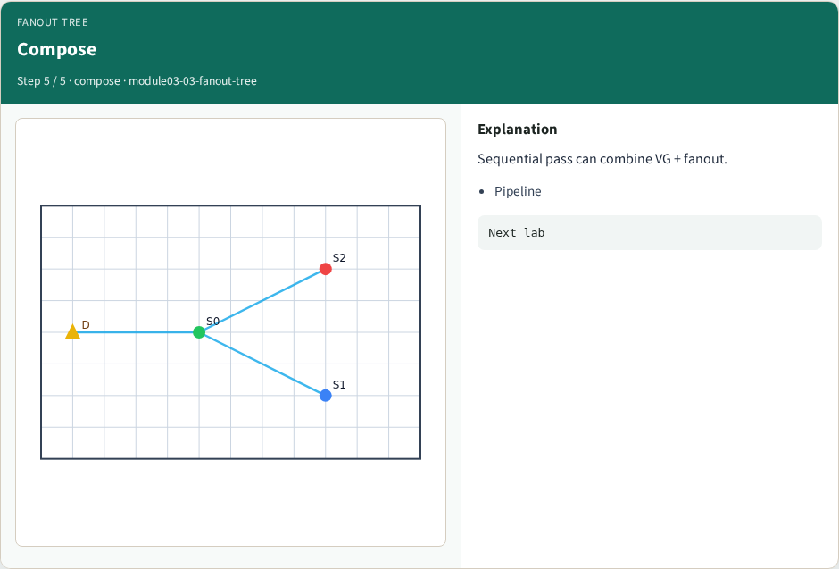

# Fanout buffer tree — step-by-step (for slides / transcript)

**Module:** `module03-03-fanout-tree`  
**Lab / algo:** `fanout-tree`  
**Viewer:** `/tools/algorithm-walkthrough/?algo=fanout-tree&step=1`

Use each **Caption** as spoken prose (or a shortened slide note).
Use **Bullets** on the PPT; pair with the PNG in `assets/steps/`.

## Step 1 — Fanout three



**Caption (transcript):** Tiny net has three sinks.

**Slide bullets:**

- S0/S1/S2

**On-screen metrics:**

```
sinks=3
```

## Step 2 — Max two



**Caption (transcript):** max_fanout=2 → must insert.

**Slide bullets:**

- Limit

**On-screen metrics:**

```
inserted
```

## Step 3 — At S0



**Caption (transcript):** Junction buffer sits on S0.

**Slide bullets:**

- Steiner-ish

**On-screen metrics:**

```
Fork
```

## Step 4 — BUF_X2


**Caption (transcript):** Stronger cell for the fork.

**Slide bullets:**

- Drive

**On-screen metrics:**

```
BUF_X2
```

## Step 5 — Compose



**Caption (transcript):** Sequential pass can combine VG + fanout.

**Slide bullets:**

- Pipeline

**On-screen metrics:**

```
Next lab
```

