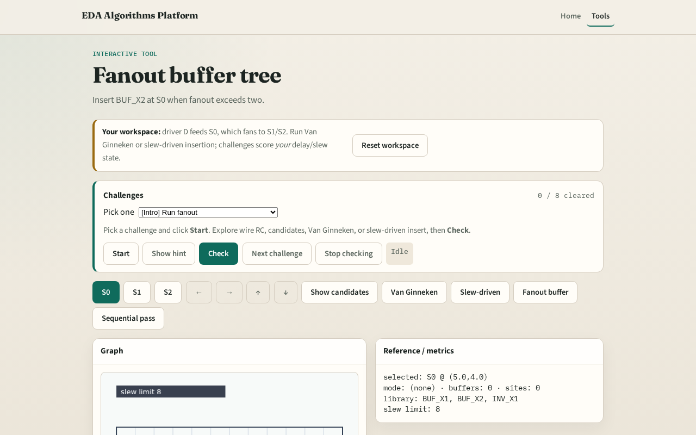

# Fanout

One driver cannot feed too many sinks without a buffer tree stage

---

## The idea
- If sink count exceeds max_fanout (two on the toy), insert BUF_X2 at S0
- Three sinks therefore force an insert

---

## Fanout three

---

## Max two

---

## At S0

---

## BUF_X2

---

## Compose

---

## Browser lab track

---

## Implement track
- Call `fanout_buffer_tree(data, max_fanout=2)`
- Assert inserted is true

---

## Pitfalls
- Buffering at the driver only
- Using max_fanout ≥ sink count
- Forgetting S0 coordinates

---

## Your turn
- Next: full sequential buffering pass

