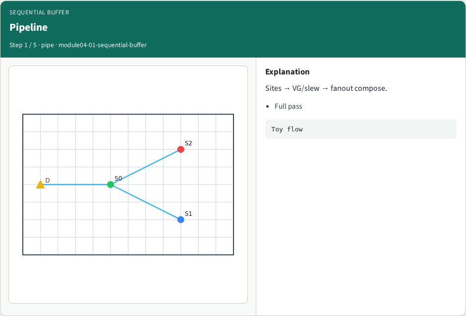
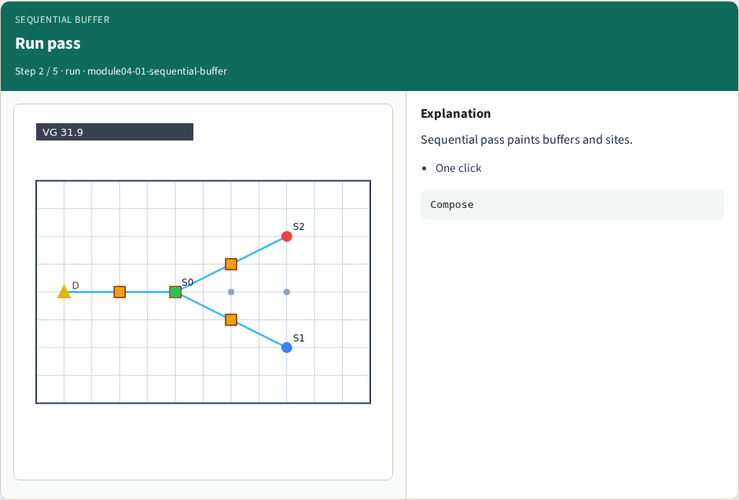
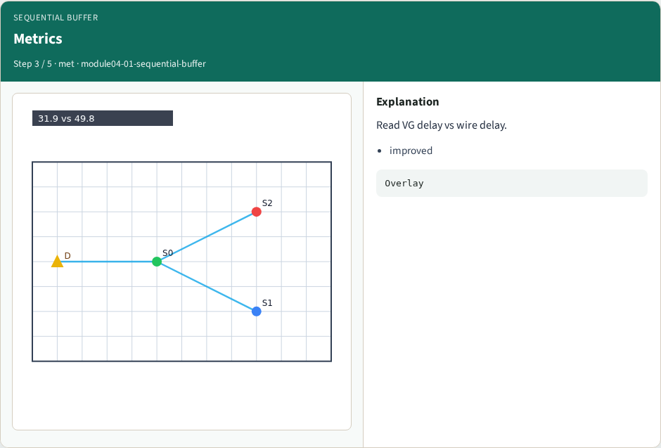
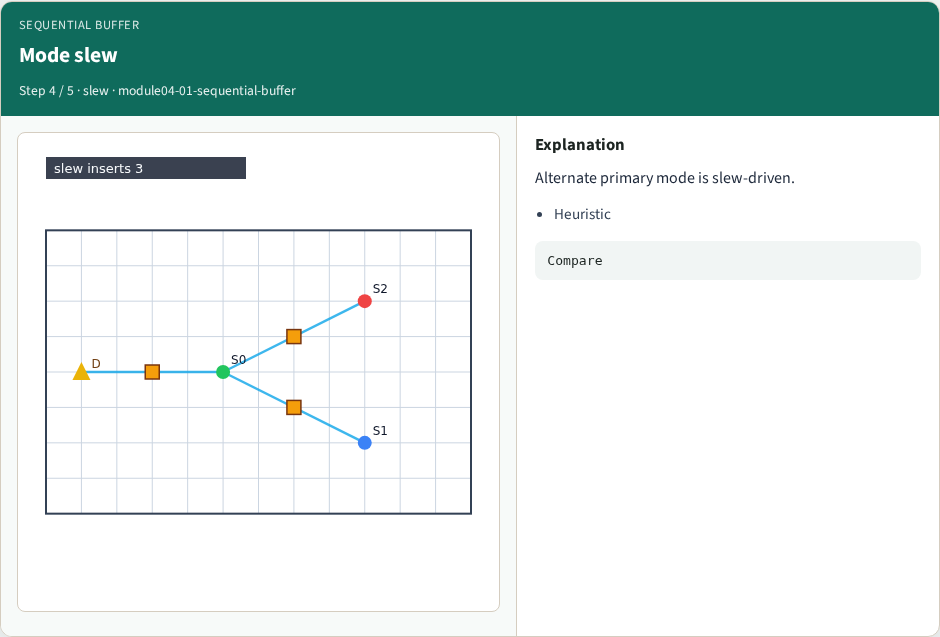
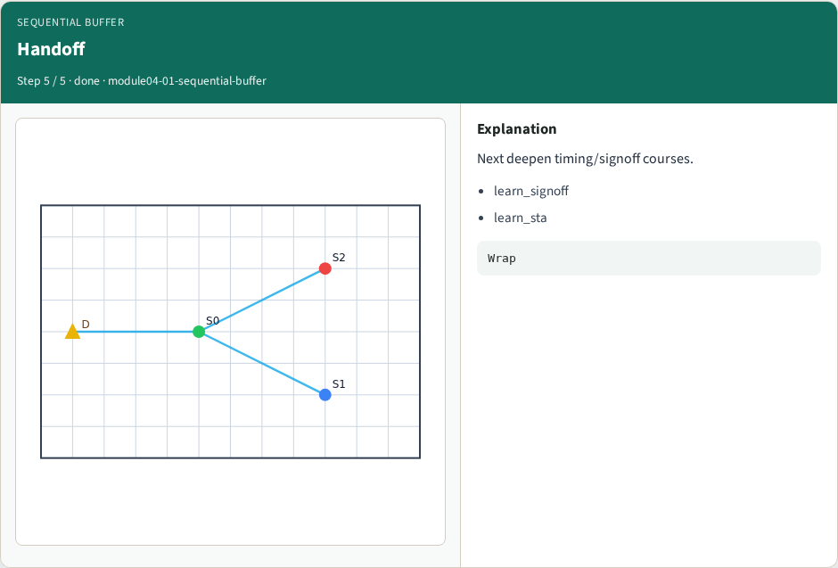
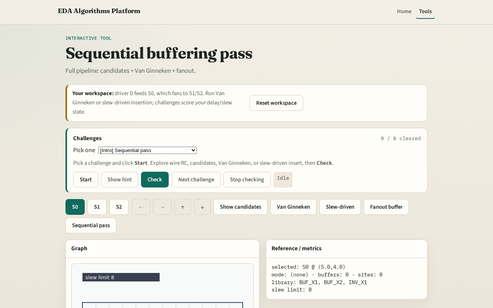

# Sequential buffering pass

**Module id:** module04-01-sequential-buffer
**Lab:** sequential-buffer
**Tracks:** A (implement) · B (browser lab)

## Slide 1 — Sequential

Production flows chain heuristics; this lab is the toy pipeline.

## Slide 2 — The idea

sequential_buffer builds sites, runs Van Ginneken, optionally adds fanout buffers, and reports primary metrics.

<!-- algorithm-walkthrough -->

## Slide 3 — Pipeline

Sites → VG/slew → fanout compose.

## Slide 4 — Run pass

Sequential pass paints buffers and sites.

## Slide 5 — Metrics

Read VG delay vs wire delay.

## Slide 6 — Mode slew

Alternate primary mode is slew-driven.

## Slide 7 — Handoff

Next deepen timing/signoff courses.

<!-- /algorithm-walkthrough -->

## Slide 8 — Browser lab track

Open **sequential-buffer**. Click Sequential pass. Confirm buffers and improved VG delay.

## Slide 9 — Implement track

Call `sequential_buffer(data)`. Assert sites and van_ginneken keys exist.

## Slide 10 — Pitfalls

Skipping prune. Mixing modes without clearing buffers. Ignoring fanout stage.

## Slide 11 — Your turn

Next: offline compare, then wrap.
