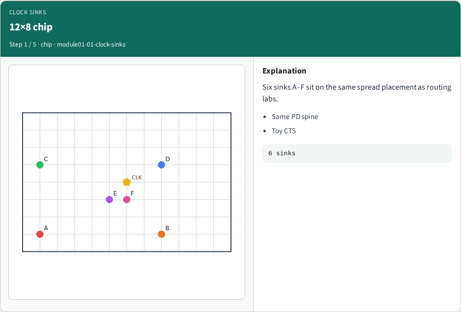
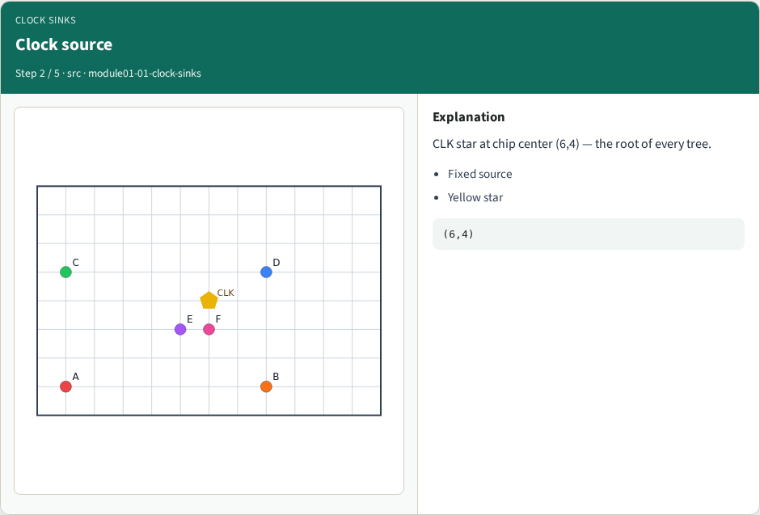
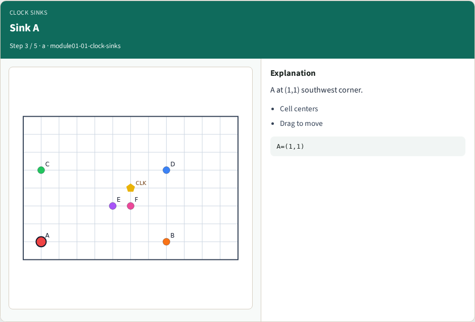
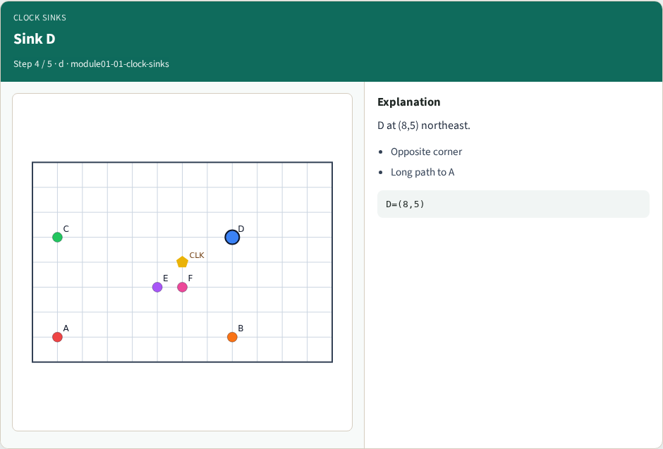
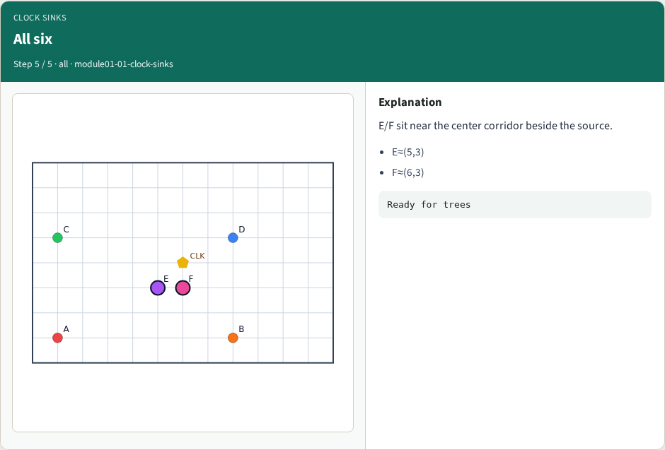
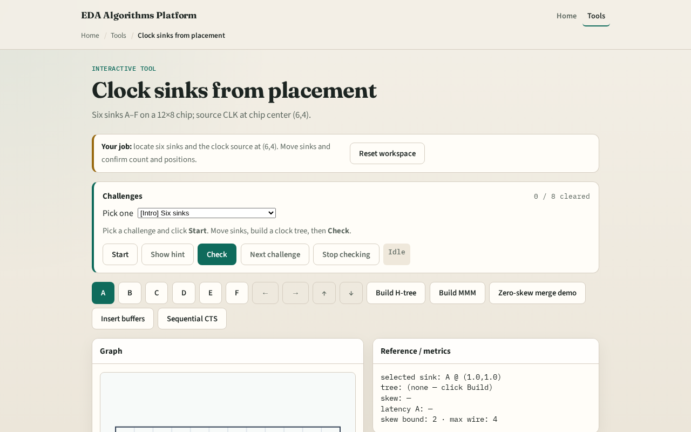

# Clock sinks from placement

Every CTS algorithm starts from sinks, cell centers that must receive the clock, and one source

---

## The idea
- Sink_points reads placement for A through F
- Source sits at six comma four
- Moving a sink moves its access point for the next tree build

---

## 12×8 chip

---

## Clock source

---

## Sink A

---

## Sink D

---

## All six

---

## Browser lab track

---

## Implement track
- Call `sink_points(placement, sinks)` in `common/ctsutil.py`
- Print A through F on tiny_cts
- Assert source at (6,4)

---

## Pitfalls
- Using GCell indices instead of cell centers
- Forgetting the source is fixed
- Treating nets as sinks

---

## Your turn
- Next: measure latency and skew on a built tree

