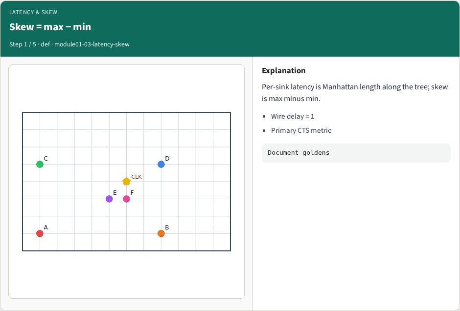
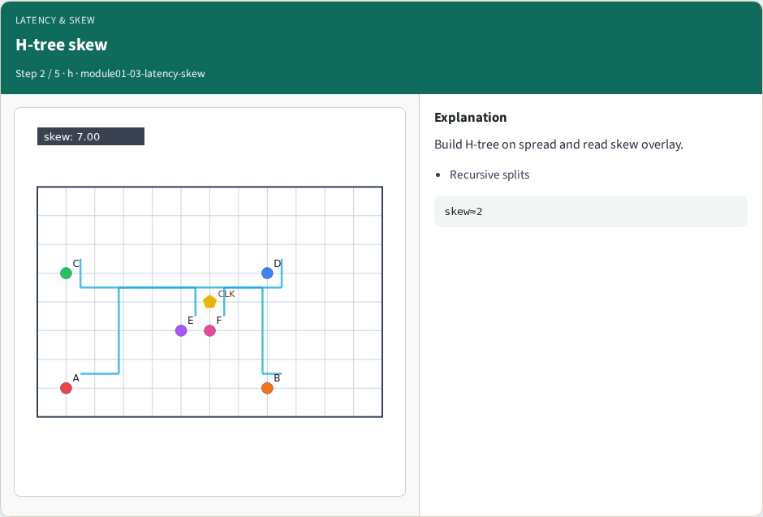
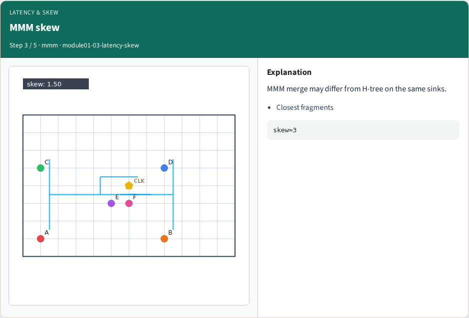
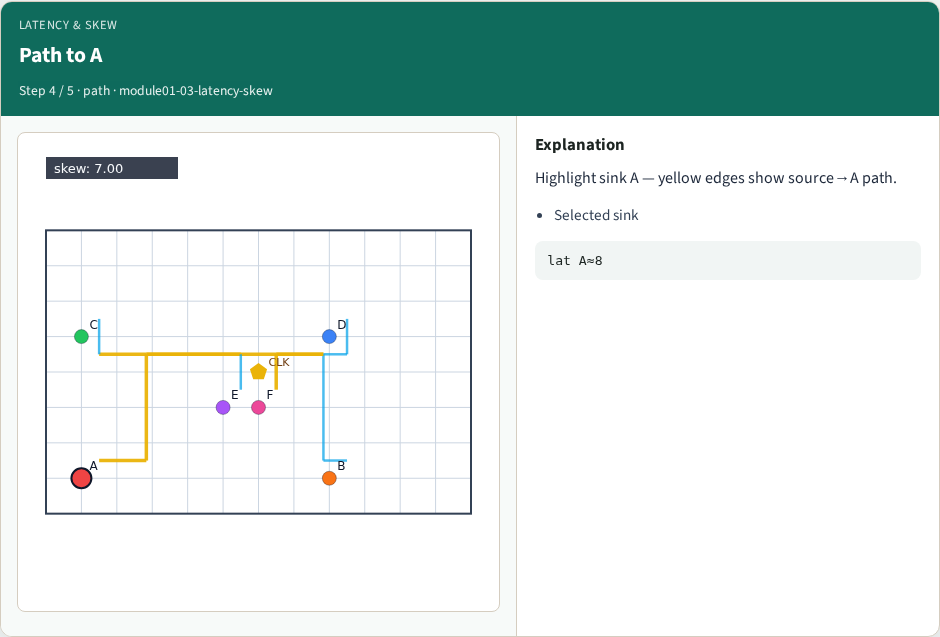
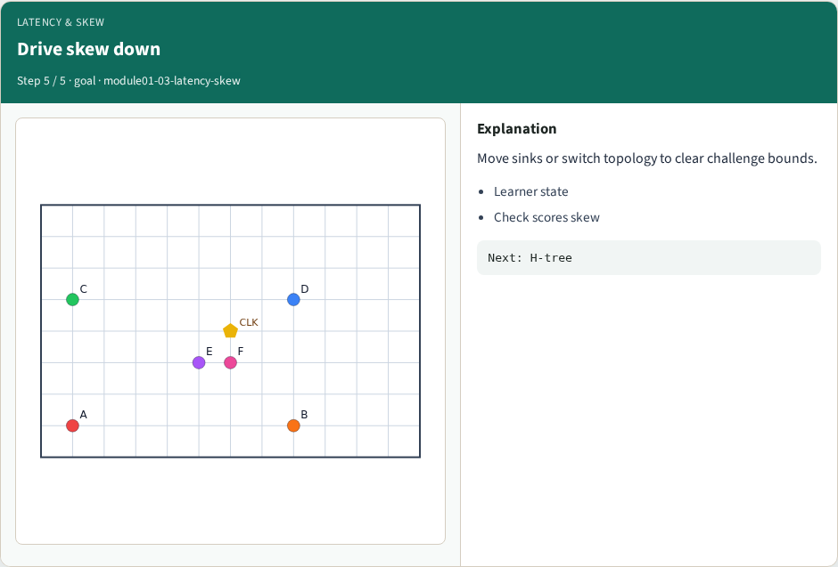
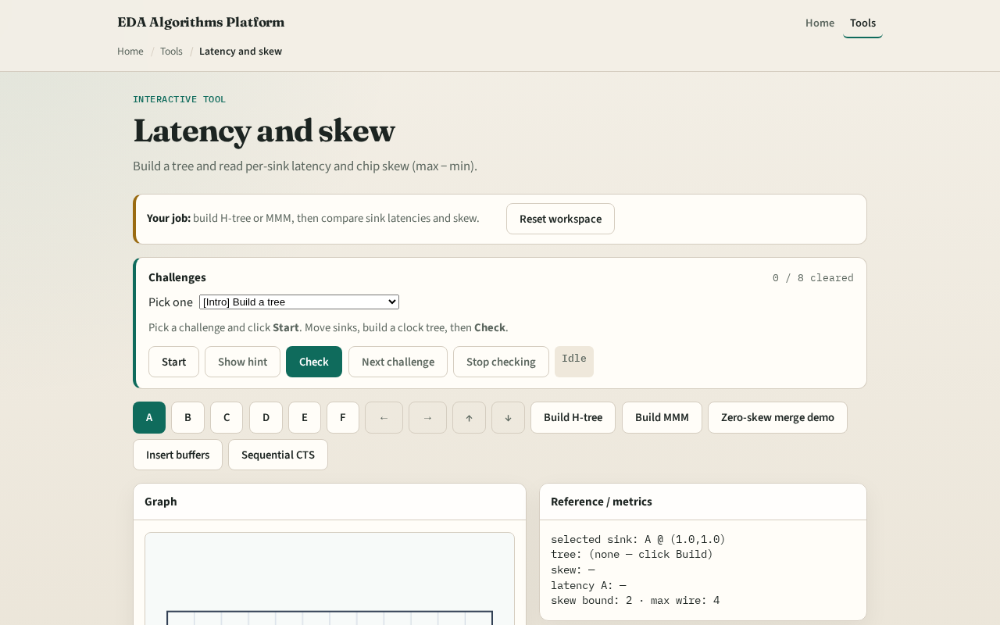

# Latency and skew

**Module id:** module01-03-latency-skew
**Lab:** latency-skew
**Tracks:** A (implement) · B (browser lab)

## Slide 1 — Latency and skew

Skew is the CTS scoreboard: how different are arrival times at sinks.

## Slide 2 — The idea

Walk the tree from source to each sink summing Manhattan edge lengths. Skew equals max latency minus min latency. Wire delay per unit is one on the toy.

<!-- algorithm-walkthrough -->

## Slide 3 — Skew = max − min

Per-sink latency is Manhattan length along the tree; skew is max minus min.

## Slide 4 — H-tree skew

Build H-tree on spread and read skew overlay.

## Slide 5 — MMM skew

MMM merge may differ from H-tree on the same sinks.

## Slide 6 — Path to A

Highlight sink A — yellow edges show source→A path.

## Slide 7 — Drive skew down

Move sinks or switch topology to clear challenge bounds.

<!-- /algorithm-walkthrough -->

## Slide 8 — Browser lab track

Open **latency-skew**. Build H-tree, read skew, then Build MMM and compare. Select A to highlight its path.

## Slide 9 — Implement track

Implement or call `latency(path)` and `skew(latencies)` in `common/solvers.py`. Print skew for MMM on tiny_cts.

## Slide 10 — Pitfalls

Using Euclidean distance. Comparing sinks without a tree. Treating buffer delay as wire length without counting buffers.

## Slide 11 — Your turn

Next: grow a classic H-tree topology.
