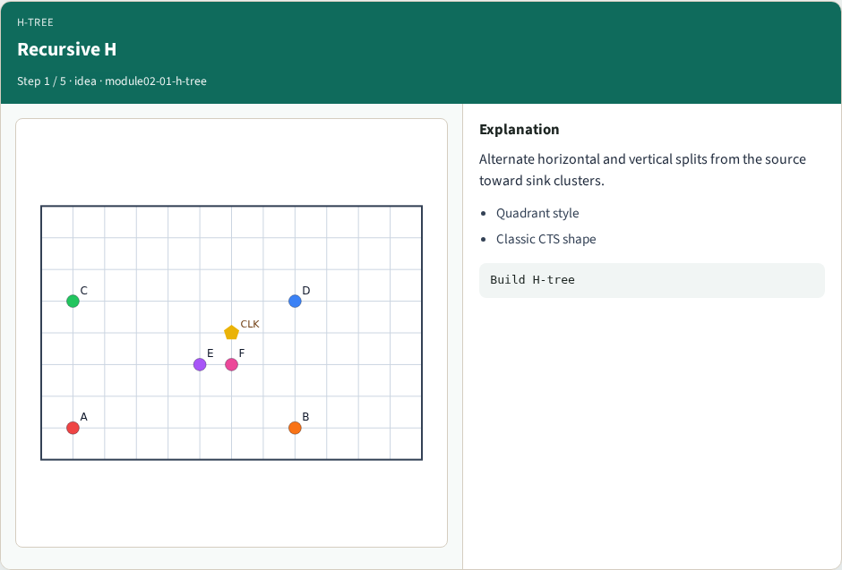
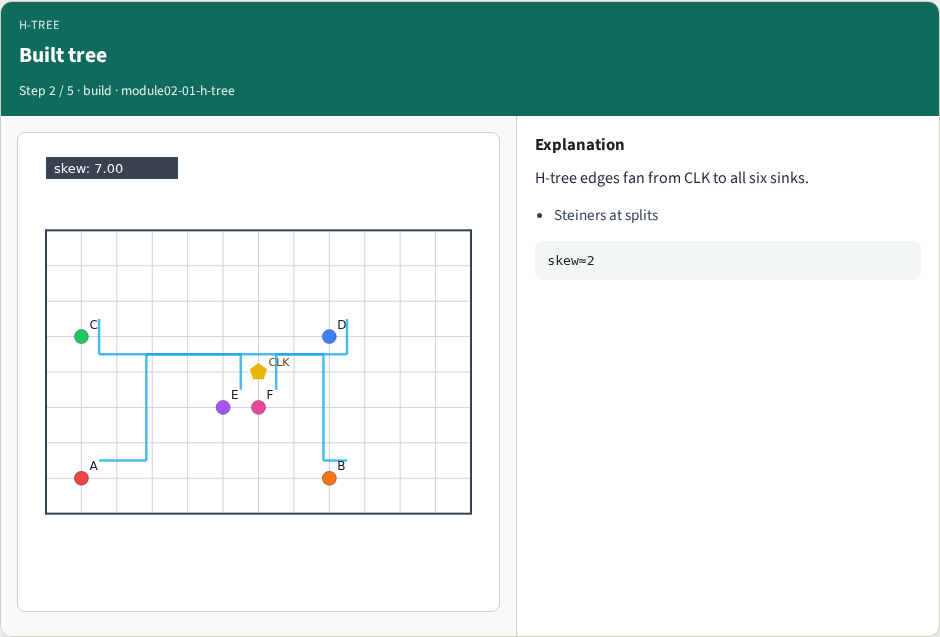
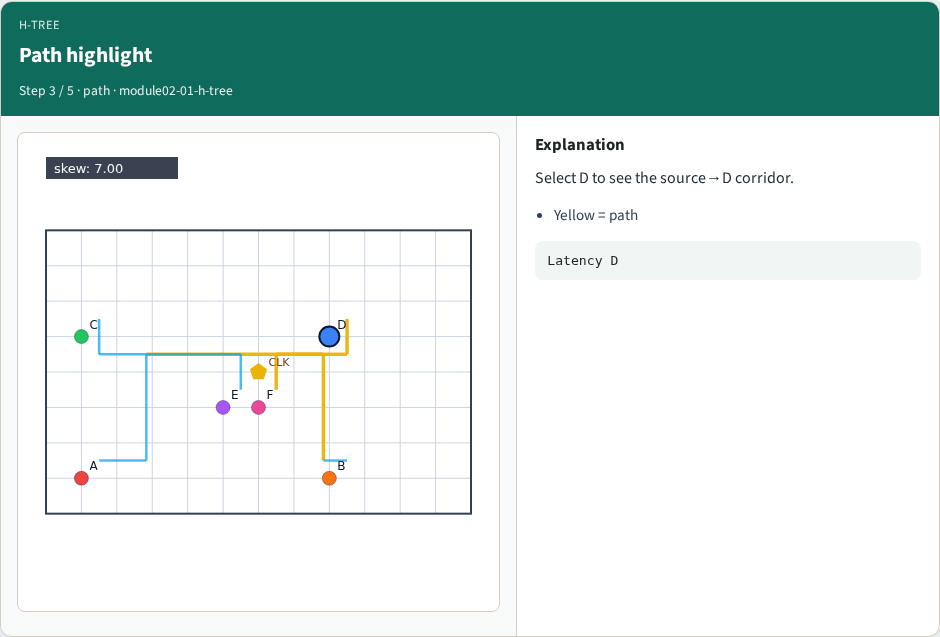
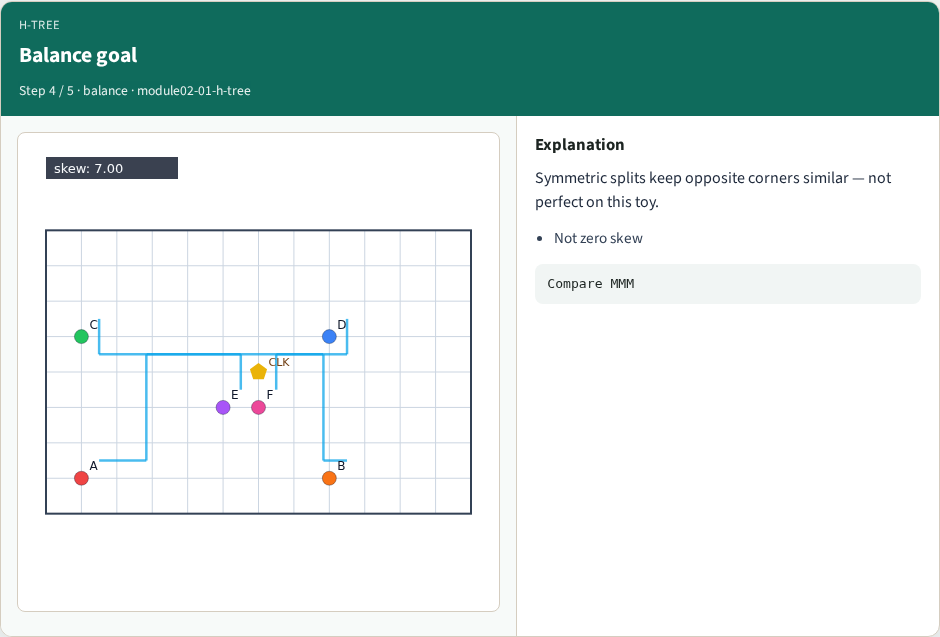
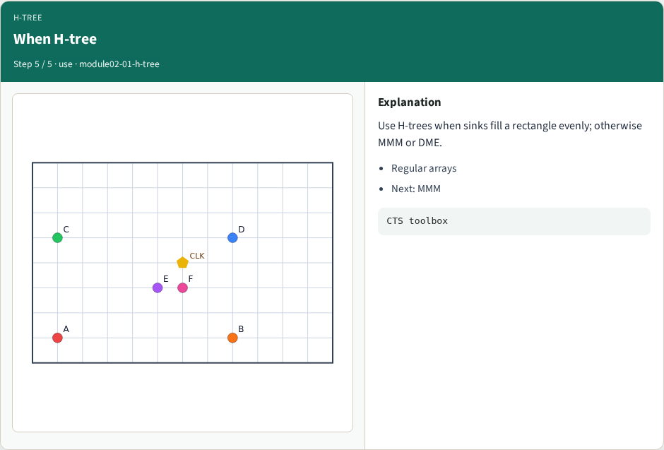

# H-tree topology — step-by-step (for slides / transcript)

**Module:** `module02-01-h-tree`  
**Lab / algo:** `h-tree`  
**Viewer:** `/tools/algorithm-walkthrough/?algo=h-tree&step=1`

Use each **Caption** as spoken prose (or a shortened slide note).
Use **Bullets** on the PPT; pair with the PNG in `assets/steps/`.

## Step 1 — Recursive H



**Caption (transcript):** Alternate horizontal and vertical splits from the source toward sink clusters.

**Slide bullets:**

- Quadrant style
- Classic CTS shape

**On-screen metrics:**

```
Build H-tree
```

## Step 2 — Built tree



**Caption (transcript):** H-tree edges fan from CLK to all six sinks.

**Slide bullets:**

- Steiners at splits

**On-screen metrics:**

```
skew≈2
```

## Step 3 — Path highlight



**Caption (transcript):** Select D to see the source→D corridor.

**Slide bullets:**

- Yellow = path

**On-screen metrics:**

```
Latency D
```

## Step 4 — Balance goal



**Caption (transcript):** Symmetric splits keep opposite corners similar — not perfect on this toy.

**Slide bullets:**

- Not zero skew

**On-screen metrics:**

```
Compare MMM
```

## Step 5 — When H-tree



**Caption (transcript):** Use H-trees when sinks fill a rectangle evenly; otherwise MMM or DME.

**Slide bullets:**

- Regular arrays
- Next: MMM

**On-screen metrics:**

```
CTS toolbox
```

