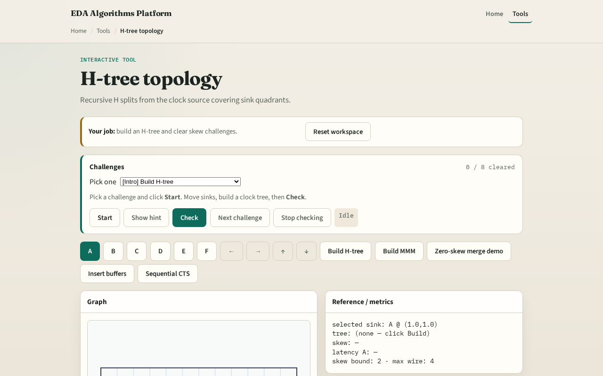

# H-tree topology

H-trees are the classic picture of a balanced clock network on a regular array

---

## The idea
- From the source, alternate horizontal and vertical splits toward sink groups
- Each split creates steiner points and L-shaped legs to children

---

## Recursive H

---

## Built tree

---

## Path highlight

---

## Balance goal

---

## When H-tree

---

## Browser lab track

---

## Implement track
- Call `h_tree(source, chip)` / browser `hTree(positions)`
- Attach sinks and print edge count and skew

---

## Pitfalls
- Stopping after one H without recursion
- Connecting sinks with Euclidean edges
- Ignoring steiner points when measuring latency

---

## Your turn
- Next: Method of Means and Medians for irregular sinks

