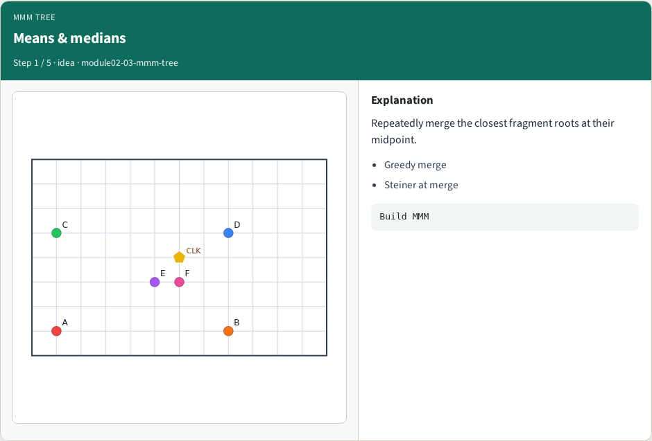
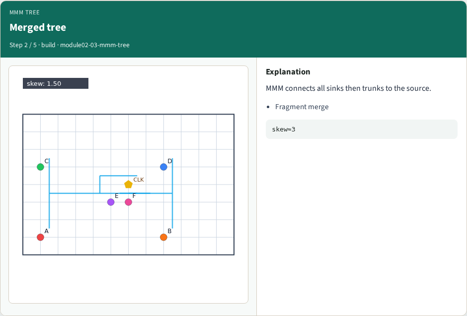
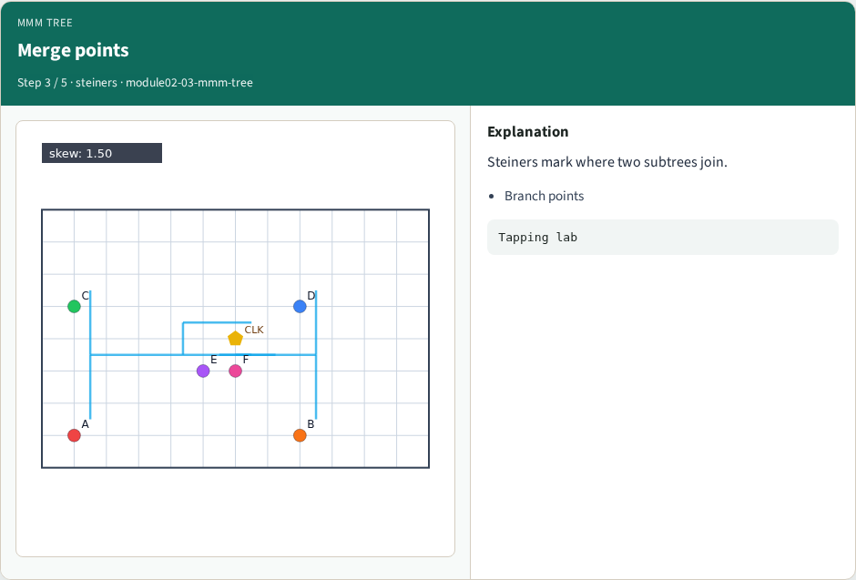
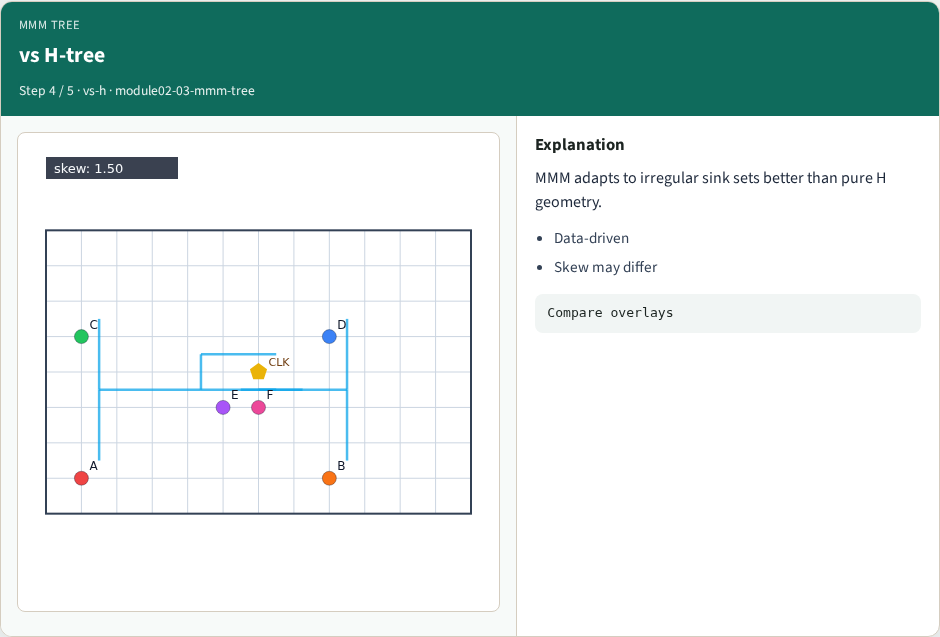
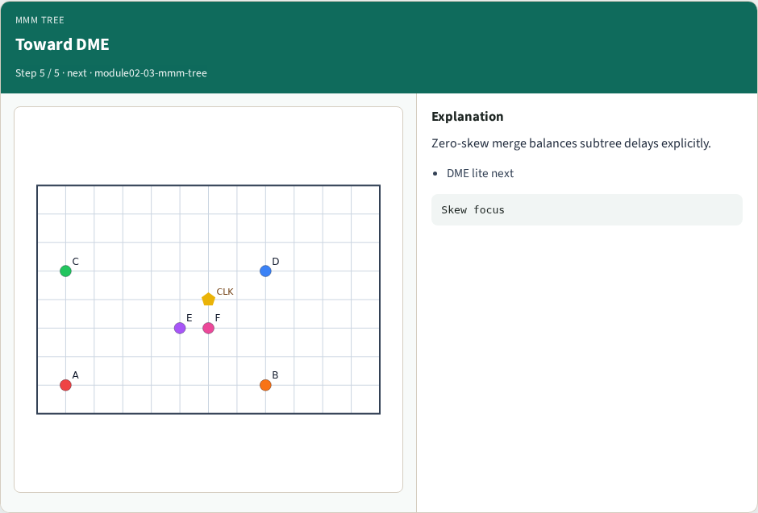
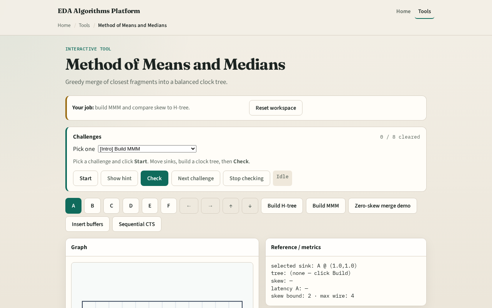

# Method of Means and Medians

When sinks are irregular, greedy merge adapts better than a pure geometric H

---

## The idea
- Treat each sink as a fragment
- Repeatedly merge the closest pair of fragment roots at their midpoint

---

## Means & medians

---

## Merged tree

---

## Merge points

---

## vs H-tree

---

## Toward DME

---

## Browser lab track

---

## Implement track
- Call `mmm_tree(source, sinks)` in solvers
- Assert every sink endpoint appears in the edge set

---

## Pitfalls
- Merging by Euclidean when latency is Manhattan
- Forgetting to connect the final fragment to the source
- Dropping steiner coordinates when buffering

---

## Your turn
- Next: zero-skew merge (DME lite)

