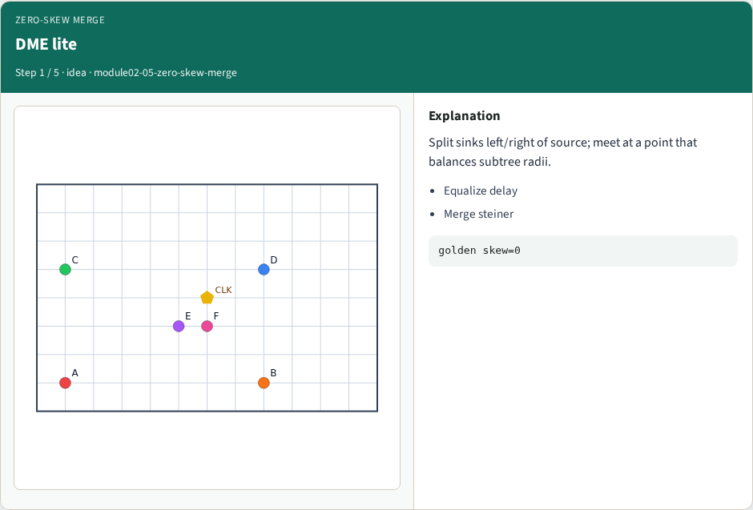
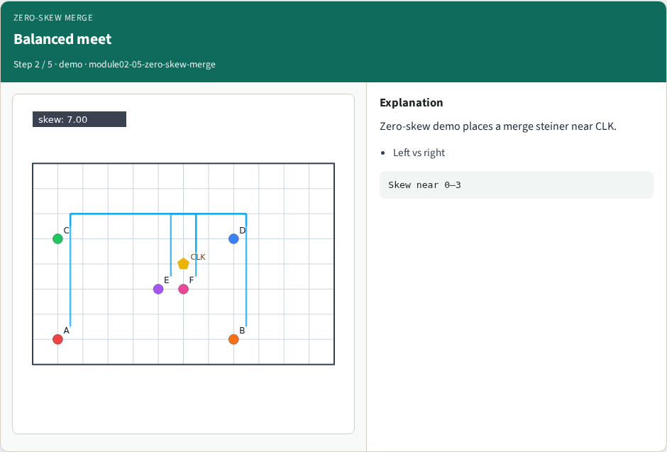
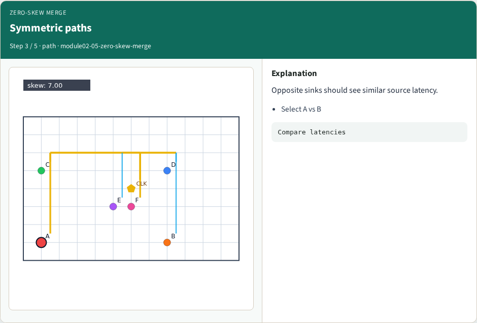
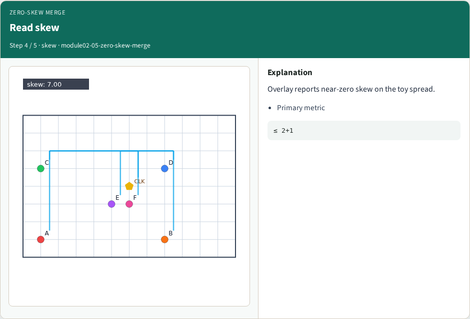
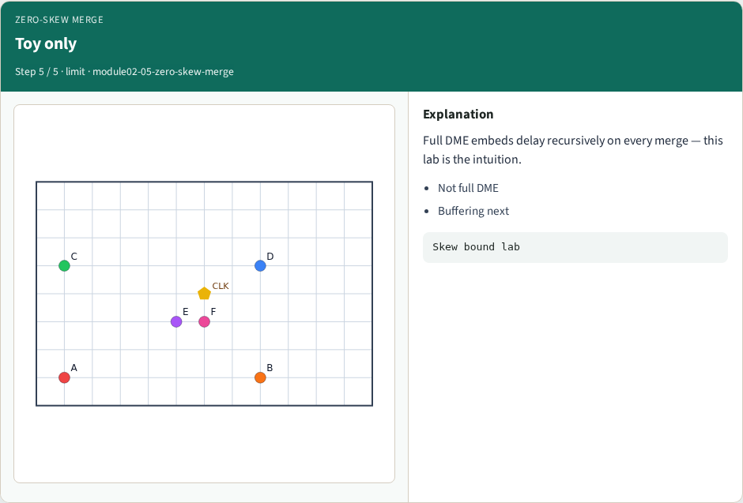
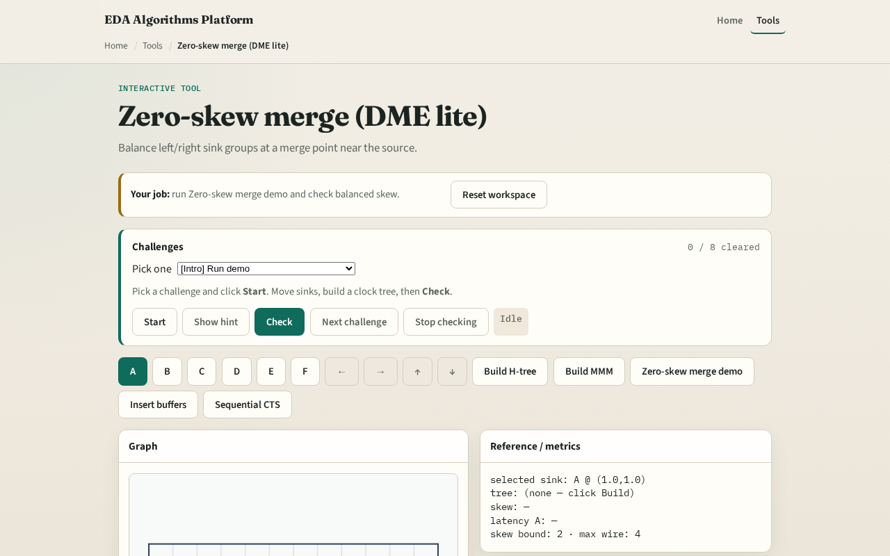

# Zero-skew merge

Deferred-merge embedding equalizes delay so opposite arms arrive together

---

## The idea
- Partition sinks left and right of the source
- Choose a meeting steiner so left radius plus wire matches right radius plus wire
- That is the zero-skew intuition

---

## DME lite

---

## Balanced meet

---

## Symmetric paths

---

## Read skew

---

## Toy only

---

## Browser lab track

---

## Implement track
- Call `zero_skew_merge(a,b,da,db)` for a 1D pair; run the browser demo for the full chip
- Assert |la−lb| ≈ 0 for equal da,db

---

## Pitfalls
- Balancing Euclidean radii
- Ignoring existing subtree delay da/db
- Expecting full industrial DME from this toy

---

## Your turn
- Next: tapping points where the tree forks

