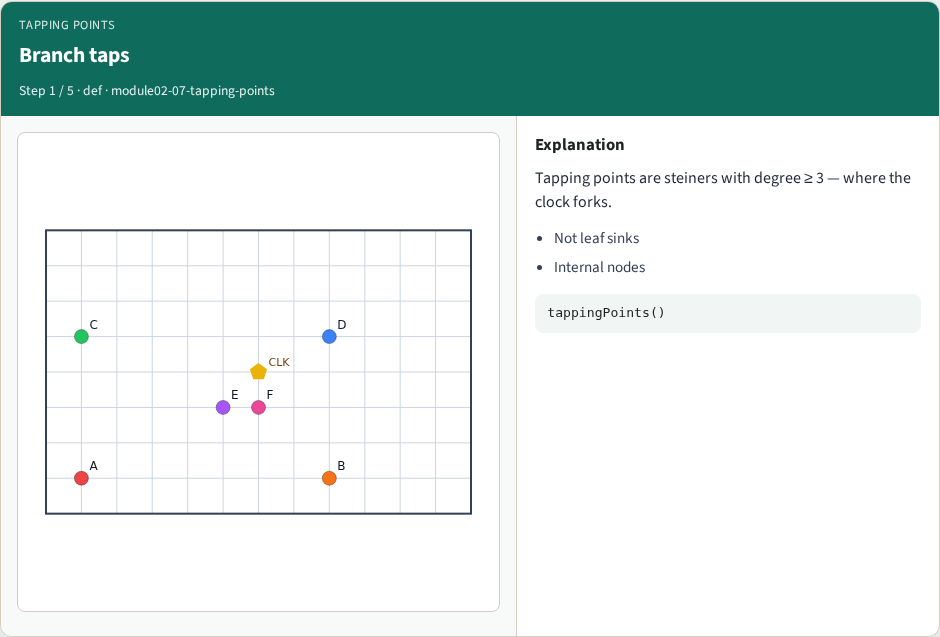
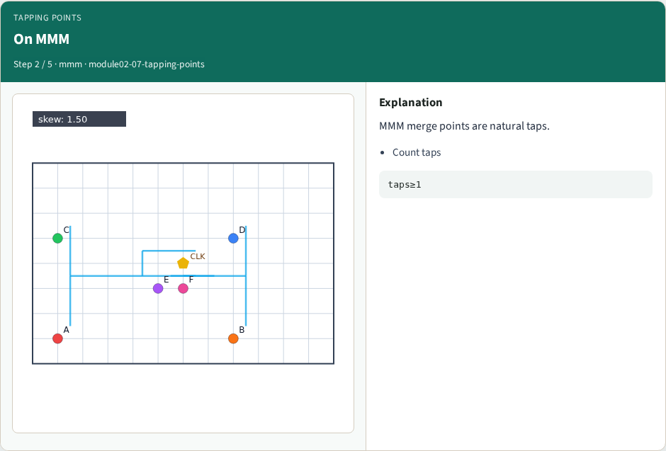
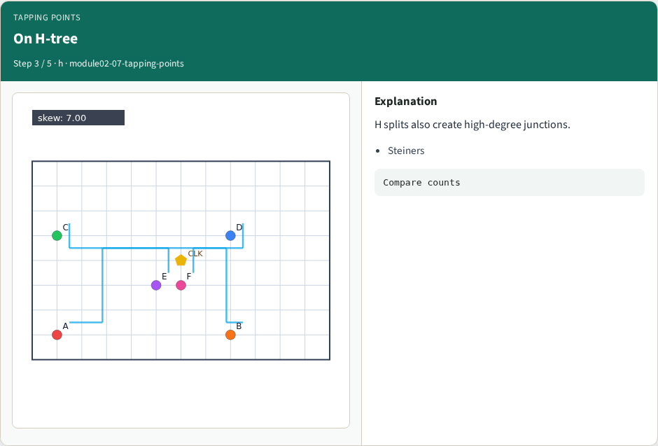
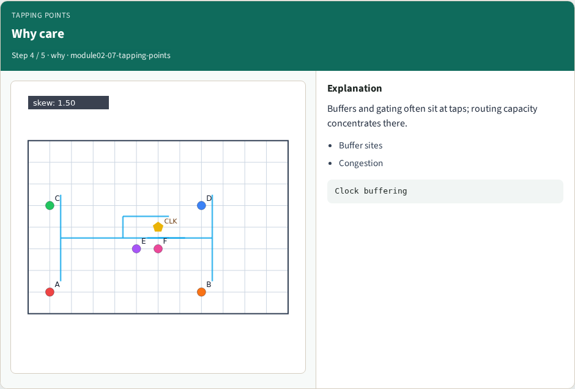
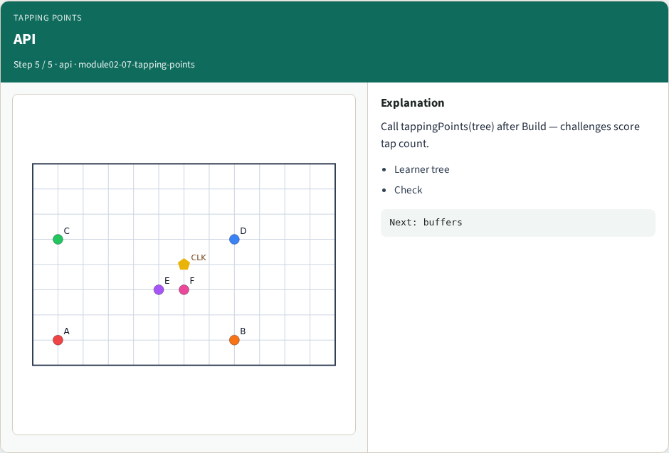
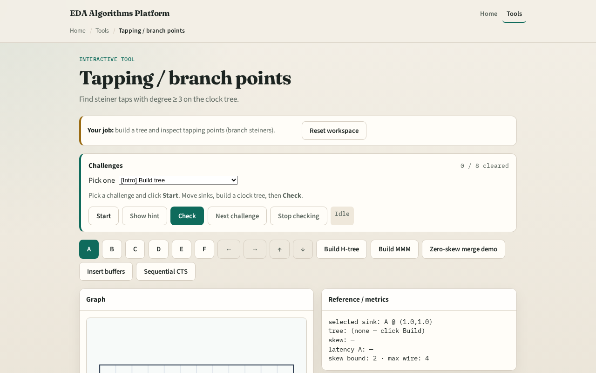

# Tapping / branch points

Buffers and clock gates often sit where the tree forks

---

## The idea
- Collect steiner and edge endpoints
- Keep points with degree at least three, those are tapping points

---

## Branch taps

---

## On MMM

---

## On H-tree

---

## Why care

---

## API

---

## Browser lab track

---

## Implement track
- Call `tapping_points(tree)` after `mmm_tree`
- Assert length ≥ 1 on tiny_cts

---

## Pitfalls
- Counting leaf sinks as taps
- Using degree on undirected edges inconsistently
- Dropping steiners before the degree pass

---

## Your turn
- Next: insert buffers on long wires

