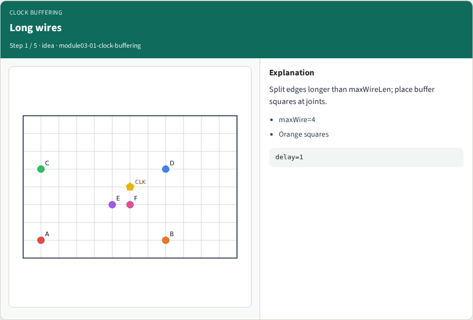
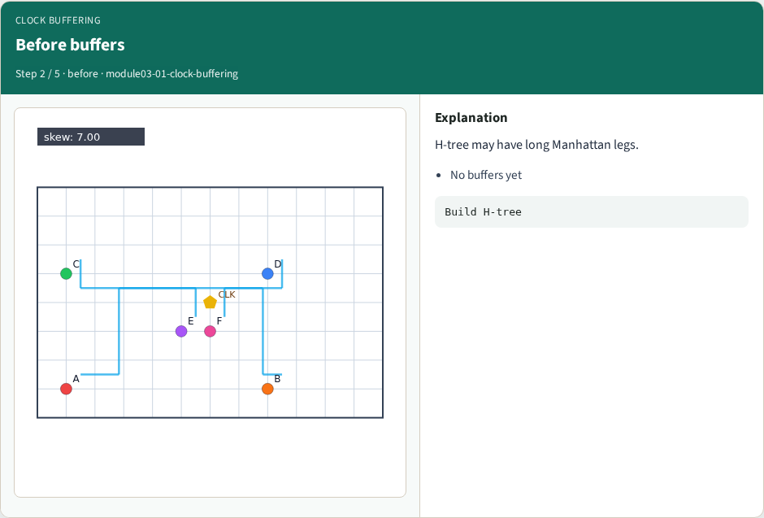
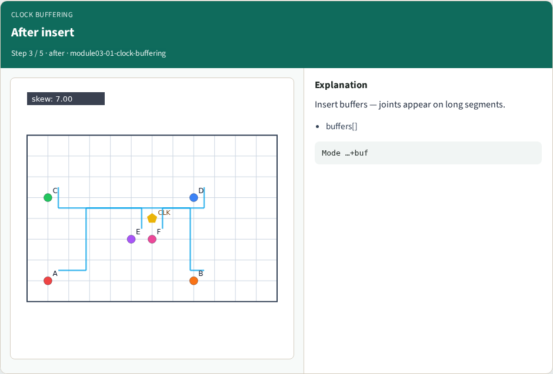
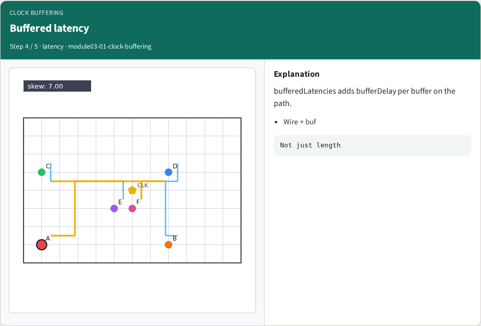
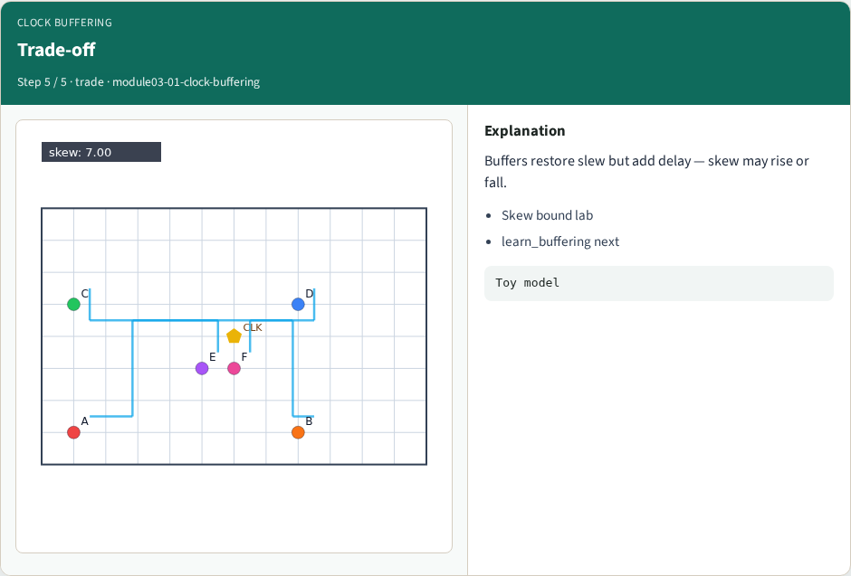
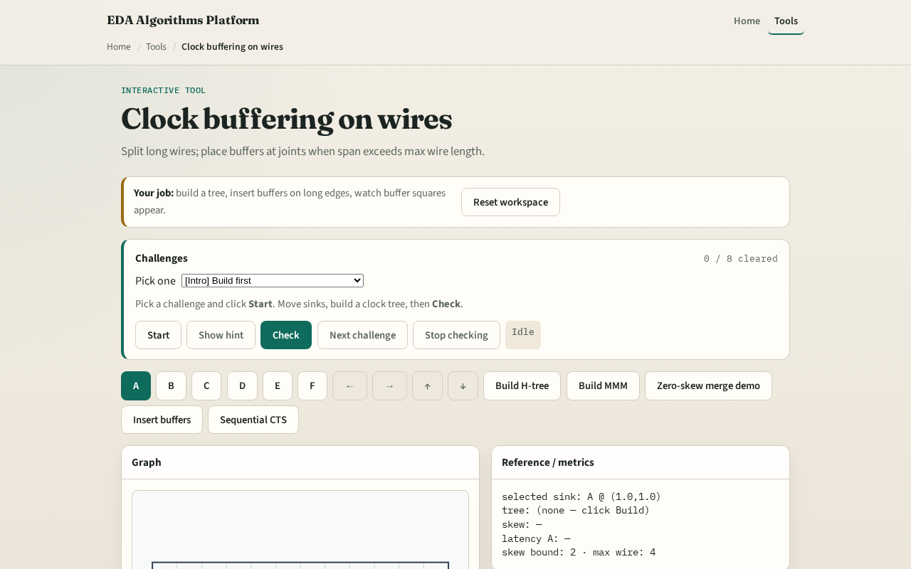

# Clock buffering on wires

Long wires lose slew; CTS inserts buffers along the tree

---

## The idea
- If an edge longer than maxWireLen
- Buffered latency adds bufferDelay per buffer on the path

---

## Long wires

---

## Before buffers

---

## After insert

---

## Buffered latency

---

## Trade-off

---

## Browser lab track

---

## Implement track
- Call `insert_buffers(edge, max_span, buffer_delay)`
- Assert max segment length ≤ max_span

---

## Pitfalls
- Buffering without splitting edges
- Counting buffer delay twice
- Using max span zero

---

## Your turn
- Next: meet a skew bound with buffers and topology choice

