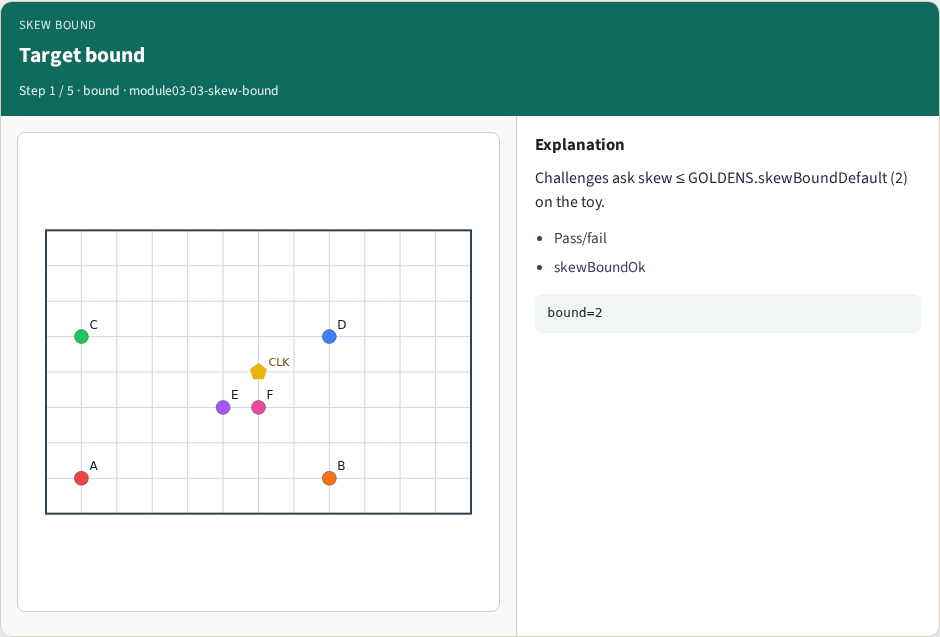
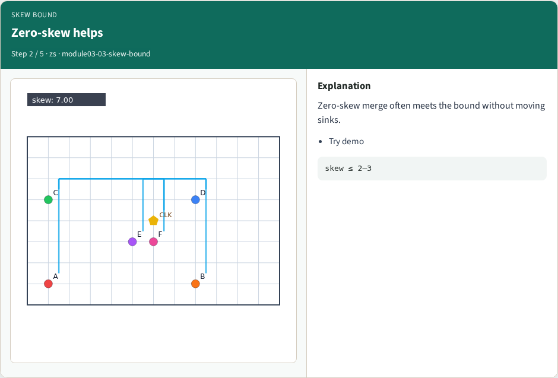
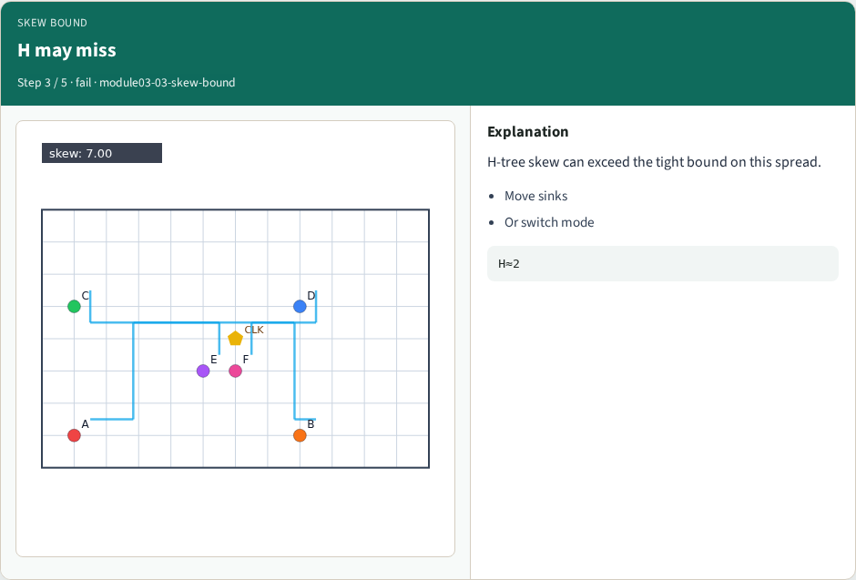
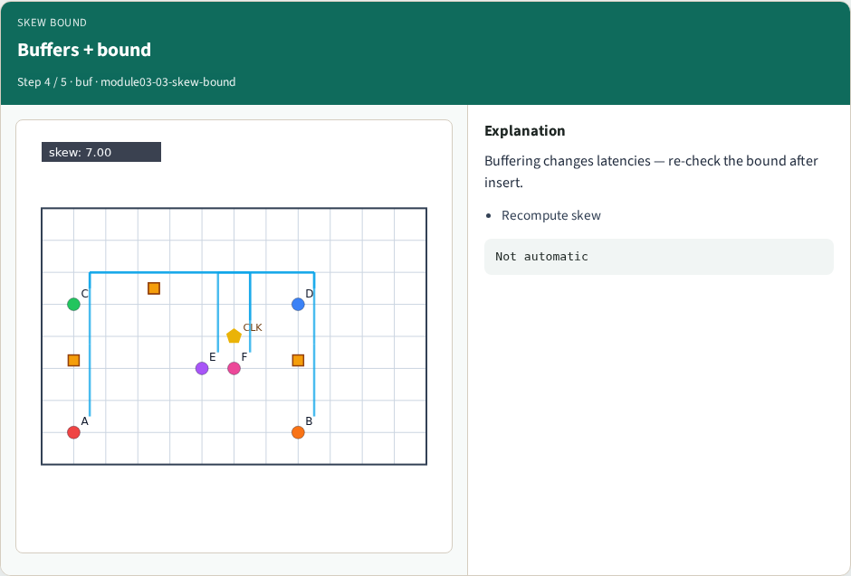
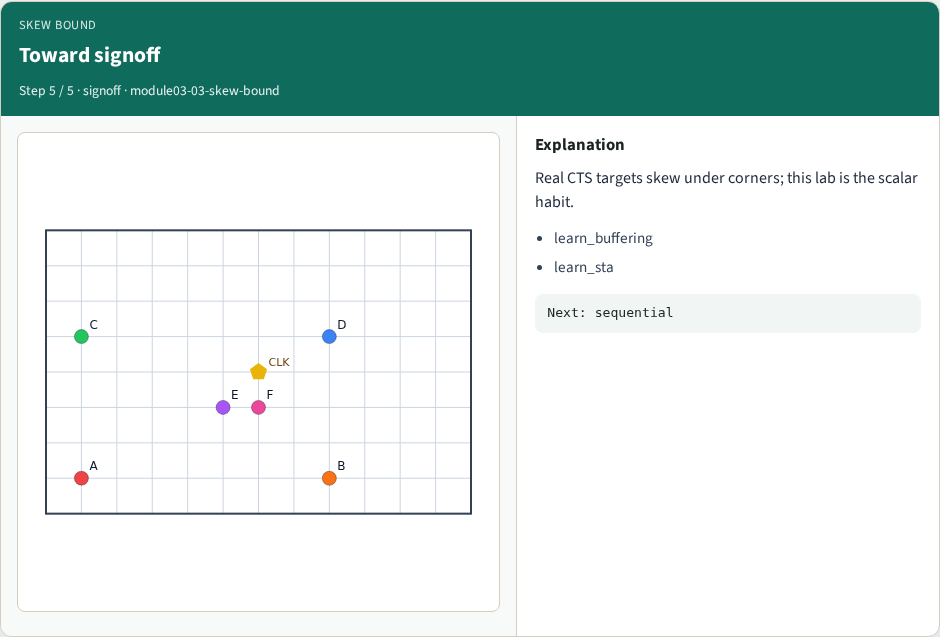
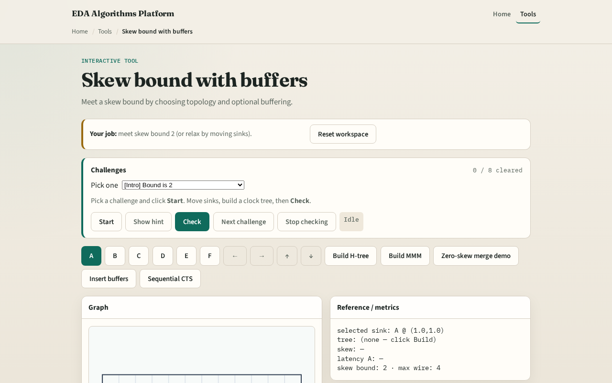

# Skew bound with buffers

Signoff asks: is skew under budget?

---

## The idea
- Skew_bound_ok is true when skew ≤ bound
- Zero-skew merge often meets bound two on the toy

---

## Target bound

---

## Zero-skew helps

---

## H may miss

---

## Buffers + bound

---

## Toward signoff

---

## Browser lab track

---

## Implement track
- Call `skew_bound_ok(latencies, bound)`
- Document GOLDENS.skewBoundDefault = 2

---

## Pitfalls
- Hard-coding pass without measuring
- Forgetting to rebuild after moving sinks
- Mixing buffered and unbuffered latencies

---

## Your turn
- Next: sequential CTS connecting sinks in order

