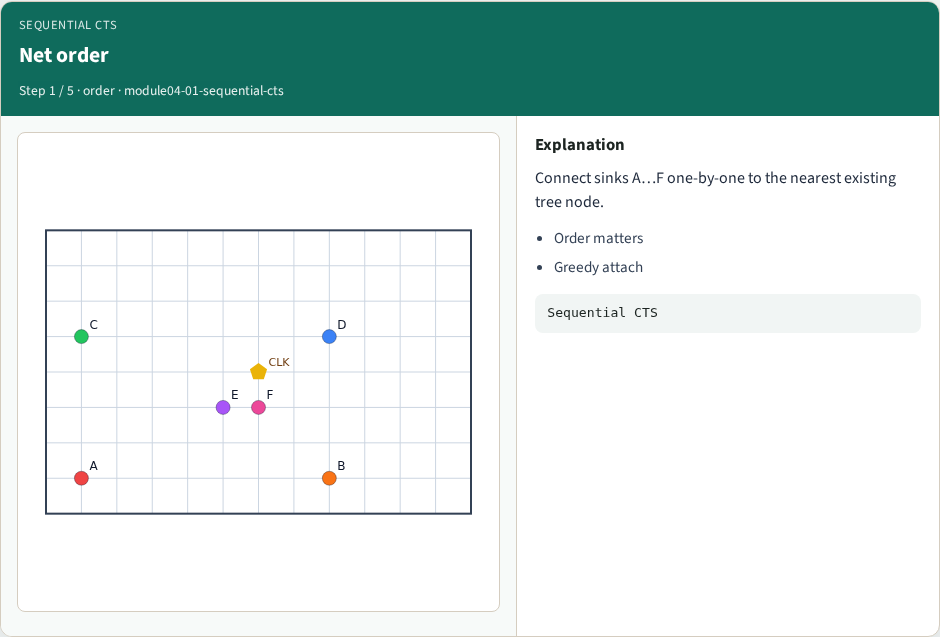
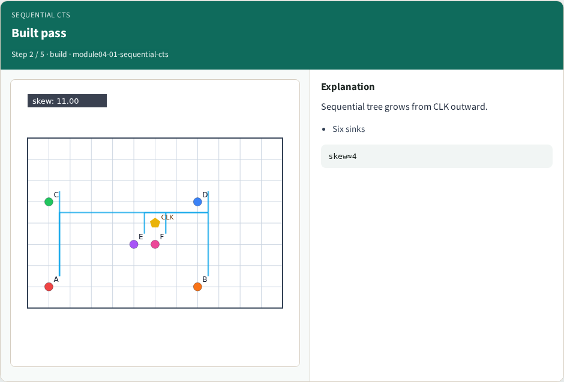
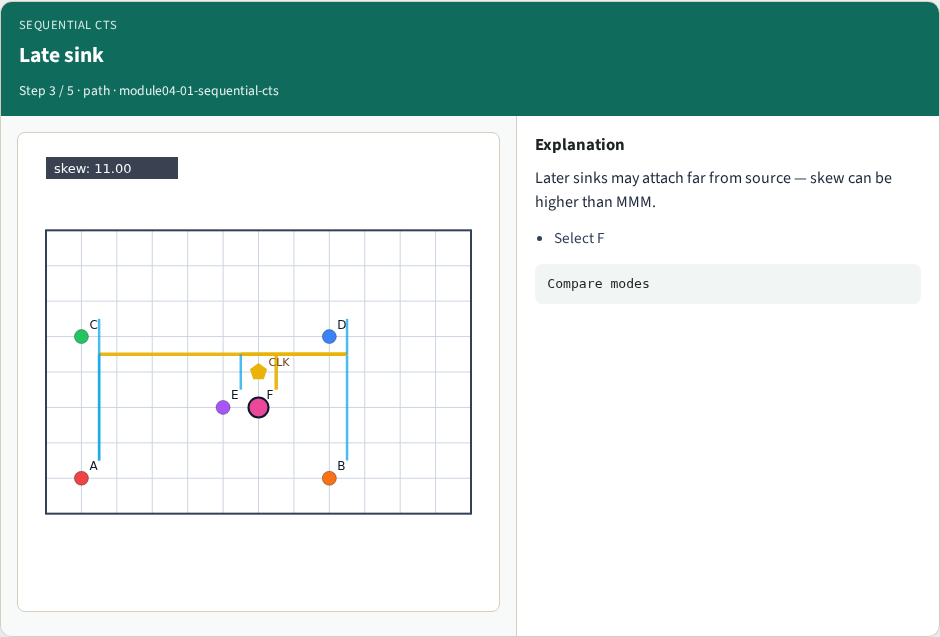
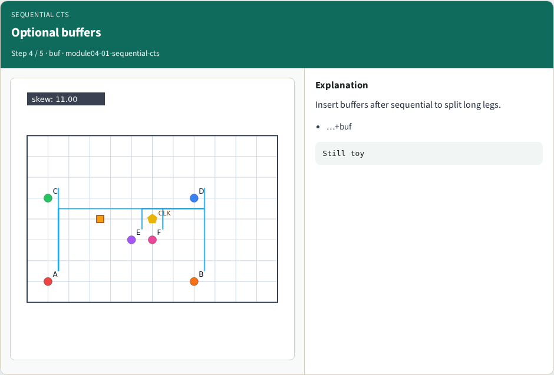
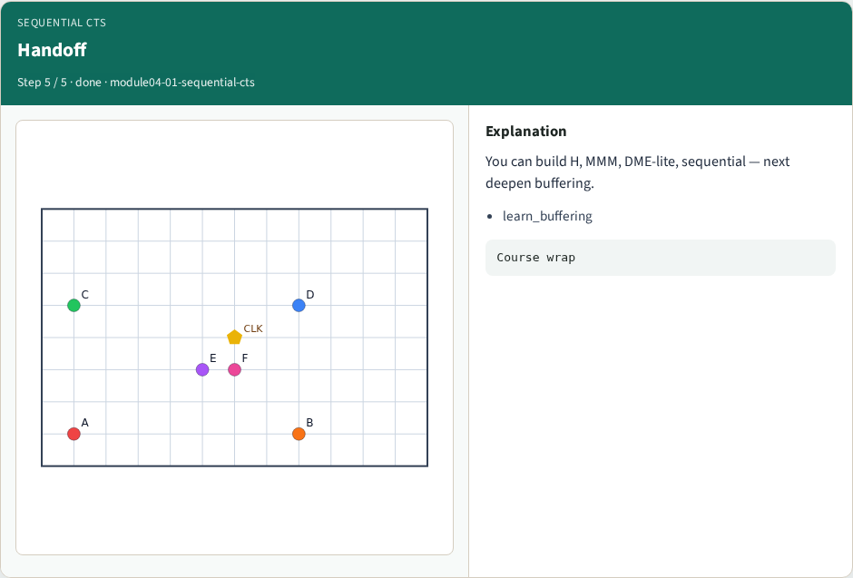

# Sequential CTS pass — step-by-step (for slides / transcript)

**Module:** `module04-01-sequential-cts`  
**Lab / algo:** `sequential-cts`  
**Viewer:** `/tools/algorithm-walkthrough/?algo=sequential-cts&step=1`

Use each **Caption** as spoken prose (or a shortened slide note).
Use **Bullets** on the PPT; pair with the PNG in `assets/steps/`.

## Step 1 — Net order



**Caption (transcript):** Connect sinks A…F one-by-one to the nearest existing tree node.

**Slide bullets:**

- Order matters
- Greedy attach

**On-screen metrics:**

```
Sequential CTS
```

## Step 2 — Built pass



**Caption (transcript):** Sequential tree grows from CLK outward.

**Slide bullets:**

- Six sinks

**On-screen metrics:**

```
skew≈4
```

## Step 3 — Late sink



**Caption (transcript):** Later sinks may attach far from source — skew can be higher than MMM.

**Slide bullets:**

- Select F

**On-screen metrics:**

```
Compare modes
```

## Step 4 — Optional buffers



**Caption (transcript):** Insert buffers after sequential to split long legs.

**Slide bullets:**

- …+buf

**On-screen metrics:**

```
Still toy
```

## Step 5 — Handoff



**Caption (transcript):** You can build H, MMM, DME-lite, sequential — next deepen buffering.

**Slide bullets:**

- learn_buffering

**On-screen metrics:**

```
Course wrap
```

