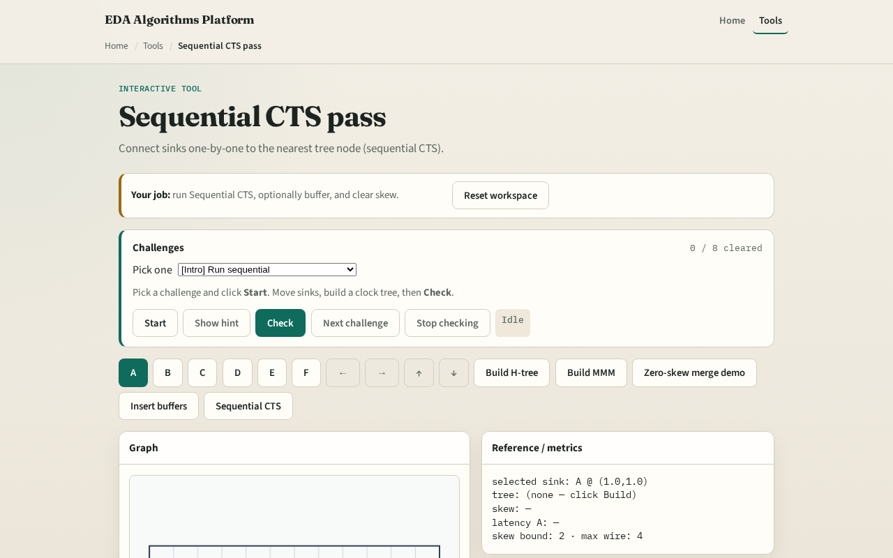

# Sequential CTS pass

Some flows grow the clock net in sink order, order changes skew

---

## The idea
- Start from the source
- For each sink in order A…F, attach an L-route to the nearest existing tree node
- Optional buffering splits long legs afterward

---

## Net order

---

## Built pass

---

## Late sink

---

## Optional buffers

---

## Handoff

---

## Browser lab track

---

## Implement track
- Call `sequential_cts(data
- Print skew

---

## Pitfalls
- Assuming order does not matter
- Attaching to sinks only, not steiners
- Skipping the source as the first node

---

## Your turn
- Next: offline benchmark compare, then wrap

