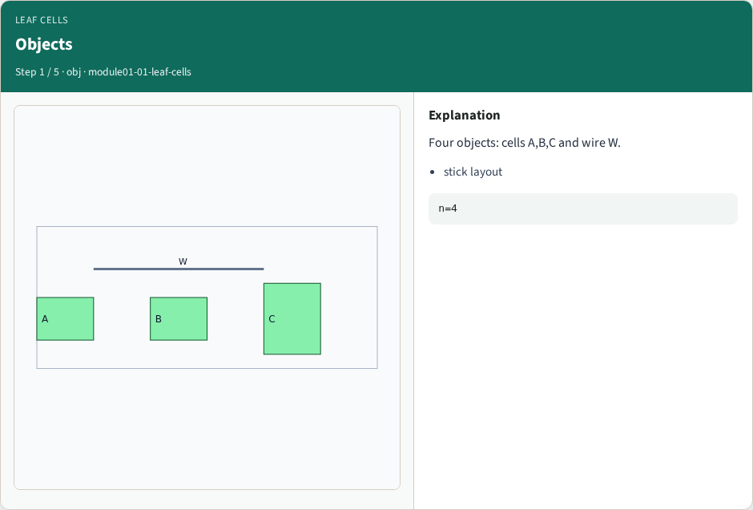
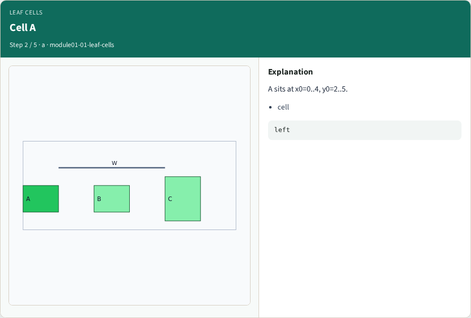
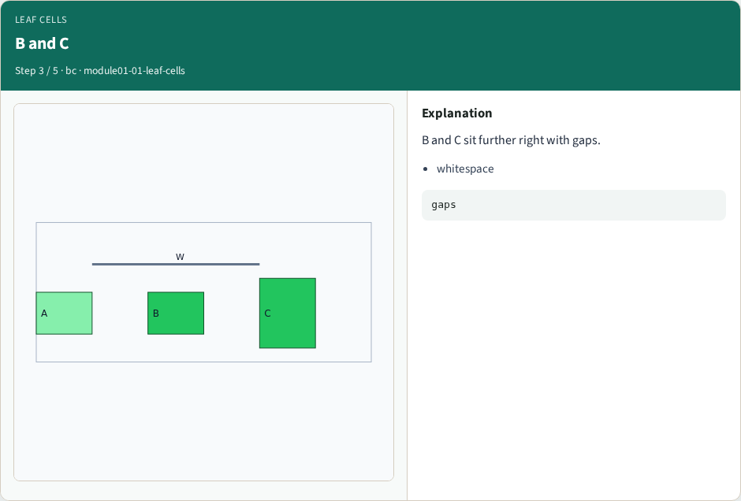
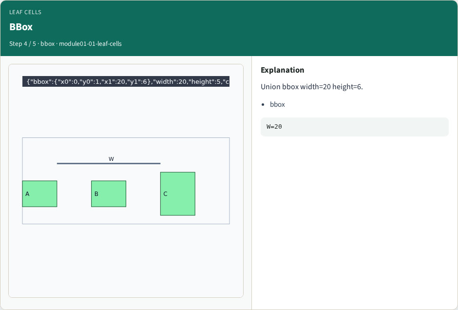
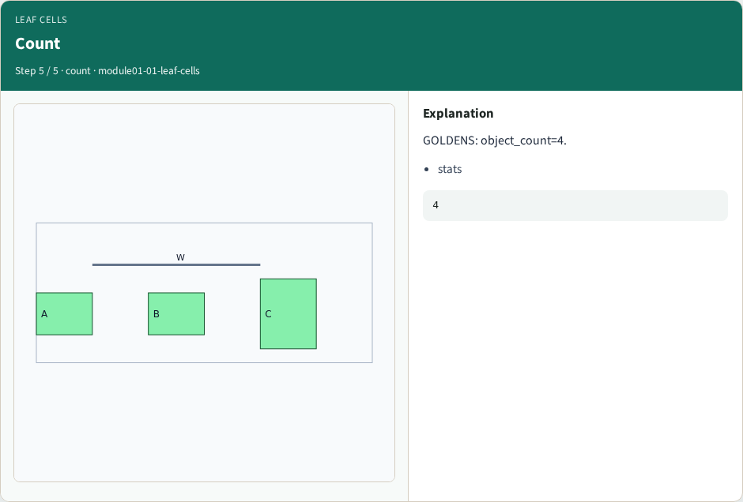

# Leaf cells and bounding boxes — step-by-step (for slides / transcript)

**Module:** `module01-01-leaf-cells`  
**Lab / algo:** `leaf-cells`  
**Viewer:** `/tools/algorithm-walkthrough/?algo=leaf-cells&step=1`

Use each **Caption** as spoken prose (or a shortened slide note).
Use **Bullets** on the PPT; pair with the PNG in `assets/steps/`.

## Step 1 — Objects



**Caption (transcript):** Four objects: cells A,B,C and wire W.

**Slide bullets:**

- stick layout

**On-screen metrics:**

```
n=4
```

## Step 2 — Cell A



**Caption (transcript):** A sits at x0=0..4, y0=2..5.

**Slide bullets:**

- cell

**On-screen metrics:**

```
left
```

## Step 3 — B and C



**Caption (transcript):** B and C sit further right with gaps.

**Slide bullets:**

- whitespace

**On-screen metrics:**

```
gaps
```

## Step 4 — BBox



**Caption (transcript):** Union bbox width=20 height=6.

**Slide bullets:**

- bbox

**On-screen metrics:**

```
W=20
```

## Step 5 — Count



**Caption (transcript):** GOLDENS: object_count=4.

**Slide bullets:**

- stats

**On-screen metrics:**

```
4
```

