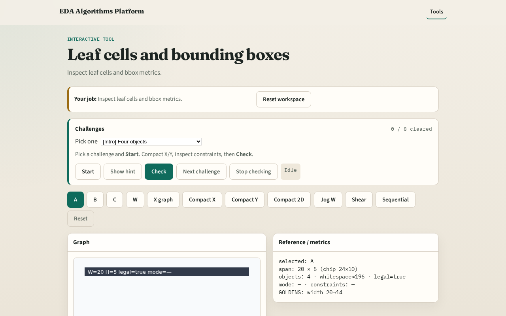

# Leaf cells

Compaction starts from leaf geometries , cells and wires with axis-aligned boxes

---

## The idea
- A,B,C are cells; W is a horizontal wire
- GOLDEN: 4 objects, bbox width 20, height 6

---

## Objects

---

## Cell A

---

## B and C

---

## BBox

---

## Count

---

## Browser lab track

---

## Implement track
- Call layout_stats; assert object_count==4 and width==20

---

## Pitfalls
- Treating wire as a cell
- Confusing chip size with bbox

---

## Your turn
- Next: spacing / gap rules

