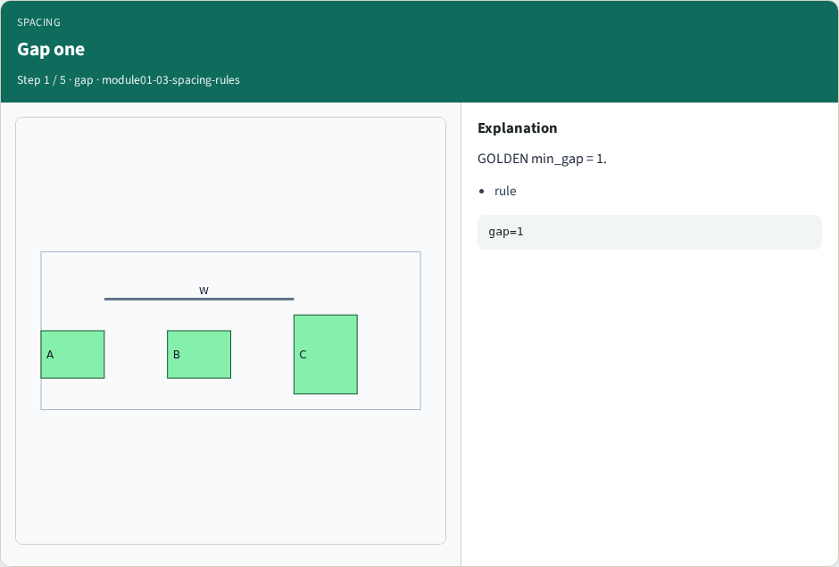
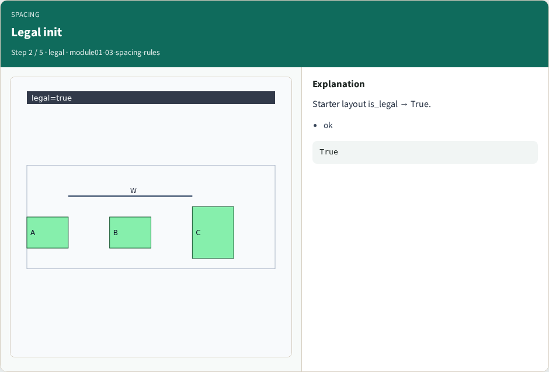
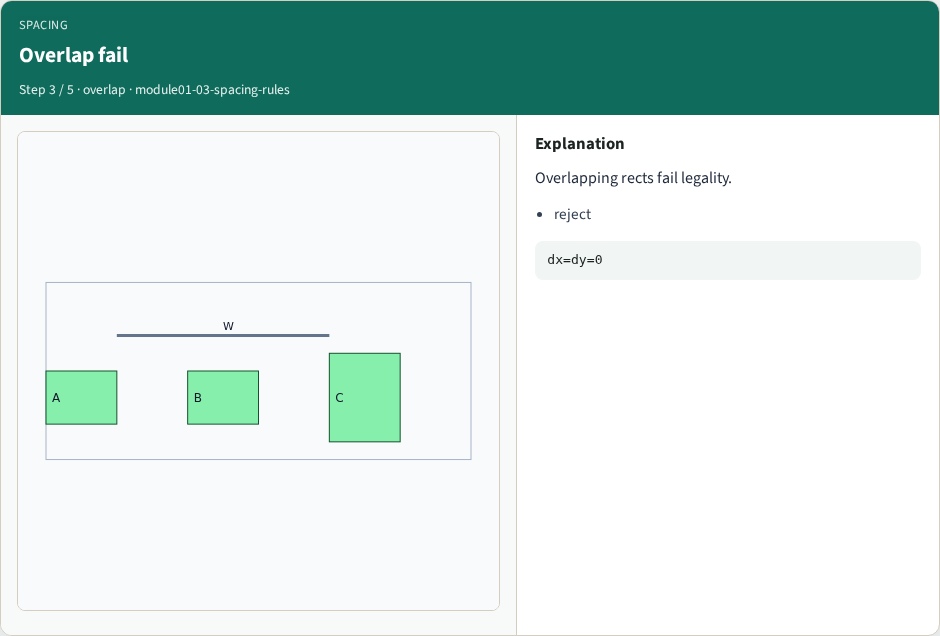
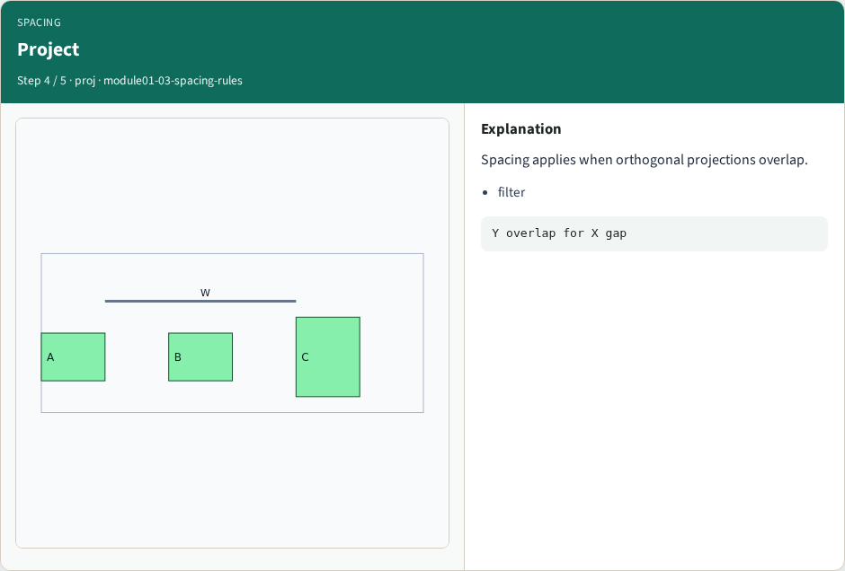
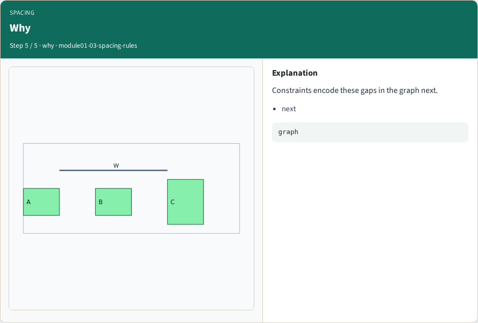

# Spacing / gap rules — step-by-step (for slides / transcript)

**Module:** `module01-03-spacing-rules`  
**Lab / algo:** `spacing-rules`  
**Viewer:** `/tools/algorithm-walkthrough/?algo=spacing-rules&step=1`

Use each **Caption** as spoken prose (or a shortened slide note).
Use **Bullets** on the PPT; pair with the PNG in `assets/steps/`.

## Step 1 — Gap one



**Caption (transcript):** GOLDEN min_gap = 1.

**Slide bullets:**

- rule

**On-screen metrics:**

```
gap=1
```

## Step 2 — Legal init



**Caption (transcript):** Starter layout is_legal → True.

**Slide bullets:**

- ok

**On-screen metrics:**

```
True
```

## Step 3 — Overlap fail



**Caption (transcript):** Overlapping rects fail legality.

**Slide bullets:**

- reject

**On-screen metrics:**

```
dx=dy=0
```

## Step 4 — Project



**Caption (transcript):** Spacing applies when orthogonal projections overlap.

**Slide bullets:**

- filter

**On-screen metrics:**

```
Y overlap for X gap
```

## Step 5 — Why



**Caption (transcript):** Constraints encode these gaps in the graph next.

**Slide bullets:**

- next

**On-screen metrics:**

```
graph
```

