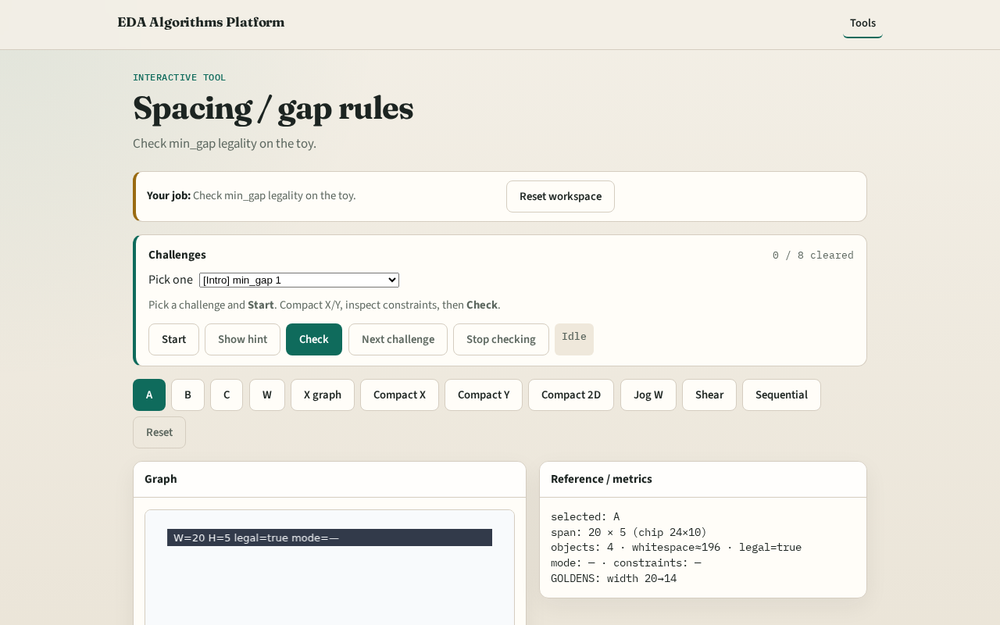

# Spacing

Design rules demand a minimum gap between adjacent shapes that project on an axis

---

## The idea
- Min_gap=1 on the toy
- Initial layout is legal; illegal if two cells overlap or gap < 1

---

## Gap one

---

## Legal init

---

## Overlap fail

---

## Project

---

## Why

---

## Browser lab track

---

## Implement track
- Call is_legal(DATA); assert True
- Print min_gap

---

## Pitfalls
- Applying gap without projection overlap
- Ignoring wires wrongly as cells

---

## Your turn
- Next: the constraint graph

