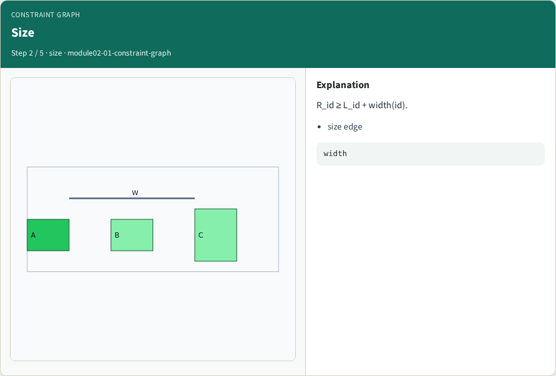
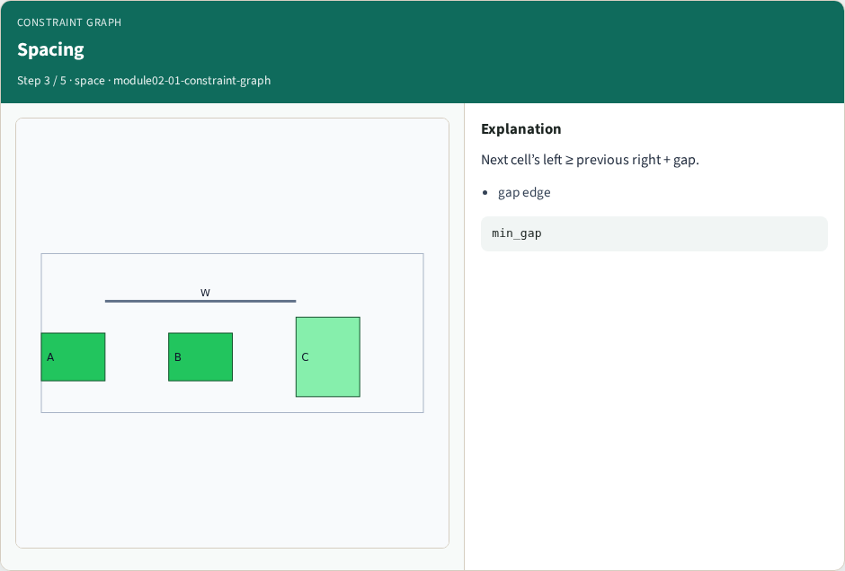
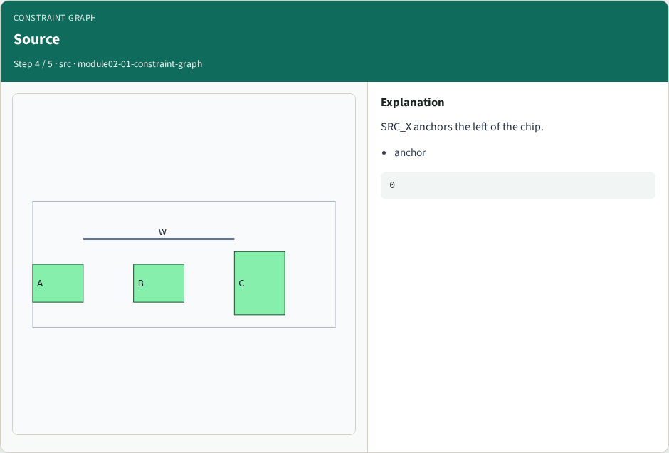
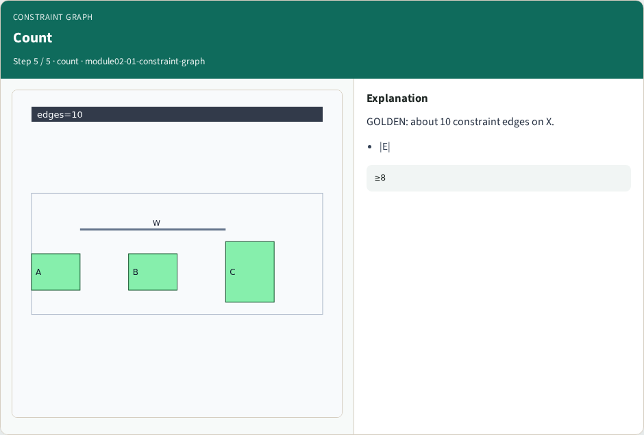

# Constraint graph — step-by-step (for slides / transcript)

**Module:** `module02-01-constraint-graph`  
**Lab / algo:** `constraint-graph`  
**Viewer:** `/tools/algorithm-walkthrough/?algo=constraint-graph&step=1`

Use each **Caption** as spoken prose (or a shortened slide note).
Use **Bullets** on the PPT; pair with the PNG in `assets/steps/`.

## Step 1 — Nodes


**Caption (transcript):** Left/right edge nodes per object.

**Slide bullets:**

- L_/R_

**On-screen metrics:**

```
vars
```

## Step 2 — Size



**Caption (transcript):** R_id ≥ L_id + width(id).

**Slide bullets:**

- size edge

**On-screen metrics:**

```
width
```

## Step 3 — Spacing



**Caption (transcript):** Next cell’s left ≥ previous right + gap.

**Slide bullets:**

- gap edge

**On-screen metrics:**

```
min_gap
```

## Step 4 — Source



**Caption (transcript):** SRC_X anchors the left of the chip.

**Slide bullets:**

- anchor

**On-screen metrics:**

```
0
```

## Step 5 — Count



**Caption (transcript):** GOLDEN: about 10 constraint edges on X.

**Slide bullets:**

- |E|

**On-screen metrics:**

```
≥8
```

