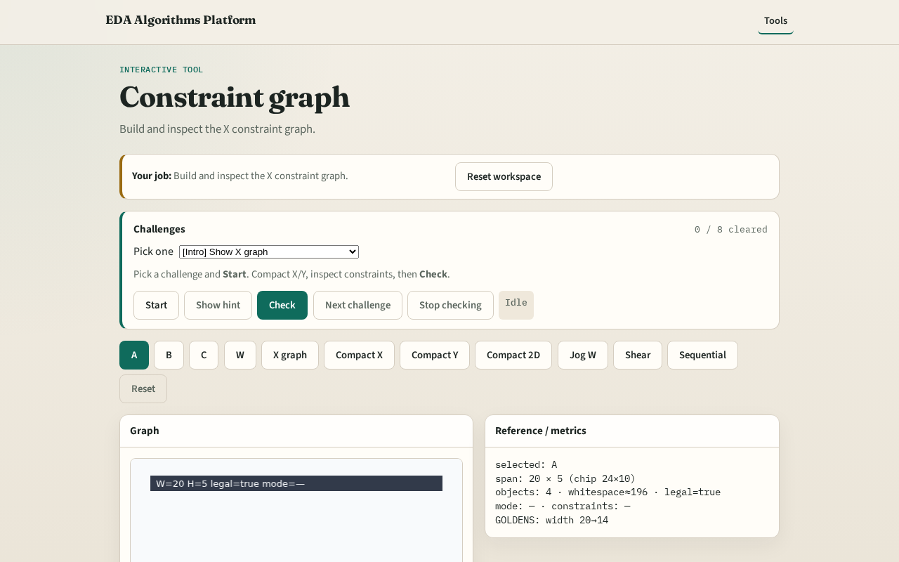

# Constraint graph

**Module id:** module02-01-constraint-graph
**Lab:** constraint-graph
**Tracks:** A (implement) · B (browser lab)

## Slide 1 — Constraints

Compaction models geometry as a directed constraint graph.

## Slide 2 — The idea

Nodes L_A,R_A,…; size edges R≥L+width; spacing edges L_right ≥ R_left + gap. GOLDEN ~10 X edges.

<!-- algorithm-walkthrough -->

## Slide 3 — Nodes

Left/right edge nodes per object.

## Slide 4 — Size

R_id ≥ L_id + width(id).

## Slide 5 — Spacing

Next cell’s left ≥ previous right + gap.

## Slide 6 — Source

SRC_X anchors the left of the chip.

## Slide 7 — Count

GOLDEN: about 10 constraint edges on X.

<!-- /algorithm-walkthrough -->

## Slide 8 — Browser lab track

Open **constraint-graph**. Inspect X graph node/edge counts.

## Slide 9 — Implement track

Call build_constraint_graph(DATA,'x'); print len(edges).

## Slide 10 — Pitfalls

Forgetting size edges. Mixing X and Y nodes.

## Slide 11 — Your turn

Next: longest-path placement.
