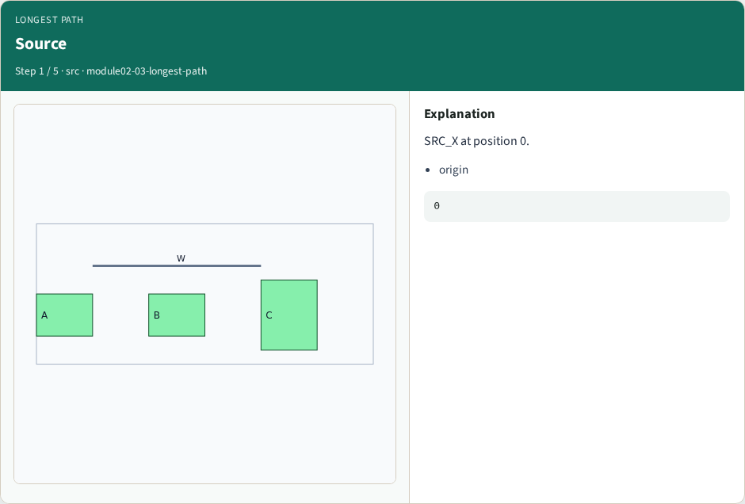
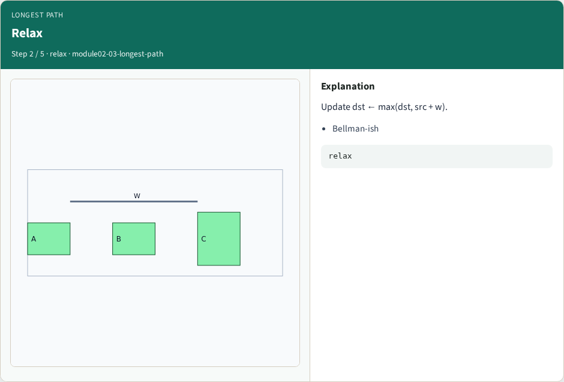
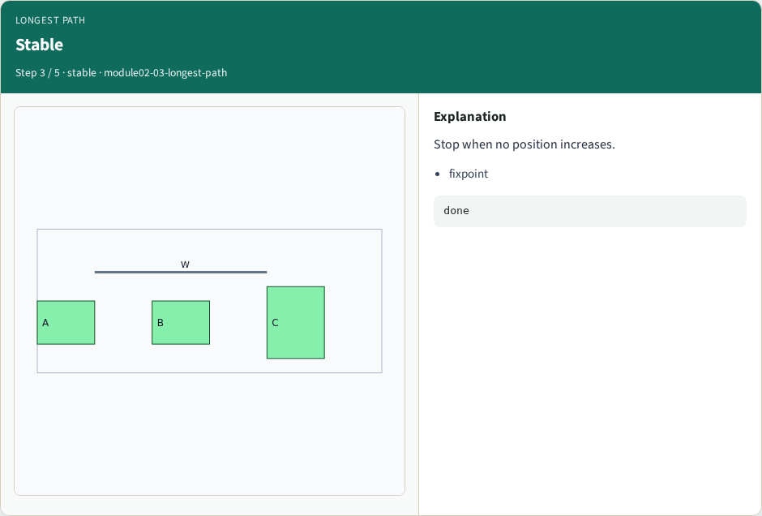
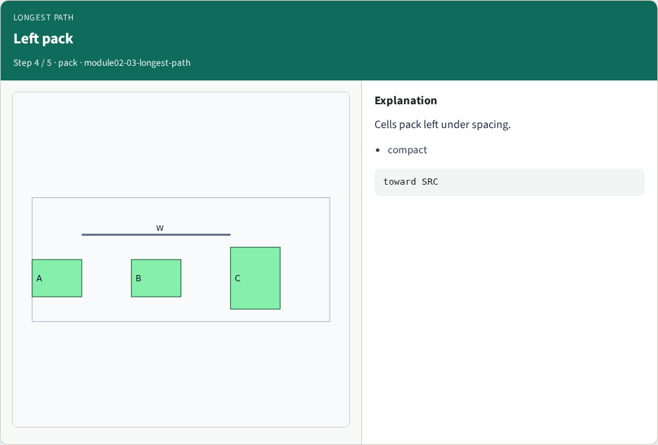
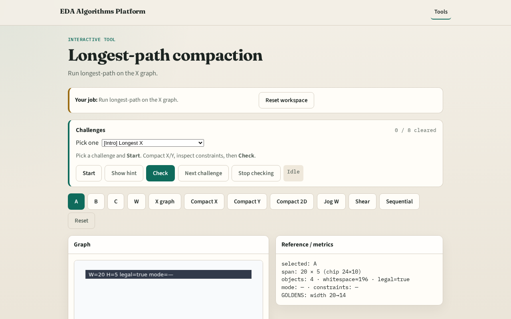

# Longest-path compaction

**Module id:** module02-03-longest-path
**Lab:** longest-path
**Tracks:** A (implement) · B (browser lab)

## Slide 1 — Longest path

Classic 1-D compaction sets each variable to the longest path from the source.

## Slide 2 — The idea

Relax edges until positions stabilize; left edges pull rightward to minimum legal places.

<!-- algorithm-walkthrough -->

## Slide 3 — Source

SRC_X at position 0.

## Slide 4 — Relax

Update dst ← max(dst, src + w).

## Slide 5 — Stable

Stop when no position increases.

## Slide 6 — Left pack

Cells pack left under spacing.

## Slide 7 — Ready

Positions feed compact_1d next.

<!-- /algorithm-walkthrough -->

## Slide 8 — Browser lab track

Open **longest-path**. Run longest-path on the X graph.

## Slide 9 — Implement track

Call longest_path_compact(build_constraint_graph(...)).

## Slide 10 — Pitfalls

Using shortest-path instead. Not iterating to fixpoint.

## Slide 11 — Your turn

Next: apply 1-D compaction.
