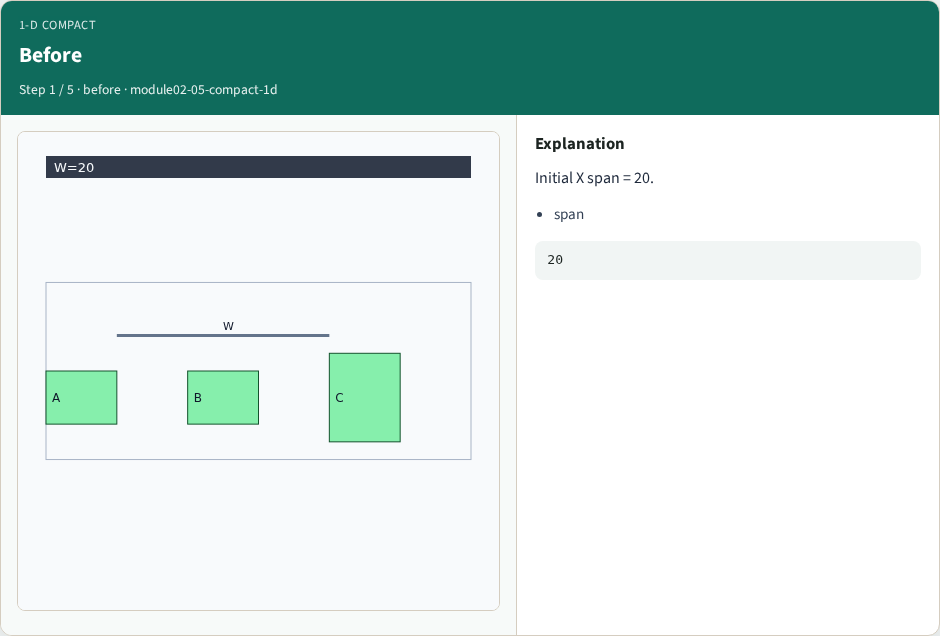
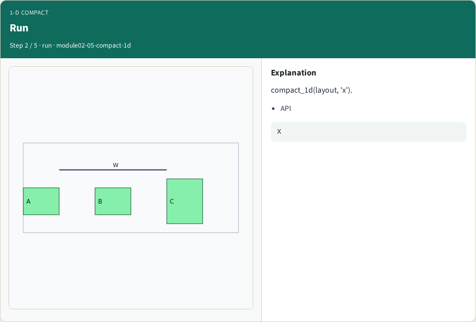
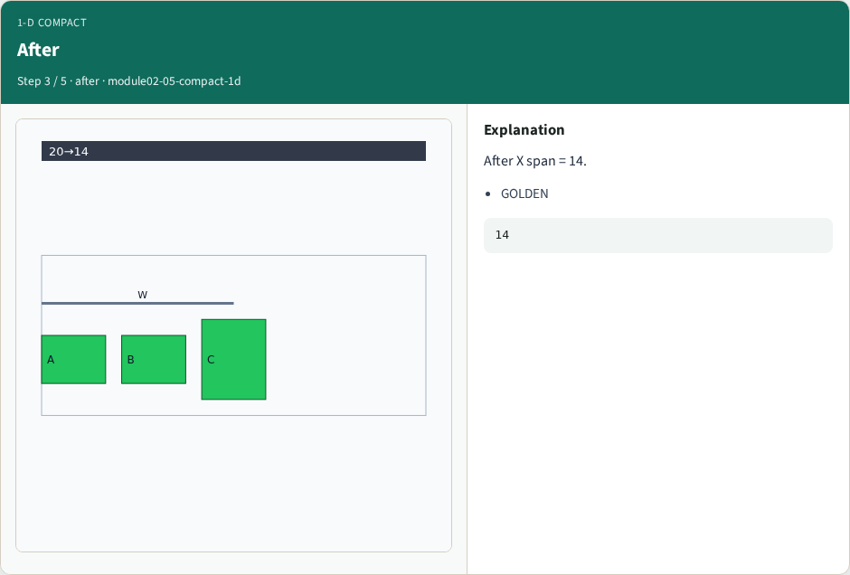
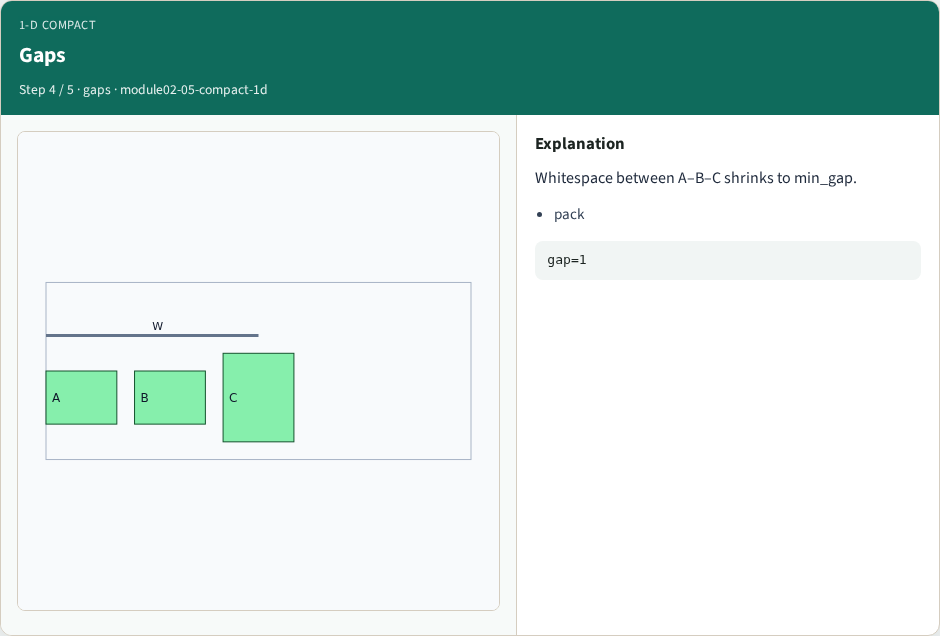
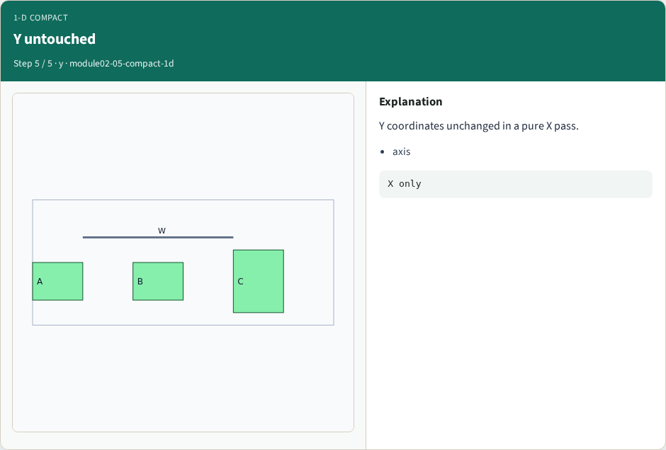
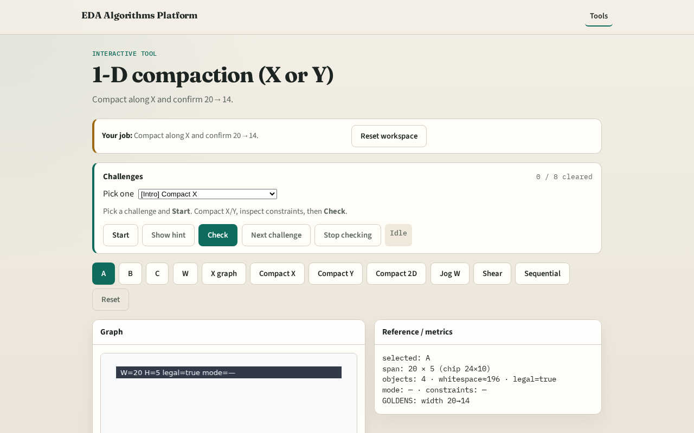

# 1-D compaction (X or Y)

**Module id:** module02-05-compact-1d
**Lab:** compact-1d
**Tracks:** A (implement) · B (browser lab)

## Slide 1 — 1-D compact

One axis at a time: build graph, longest-path, rewrite coordinates.

## Slide 2 — The idea

GOLDEN: X compaction before_span=20, after_span=14, improved=True.

<!-- algorithm-walkthrough -->

## Slide 3 — Before

Initial X span = 20.

## Slide 4 — Run

compact_1d(layout, 'x').

## Slide 5 — After

After X span = 14.

## Slide 6 — Gaps

Whitespace between A–B–C shrinks to min_gap.

## Slide 7 — Y untouched

Y coordinates unchanged in a pure X pass.

<!-- /algorithm-walkthrough -->

## Slide 8 — Browser lab track

Open **compact-1d**. Click Compact X; confirm 20→14.

## Slide 9 — Implement track

Call compact_1d(DATA,'x'); assert after_span==14.

## Slide 10 — Pitfalls

Expecting Y to change. Ignoring improved flag.

## Slide 11 — Your turn

Next: 2-D compaction.
