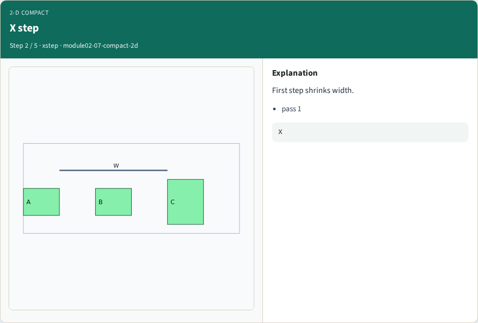
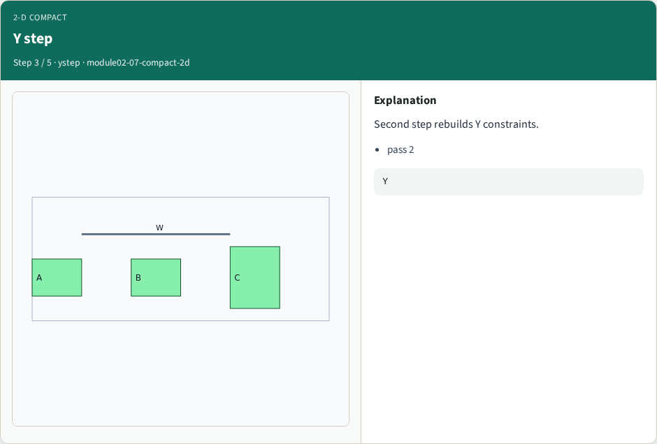
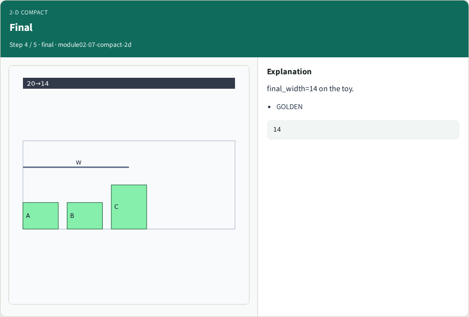
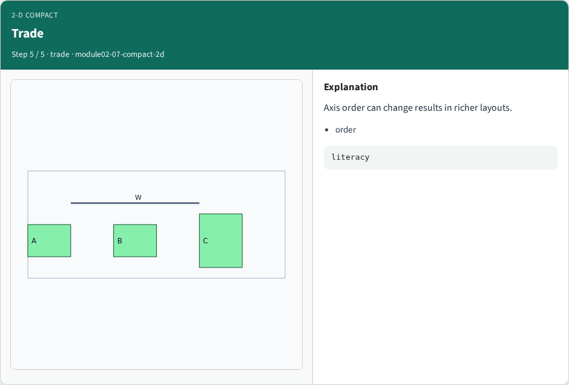
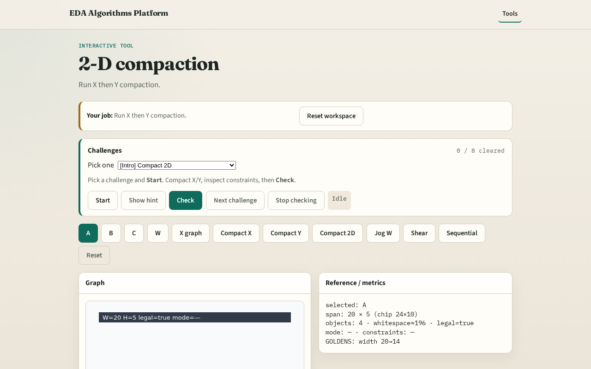

# 2-D compact

2-D compaction usually alternates axes (X then Y on the toy)

---

## The idea
- GOLDEN: initial 20×6 → final width 14 (height may shift slightly with projections)

---

## Order

---

## X step

---

## Y step

---

## Final

---

## Trade

---

## Browser lab track

---

## Implement track
- Call compact_2d(DATA); assert final_width==14

---

## Pitfalls
- Assuming one axis is enough
- Ignoring order sensitivity

---

## Your turn
- Next: wire jogs

