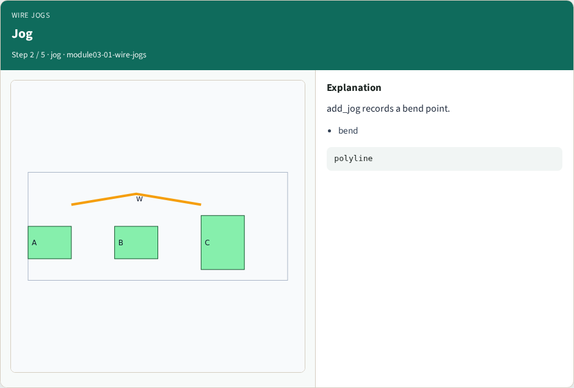
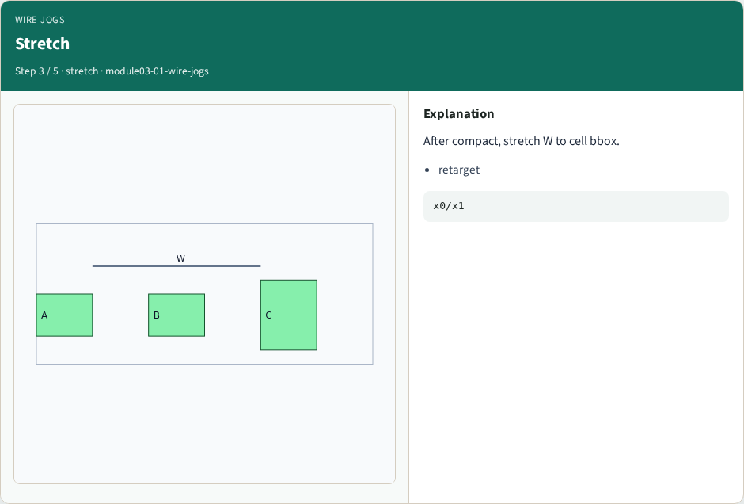
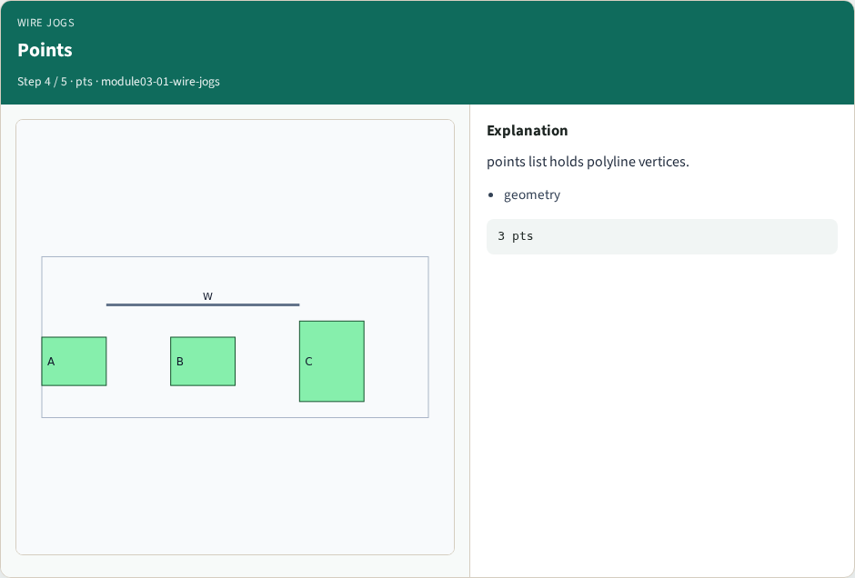
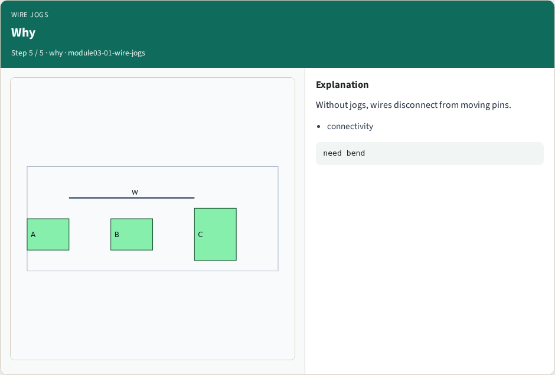
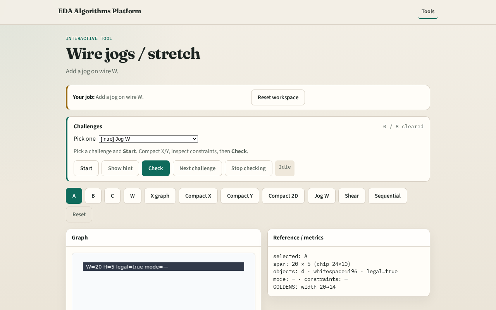

# Wire jogs

Wires must bend or stretch when cells move during compaction

---

## The idea
- Add_jog inserts a bend; stretch_wire_to_bbox retargets a horizontal wire to the cell union

---

## Wire W

---

## Jog

---

## Stretch

---

## Points

---

## Why

---

## Browser lab track

---

## Implement track
- Call add_jog on W; stretch_wire_to_bbox after compact_1d

---

## Pitfalls
- Deleting the wire
- Stretching without updating y

---

## Your turn
- Next: shear lite

