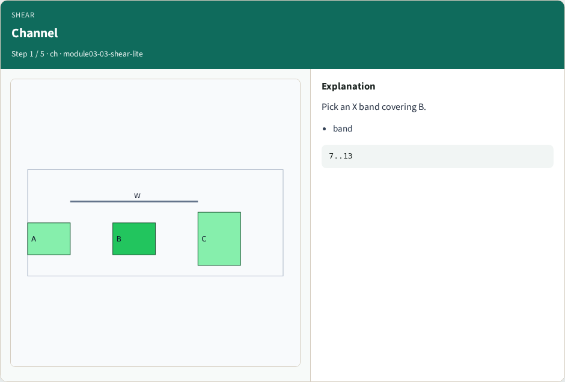
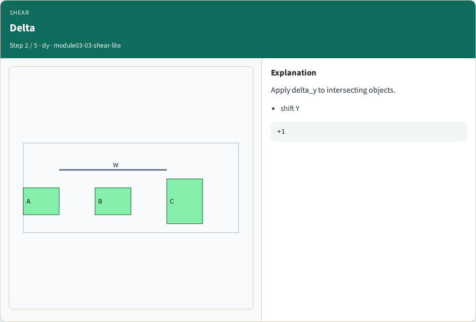
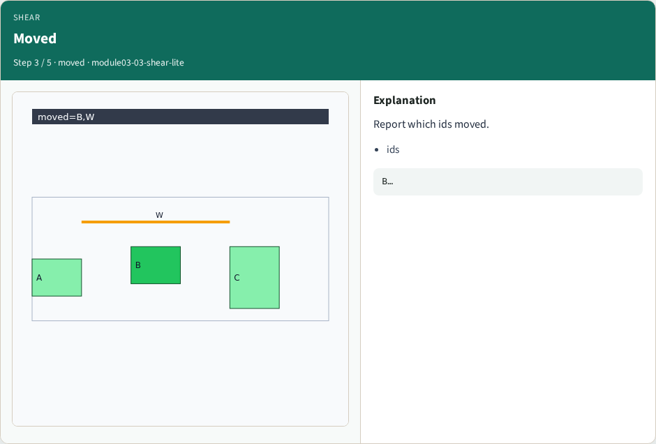
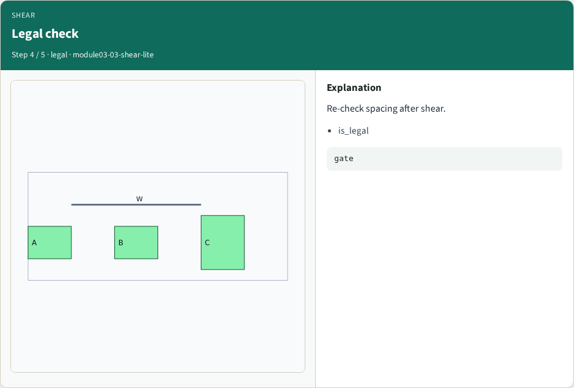
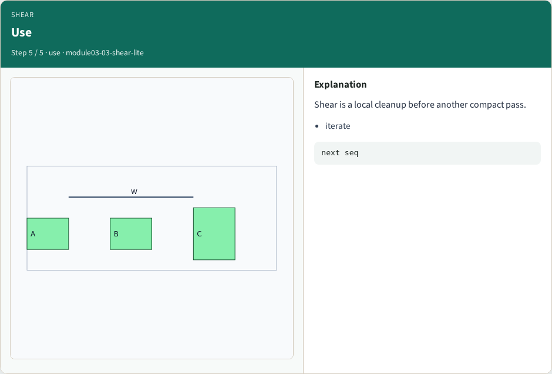
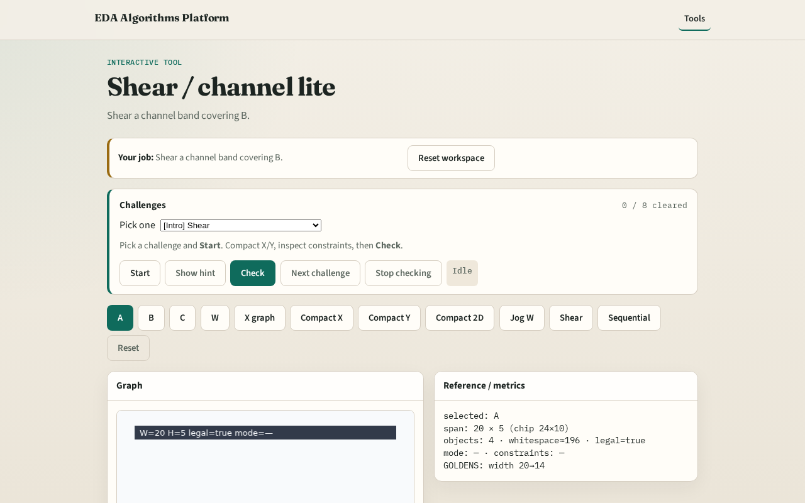

# Shear / channel lite

**Module id:** module03-03-shear-lite
**Lab:** shear-lite
**Tracks:** A (implement) · B (browser lab)

## Slide 1 — Shear

Shear slides a channel to open or close space without full recompaction.

## Slide 2 — The idea

shear_channel_lite(x_lo,x_hi,delta_y) moves objects intersecting the band.

<!-- algorithm-walkthrough -->

## Slide 3 — Channel

Pick an X band covering B.

## Slide 4 — Delta

Apply delta_y to intersecting objects.

## Slide 5 — Moved

Report which ids moved.

## Slide 6 — Legal check

Re-check spacing after shear.

## Slide 7 — Use

Shear is a local cleanup before another compact pass.

<!-- /algorithm-walkthrough -->

## Slide 8 — Browser lab track

Open **shear-lite**. Shear a band; inspect moved ids.

## Slide 9 — Implement track

Call shear_channel_lite(DATA, 7, 13, 1); print moved.

## Slide 10 — Pitfalls

Shearing the whole chip blindly. Skipping legality after shear.

## Slide 11 — Your turn

Next: sequential compact pipeline.
