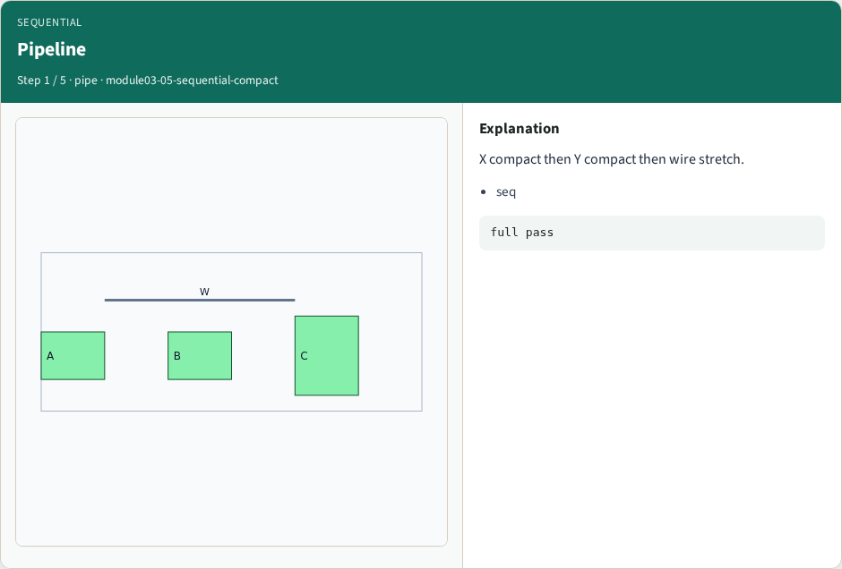
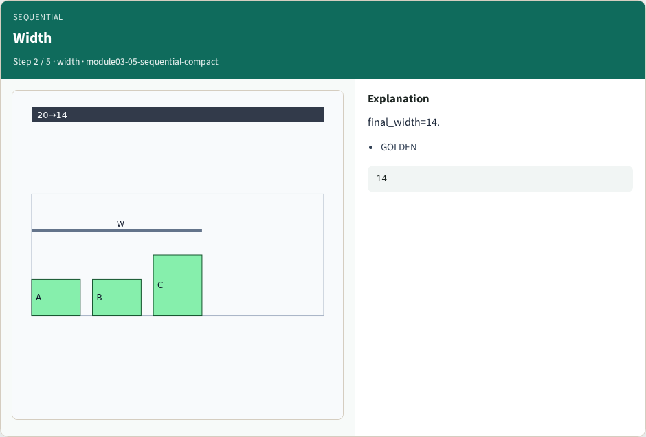
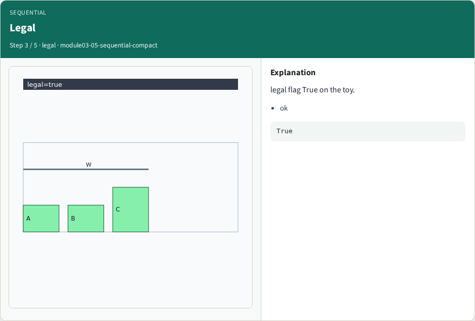
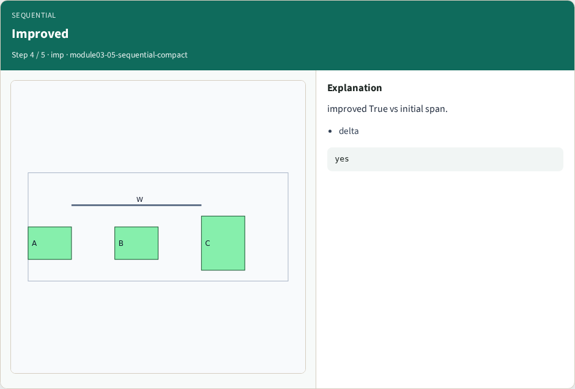
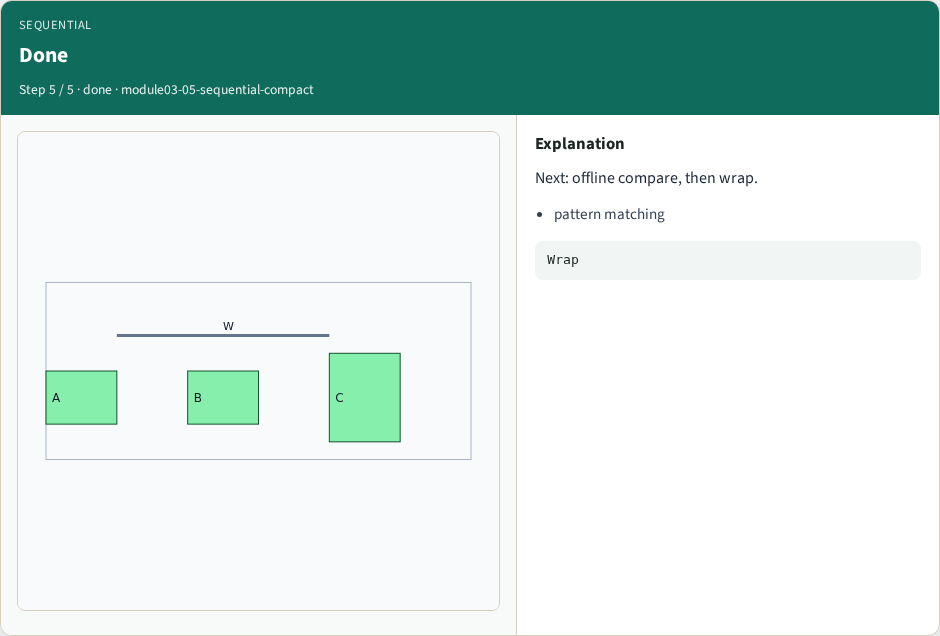

# Sequential compact pass — step-by-step (for slides / transcript)

**Module:** `module03-05-sequential-compact`  
**Lab / algo:** `sequential-compact`  
**Viewer:** `/tools/algorithm-walkthrough/?algo=sequential-compact&step=1`

Use each **Caption** as spoken prose (or a shortened slide note).
Use **Bullets** on the PPT; pair with the PNG in `assets/steps/`.

## Step 1 — Pipeline



**Caption (transcript):** X compact then Y compact then wire stretch.

**Slide bullets:**

- seq

**On-screen metrics:**

```
full pass
```

## Step 2 — Width



**Caption (transcript):** final_width=14.

**Slide bullets:**

- GOLDEN

**On-screen metrics:**

```
14
```

## Step 3 — Legal



**Caption (transcript):** legal flag True on the toy.

**Slide bullets:**

- ok

**On-screen metrics:**

```
True
```

## Step 4 — Improved



**Caption (transcript):** improved True vs initial span.

**Slide bullets:**

- delta

**On-screen metrics:**

```
yes
```

## Step 5 — Done



**Caption (transcript):** Next: offline compare, then wrap.

**Slide bullets:**

- pattern matching

**On-screen metrics:**

```
Wrap
```

