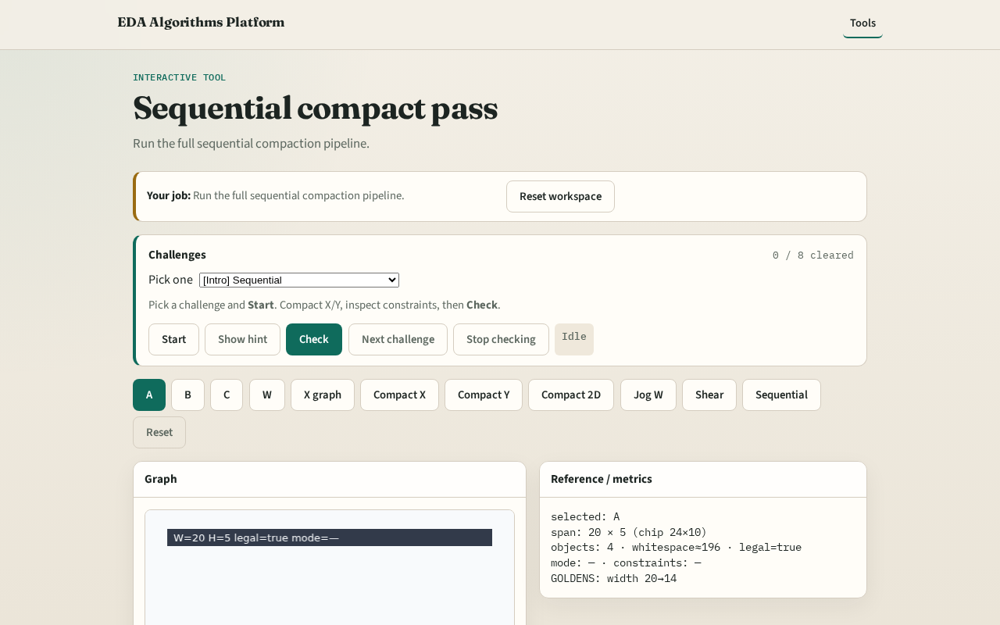

# Sequential compact pass

**Module id:** module03-05-sequential-compact
**Lab:** sequential-compact
**Tracks:** A (implement) · B (browser lab)

## Slide 1 — Sequential

A full pass chains axis compaction and wire repair like a tiny cleaner.

## Slide 2 — The idea

GOLDEN: width 20→14, legal=True, improved=True.

<!-- algorithm-walkthrough -->

## Slide 3 — Pipeline

X compact then Y compact then wire stretch.

## Slide 4 — Width

final_width=14.

## Slide 5 — Legal

legal flag True on the toy.

## Slide 6 — Improved

improved True vs initial span.

## Slide 7 — Done

Next: offline compare, then wrap.

<!-- /algorithm-walkthrough -->

## Slide 8 — Browser lab track

Open **sequential-compact**. Click Sequential compact; confirm 20→14.

## Slide 9 — Implement track

Call sequential_compact(DATA); assert final_width==14 and legal.

## Slide 10 — Pitfalls

Skipping wire stretch. Claiming illegal layouts are OK.

## Slide 11 — Your turn

Next: offline benchmark, then wrap.
